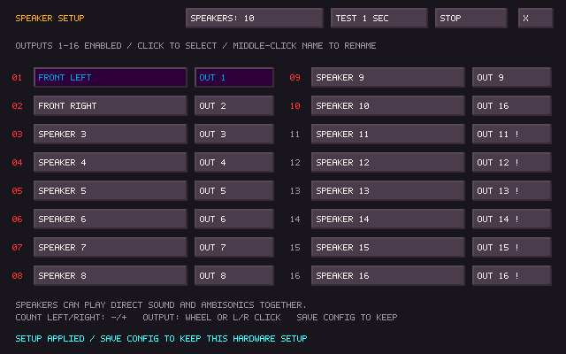
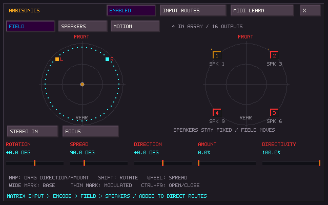
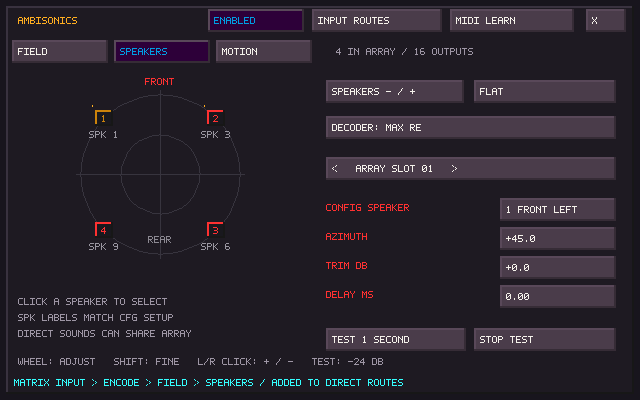
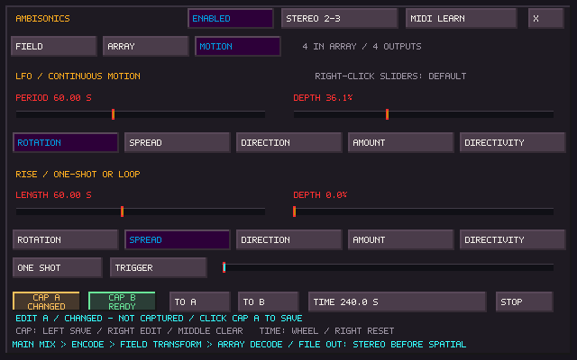

# Ambisonics output

Open **F9 → AMBISONICS**, or press **Ctrl+F9**, for the separate, modeless
Field / Speakers / Motion window. In the [routing matrix](ROUTING_MATRIX.md),
**AMBISONICS** is a destination: send selected tiles, tracks, inputs or processor
outputs to its encoder, field controls and decoder. It supports a horizontal
first-order Ambisonics (FOA) array of **3–16 speakers**. Closing the window leaves
audio and modulation running. No plugin host is required.

## Speaker setup and first routing

1. Open **CFG → SPEAKERS** (also available as **SPEAKERS** in the Matrix).
   Set the active speaker count: **10** for a ten-output setup, up to **16**.
   Name each speaker and assign its physical output. Click a name to edit it;
   Enter saves and Escape cancels. Scroll an output number, or left/right-click
   it, to adjust. Active speakers must have different physical outputs.
2. Select each speaker and use **TEST 1 SEC** to check its cable/position.
   The tone is 440 Hz at approximately −24 dBFS. Stop, closing the setup window,
   or leaving its focus cancels the test. **SAVE CONFIG** keeps this hardware
   setup across projects. Legacy projects use ARRAY's existing test instead.
3. Open **AMBISONICS → SPEAKERS**. Choose at least three array slots, then
   choose a configured **SPK** for each slot. An array can use any subset of
   active speakers. Adjust its angles, trim and delay as needed.
4. Click **INPUT ROUTES** to reveal the Ambisonics column in the Matrix.
   Connect a source or processor output to it, then click **MUTED** to enable
   the Ambisonics layer. Use Field and Motion to position and move that mix.

Only active **SPK** columns appear in the Matrix. Reducing the count hides those
columns and silences them without deleting their saved connections. Increasing
it restores them. An active speaker whose physical output is unavailable stays
visible as **N/A** and remains silent. Hardware **OUT n/n** pairs remain available
separately for stereo routes and external hardware loops.

## Direct sounds and the array can share speakers

Send a rotating sound to **AMBISONICS**, with SPK 1–4 in the array. Send four
other sounds directly to **SPK 1**, **SPK 2**, **SPK 3** and **SPK 4**. Each speaker
plays the sum of its decoded field and its direct sound. Speakers 5–7 can play
three separate point sources without joining the array.

Direct speaker connections average their left and right inputs to mono. Array
membership does not reserve or remove a speaker's direct destination. **MUTED**
silences only the Ambisonics layer; direct routes continue. A missing array member
or invalid geometry mutes the spatial layer and reports the problem, without
redirecting it to the main stereo outputs. OUT gain and the final linked hardware
guard apply to the combined output; leave headroom when layering signals.

All sources sent to this bus share one field and its motion controls. To keep a
source exclusively in the array, remove any unwanted Main or direct connection
from its row. Routing Main itself into Ambisonics sends the summed Main mix.

## Legacy projects: four speakers and a MOTU M6

Projects still using the legacy serial Router keep their original behavior:
the complete stereo mix feeds Ambisonics, and **STEREO / ENABLED** switches
between an adjacent stereo pair and the array. The following pair selection and
fallback rules apply to that legacy path, not the Matrix's Ambisonics bus.

In **CFG → AUDIO**, select the M6's multichannel ASIO device on Windows. Open
Ambisonics → **ARRAY**, keep **4 SPEAKERS / FLAT**, then use **TEST 1 SECOND**
on each speaker to check the physical assignment. Test is a 440 Hz tone at
approximately −24 dBFS; **STOP TEST**, closing the window or leaving its focus
cancels it. The tone works with the spatial stage off.

The default assumes hardware outputs 1/2 are front L/R and 3/4 are rear L/R.
Speaker numbers instead run clockwise around the room:

| Speaker | Position | Default hardware output | Azimuth |
| --- | --- | --- | --- |
| 1 | Front left | 1 | +45° |
| 2 | Front right | 2 | −45° |
| 3 | Rear right | 4 | −135° |
| 4 | Rear left | 3 | +135° |

**STEREO n–n** selects the adjacent pair used when Ambisonics is off. The first
speaker receives the original left channel and the second receives the original
right channel. For the flat quad default:

| Stereo pair | Side of the room | Physical outputs, L then R |
| --- | --- | --- |
| 1–2 | Front | 1, 2 |
| 2–3 | Right | 2, 4 |
| 3–4 | Rear | 4, 3 |
| 4–1 | Left | 3, 1 |

Click to advance; right-click or scroll to move in either direction. These are
ordinary stereo channels: spatial rotation, width, transforms, calibration and
modulation do not alter bypassed audio. Changing the pair and engaging/bypassing
use short coefficient fades. The pair selector also chooses the fallback while
the spatial stage is enabled but unavailable.

On Linux select TapeSister's **JACK** backend and route its master playback ports
to the M6 using your JACK or PipeWire JACK patchbay. **CFG → OUTPUT RANGE**
chooses which numbered master ports to expose (up to 16; ALL preserves the old
16-port default). Connect the four assigned ports for this setup. The dedicated stereo Insert
Send/Return ports stay separate. A visible JACK port does not prove that it is
connected to a physical speaker: check the patchbay and test tones.

## Field

The left circle shows the transformed field and encoded L/R source positions.
The right circle shows fixed speakers and their output meters. Drag inside the
left circle to change **DIRECTION** and **AMOUNT**; Shift-drag changes **ROTATION**;
the wheel changes **SPREAD**. The hollow point marks the base direction/amount;
the line and solid point show the live modulated value.

The five controls also support horizontal dragging, scroll adjustment, Shift for
fine scrolling and right-click to reset. Their wider bar mark is the base value;
the narrow mark is the live value.

| Control | Effect |
| --- | --- |
| Rotation | Rotate the encoded scene through −180° to +180° |
| Spread | Separate the stereo source directions from 0° to 360°; default 90° |
| Direction | Aim the selected field transformation |
| Amount | Move from the neutral field to maximum transformation |
| Directivity | Reduce directional components toward an omnidirectional field |

**STEREO IN / MONO** chooses two encoded sources or their mono average.
At zero spread the stereo sources coincide; at 360° they coincide behind the
listener. Opposite-polarity stereo material can cancel in MONO or at coincident
source directions.

The transformation button cycles **FOCUS, PRESS, PUSH, ZOOM**, adapted from the
Ambisonic Toolkit. They change the field toward the selected direction, with
different angular and level behavior. FOCUS includes its upstream gain
compensation; ZOOM can increase level. A linked output limiter contains spatial
peaks without independently changing valid speakers' relative levels.

## Array geometry

Choose 3–16 speakers, up to the active count in CFG. In Matrix mode, changing
the count retains existing members and calibration; added slots start with unused
speakers and regular-ring angles. **FLAT** places the front between speakers;
**POINT** places a speaker directly ahead. Changing FLAT/POINT resets all angles
to a regular ring but preserves assignments, trim and delay. Legacy ARRAY count
changes reset the ring, assignments and calibration. Lower playback before
changing the array or hardware assignments; these are setup operations.

Click a speaker on the map, or use **ARRAY SLOT**, then choose its **SPK** and
adjust **AZIMUTH**, **TRIM DB** (−60 to +6) and **DELAY MS** (0–20). Already-used
members are skipped when choosing a SPK. In legacy mode this control chooses
**HARDWARE OUTPUT** directly. Scroll or left/right-click to adjust; Shift-scroll
is finer. Physical output numbers are one-based; up to 64 hardware channels are
addressable, subject to the active device. Front is 0°, positive angles go left,
negative angles go right.

Decoder choices are **MAX RE** (default), **IN PHASE** and **BASIC**. The horizontal
least-squares decoder accepts nonuniform azimuths as well as regular rings. Very
degenerate layouts are rejected. This is first-order reproduction with broad
spatial resolution, not a room-correction system or a guarantee of equal coverage
for every arbitrary speaker layout. Trim/delay are manual calibration aids.

In the legacy path, missing outputs, duplicate assignments, degenerate geometry or an output reserved
by a shared-device external Insert prevent the spatial stage from engaging. It
fades back to the selected complete stereo pair. If that pair is unavailable,
stereo falls back to hardware **1–2**. The window reports the problem. Reserved
Insert send channels remain owned by Insert, including while it is bypassed.

## Motion and MIDI

The Motion page reuses Fallout's timing curves: **LFO** periods from 0.1 seconds
to one hour, and **RISE** lengths from one second to four hours. Each has a depth
and a set of five target buttons. LFO is bipolar around the base value; Rise adds
upward from it. Angular targets wrap; other targets clamp to their control range.
Rise can run once, holding its final value, or loop. **TRIGGER** restarts Rise.

**CAP A / CAP B** store the five base field values. **TO A / TO B** morph toward
a captured endpoint over **MORPH** time (10 ms to one hour; scroll to adjust).
Rotation/direction follow the shortest arc. Editing a base value cancels a morph.
Capture stores base settings, not a momentary LFO excursion. The transform type,
input mode, speaker geometry and routing are not morphed.

**MIDI LEARN**, or Ctrl+Shift+M, can learn the five field controls, enable toggle
and Rise trigger. Select a control, then move the controller as elsewhere in
TapeSister. Normal note and transport keys remain available with this window
focused. Escape exits Learn first, then closes the window.

## Saving and recording

Project/session saves include the array membership, calibration, field settings,
modulators and captured A/B endpoints, plus the legacy stereo pair. Configuration
also stores these settings. Speaker count, names and physical output mappings are
global hardware preferences saved by **SAVE CONFIG**; loading a project does not
replace them. Project
recall resets modulation phase and cancels in-flight triggers/morphs; a saved
morph recalls its destination. Older projects default to disabled, front stereo.

**FILE OUT and Mosaic OUTPUT remain stereo before the speaker stage.** In Matrix
mode they capture the existing OUT 1/2 program, excluding the added direct-speaker
and decoded Ambisonics layers. A source routed only to Ambisonics is therefore
not in that stereo capture. These captures do not record all hardware outputs,
speaker feeds or Ambisonic B-format. This bus encodes the sum of its selected
mono/stereo inputs; it does not independently
position tracker lanes or tiles, decode imported B-format files, export B-format,
provide higher orders/elevation or binaural HRTFs. Multichannel import still uses
the existing downmix behavior, so an imported B-format file is not a spatial field.

## Verification and listening checklist

Automated coverage exercises additive direct/decoded playback at 3–16 speakers,
10/16-channel application callbacks, hidden speaker columns and retained routes,
unavailable-output muting, setup persistence and window controls. It also covers
horizontal decoder reconstruction for every count
3–16 in both orientations; ATK neutral and maximum transform vectors; all four
quad stereo pairs; Insert ownership and unavailable-output fallback; bounded
transitions and modulation; delay at multiple sample rates; config/project
round trips; native window gestures/MIDI/lifecycle; and four-channel rendering
through the application's real audio callback. JACK tests exercise all 16 master
ports through its mocked ABI. Screenshots above come from the actual UI renderer.

For the legacy M6 listening check:

1. Verify each speaker with its test tone and correct the hardware assignments.
2. Bypass and play a known stereo source on each adjacent pair.
3. Enable MONO with zero Amount; rotate a sustained source around the quad.
4. Compare the four transforms, then try a slow rotation LFO and an A/B morph.
5. Save, reopen, and check the array and stereo pair. Close the window during
   playback to confirm that audio continues.
6. Confirm FILE OUT remains stereo and that an unavailable endpoint reports
   fallback. Check Audio Health under your normal performance load.

Automated tests cannot verify physical interface wiring, ASIO driver behavior or the
room's acoustic result. Native Windows CI and this listening check complement
the Linux software tests.

ATK provenance and license: [third_party/atk/UPSTREAM.md](../third_party/atk/UPSTREAM.md).
