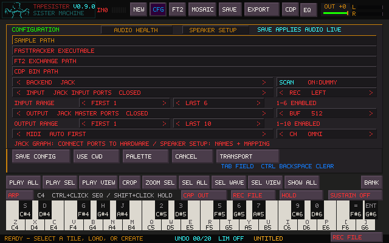

# Audio channel ranges

Open **CFG** and choose the backend and device. Under **INPUT RANGE** and
**OUTPUT RANGE**, use the arrows to choose **FIRST** and **LAST**, then
**SAVE CONFIG**. Playback stops briefly while the settings apply. **ALL** follows
the channels offered by the device and preserves older configurations.

For a Focusrite with ten playback outputs, choose **OUTPUT RANGE: FIRST 1,
LAST 10**. If you need six inputs, choose **INPUT RANGE: FIRST 1, LAST 6**.
The chosen device must expose that many channels. **REC** selects the recording
input mode; it does not change the number of input or output channels.

**SPEAKER SETUP** sets the active speaker count, names and physical output
assignments. **AMBISONICS** selects a subset of 3–16 speakers for the array.
The same speaker can receive direct audio and the decoded ambisonic layer.

The matrix shows a speaker only when it is active in Speaker Setup and its
mapped output is available within the saved output range. Unavailable physical
OUT pairs are hidden too. A pair with one enabled member shows that member's
number. Hidden routes remain saved and return when the channels are available.
If an array member becomes unavailable, the ambisonic bus mutes until the whole
array is available; direct routes to available speakers keep playing.

| Backend | Range behavior |
| --- | --- |
| Linux JACK | Registers only selected ports: inputs up to 8, master outputs up to 16. Connect them to hardware in the JACK graph. Dedicated stereo Insert ports remain separate. |
| Windows ASIO | Opens one duplex stream with the selected physical input and output ranges. Insert shares these ranges. |
| WASAPI, DirectSound and other SDL backends | Uses the device's negotiated layout; channels outside the selected range are silenced. The device/backend determines which hardware channels are exposed. |

Channel numbers never shift: outputs 3–10 remain outputs 3–10. Input monitoring
and recording selections also keep their original channel numbers, so select
an input inside the enabled range. A JACK port is an application port, not proof
of a physical connection. The graph still chooses the hardware destination.

Changing a range does not alter speaker assignments or saved project routes.
Invalid ranges are rejected. If opening the new configuration fails, TapeSister
attempts to restore the preceding audio setup and leaves the failed changes
unsaved. Finish or cancel recording before applying audio changes.
