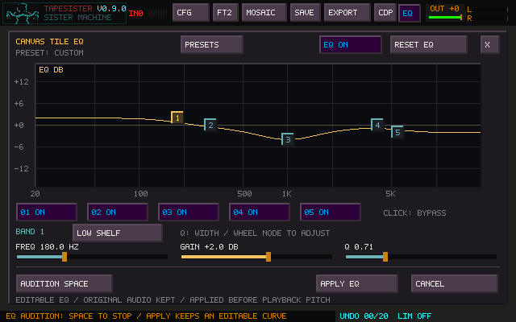
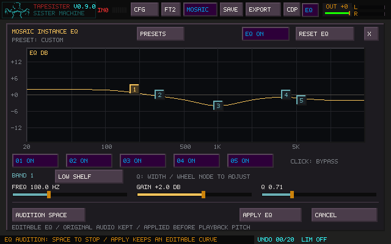

# Canvas and Mosaic instance EQ

Click **EQ** beside the waveform's S/M/R/L display control. The five-band overlay
edits the selected tile; double-click a Mosaic card to reach the same controls
for that instance. This is separate from the master/room EQ.

Drag a numbered point to change frequency and gain. Wheel over a point changes
Q. The Frequency, Gain and Q sliders also accept the wheel; Shift gives finer
adjustment and right-click restores their defaults. The band buttons bypass
individual bands; Ctrl-click solos a band temporarily. Choose bell, shelves,
high/low pass or notch with the type button, or start from a preset.

**Space / Audition** loops the pre-EQ audio through the edited curve without
changing the tile. **EQ Bypass** lets you compare it with that source. **Apply EQ**
commits one tile edit; **Cancel / Escape** discards the pending curve. Temporary
band solo is cleared on Apply. Reopen EQ to adjust the same curve. Ctrl+Z / Ctrl+Y
in the canvas undo/redo the committed edit.

Preparation and Apply render in a worker. During rendering the overlay keeps
ownership of editing controls. Existing arrangements keep playing. Applying EQ
preserves already-held voices; newly triggered playback uses the rendered result.
Committed playback uses cached audio, with no additional EQ DSP per tile or card.
Audition uses one live EQ. The tradeoff is extra cached/source audio storage.

EQ is the final tile edit stage, before playback pitch and routing. It processes
the whole tile, preserving mono or stereo channels. Subsequent native edits can
re-render that stage. Accepting an external transform of Current audio bakes the
current sound into its new material checkpoint and resets the curve; Undo restores
the preceding editable state. The original source and EQ controls are retained
in normal tile saves and through edit-history compaction.

For Mosaic, Apply updates the working document. Returning to the arrangement
uses the existing **Update Instance / Update All / Create Tile / Cancel Edit**
decision. Update Instance keeps siblings on their existing source. Update All
updates cards sharing that source and matching Sample-bank tiles. New sources
retain pre-EQ float audio and the curve, including after project reload.

Current tile saves use TSR38; Mosaic format 6 stores card routing and editable EQ.
Older projects load with neutral EQ. Exported WAVs contain the rendered sound;
the complete project folder retains editability. Boosts can raise signal levels:
the usual downstream routing, master EQ and output controls still apply.
