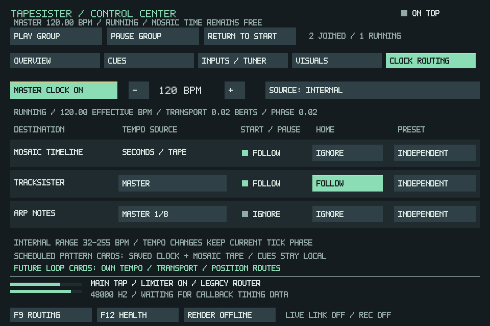

# Optional master clock and independent transport

Open **F11 → Clock Routing**. Master clock starts **off**, including when an
older project is opened. Turning it on alone does not change any player's
tempo. Choose tempo followers individually; the existing group checkboxes
control start/pause, and **Reset** has its own choice for each player.

The screenshot is a synthetic SDL integration fixture, not a user's project.
The window remains 960×640. The overview, local cues, input/tuner and visualizer
pages remain available, with group commands and routing/health access on every
page. The overview distinguishes group membership, playback, mute/solo, trim
and actual playback position.

## Choices in this first clock stage

| Destination | Tempo | Start/pause | Group Reset Group / Reset |
| --- | --- | --- | --- |
| TrackSister song | Local score or master, retaining ticks per row and lane ratios | Follow group or remain independent | Follow Reset or retain its row/order |
| ARP notes | Local intervals; master quarter/eighth/sixteenth; or the existing direct TrackSister link | Follow group or remain independent | Follow Reset or ignore it |
| Mosaic timeline | Seconds and tape speed, unchanged | Follow group or remain independent | Follow Reset or retain its timeline position |
| Scheduled Mosaic pattern cards | Each saved pattern clock, further affected by Mosaic tape speed | Existing Mosaic scheduling | Existing Mosaic seek/reconstruction |
| Manual QWERTY/MIDI notes, Live Tiles | Existing note/sample timing | Independent of group pause | Unaffected |
| SisterMachine, Router, ARP slot/LFO timers and host effects | Existing local timing | Existing controls | Existing controls |

Select **Internal** for 32–255 BPM, or **TrackSister** to follow the native
tracker's actual tick duration. The latter includes score tempo changes within
an audio buffer and the tracker's existing timing compatibility law. Its current
tempo remains available when the tracker is stopped. A tracker selected as the
source cannot follow itself; choosing that source clears its master-tempo route.
The BPM buttons control only the internal source. Clock power affects tempo
routes; group and Reset choices also work with clock power off.

The **Independent** preset clears that player's tempo, group and Reset links.
For ARP it also returns the older direct TrackSister link to Local. It does not
stop, start, rewind or silence the player at the moment it is chosen.

## During playback

- Tempo, start/pause and Reset are separate. For example, an ARP can use master
  tempo while continuing through a group pause. Conversely, Mosaic can follow
  group start/pause while retaining free tape time.
- Routing edits never automatically start, stop or seek a player. Tempo changes
  apply at the next audio callback boundary and preserve the current tracker
  tick or ARP note's fractional progress. They do not transpose sample playback
  or rewrite the score's BPM, ARP intervals, slot timing or LFO settings.
- Followers share a **rate**. Joining during playback does not snap them to the
  master's beat phase. There is no quantized launch, bar alignment, meter editor,
  external MIDI clock, or linked cue-position mapping in this stage.
- Play Group resumes checked players and starts the master cursor. Pause Group
  pauses checked players and the cursor. Unchecked players keep their current
  state. Tempo and clock phase remain available to independent followers while
  the master cursor's elapsed seconds/beats are paused.
- Reset Group pauses the group, zeros the master cursor, and rewinds only
  Reset followers. An unchecked Reset follower is rewound while retaining its
  playing/stopped state. A checked player ignoring Reset pauses at its position.
  Individual channel Reset still stops and rewinds just that channel.
- Until the first explicit Reset edit, Reset follows the original group selection
  exactly. That first edit makes all three Reset choices independent of later
  group checkbox changes. ARP retains its existing Stop/start-from-pattern-beginning
  behavior; it does not acquire a seamless pause/resume in this stage.

F11 **Cues** still seeks/loops only Mosaic. Neither cue jumps nor loop wraps
reposition the master, tracker or ARP. Mosaic sample and pattern cards keep
their current seconds/tape workflow; enabling the master does not stretch audio
or change their pitch. Explicit master ARP timing carries fractional samples
between notes to avoid accumulated rounding drift; older ARP modes retain their
existing timing law. An intentional tempo change changes tempo-sensitive effects
as well as note scheduling; it is not a claim of identical sound at different
tempos.

## Saving, older projects and rendering

Clock power, source, BPM, tempo routes, ARP division, group membership and Reset
choices save with the project and participate in modified-state detection.
The displayed master location/phase also saves; reopening restores that location
**paused**, alongside the existing saved workspace/Mosaic view. Running audio
voices and effect tails are not serialized.

Older projects retain their original local timing, direct ARP link and legacy
group/Reset behavior. No migration enables master tempo or rewrites card lengths.
Projects saved with active master clock or custom Reset routes require this build
or newer. Their Sister sidecar uses a feature header that older builds reject,
so an older build cannot silently open and resave them after dropping active
clock behavior. Keep a separate copy of an important project for comparisons.

Offline rendering uses the same callback and saved clock configuration, so an
explicit TrackSister tempo follower renders at master rate. Render-source
selection, fixed export duration and tails retain their existing meanings;
Mosaic-only export does not change with master tempo. ARP/manual live performance
is still outside the existing offline renderer's source choices.

## Future Mosaic persistent looper

Persistent loop cards remain a later feature. They are intended to stay on the
Mosaic canvas with separate playheads and independent tempo/run/position choices,
including the ability to continue through main timeline pause or seeking. This
stage deliberately does not make the parent Mosaic playhead their clock owner.
Per-pattern master timing, launch quantization, mapped cue following and exact
persistent-loop launch/length policies need their own reviewed implementation.

See [clock validation and hardware checks](validation/master-clock-routing.md).
