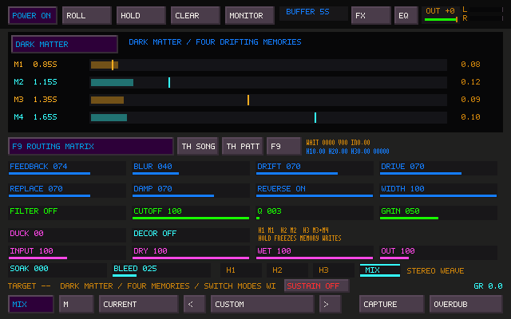
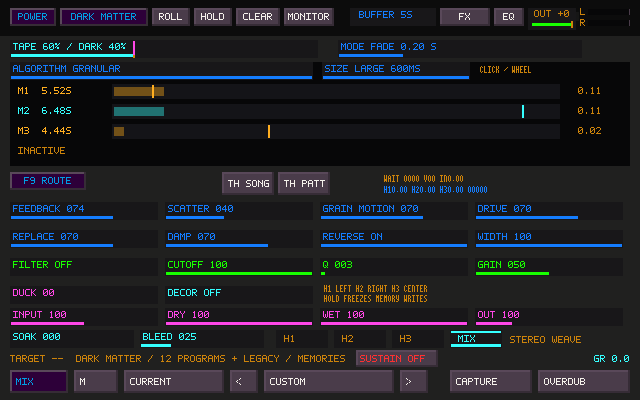

# Sister Machine: Dark Matter

Dark Matter is an optional, native drifting-memory mode inspired by SOMA COSMOS.
Click the compact **TAPE / DARK MATTER** switch beside **POWER** in Sister's
top row to select the memory engine. It is available on every Sister page and
leaves the waveform unobstructed. Click again to return. The mode is MIDI-learnable and changes
over the **MODE FADE** time (200 ms by default, adjustable from 20 ms to 120 s).
The **TAPE / DARK** fader parks anywhere between both memories with a short
smoothing ramp. See [blend controls](STEREO_FILTERS.md#tape--dark-matter-crossfade).
It does not clear either memory or allocate on a mode change.

Use F9 to route a tile, synth, TrackSister or external input into Sister and
route Sister's return to the destination you want. POWER, ROLL, HOLD, MONITOR,
capture, dry/wet levels and master safety retain their existing ownership.

## Play it

The **ALGORITHM** choice above the memories cycles through **Legacy Memory**,
**Two Delays**, **Four Delays**, **Giant Reverb**, and **Granular**. **SIZE**
cycles Small / Medium / Large. Mouse wheel chooses adjacent entries; Shift-click
locks either choice. These are processing programs: changing family changes
the memory topology or read/write algorithm, while retaining the sound controls.

| Family | Small | Medium | Large |
| --- | --- | --- | --- |
| Two Delays | About 2.5 s across two unequal memories | About 9.5 s | About 22 s |
| Four Delays | About 2.5 s across four unequal memories | About 8.5 s | About 11.5 s |
| Giant Reverb | Huge hall | Larger hall | Largest hall |
| Granular | 60 ms grains, short delays | 180 ms grains, medium delays | 600 ms grains, long delays plus a centered third bank |

The delay time totals follow the approximate program descriptions in SOMA's
[main manual](https://somasynths.com/cosmos_specs-manual/). The individual splits,
reverb network, grain sizes and control curves are original TapeSister choices.
They are not recovered firmware tables or claims of matching COSMOS audio.
The reverb uses four long feedback delays, an orthogonal mixing matrix and
three short allpass diffusion stages per line. Its original aggregate long-delay
times are approximately 3.6 / 8.4 / 15 s; these are not decay-time specifications.
Granular uses overlapping Hann-windowed reads, noise-based position scatter
(**BLUR / SCATTER**), and slow asynchronous grain movement (**DRIFT / GRAIN
MOTION**). Blur and Drift are labeled N/A in the hall programs, matching their
documented absence from COSMOS's reverb controls.

The twelve programs use fixed size settings. **BUFFER** continues to set Tape's
window and the Legacy Memory bank; it does not stretch the twelve programs.
Legacy Memory is the original Dark Matter engine and remains the default,
including when older projects, presets or INI files are loaded.

Algorithm and size changes fade the outgoing return down over 50 ms, reconfigure
the read layout at silence, then fade back over 50 ms. The envelope has flat
slopes at both ends. This is a short soft gap,
not simultaneous playback of both algorithms. Storage and reverb diffusion
memory are retained, never cleared or allocated during a program change.
Rapid requests coalesce to the latest choice. HOLD freezes both memory writes
and the reverb diffuser writes while readers keep running.

The write path follows the transition envelope too: changing an internal
feedback network must not record a pulse that returns after the output fade.
Bypassed reverb diffusion continues aging with silence while writing is on.

Retained ring joins use short read-only audio crossfades (up to 12 ms either
side). Each splice combines two moving reads away from known joins and fades
away from the live write frontier, including during reverse/grain playback.
No last-sample/DC plateau is fed back into the memory. Splices survive HOLD and
protect dormant outer memory when programs shrink; once new audio has replaced
an active period, its guards fade away over 50 ms. Up to 32 join records per
bank are preallocated; no shadow audio buffer or program-change allocation is
needed. Recorded memory under HOLD remains byte-exact.

For Legacy Memory, start with the defaults: Feedback 92%, Blur 35%, Drift 35%, Replace 30%, Drive
8% and Damp 25%. Play a short phrase, leave space, then add another sound.
The four different memory periods let those phrases separate and recombine.
With the default 40-second total, the individual memories are about 6.8, 9.2,
10.8 and 13.2 seconds; allow time for the first returns.

| Control | Behavior |
| --- | --- |
| BUFFER | Legacy's total approximate memory time, 5–60 seconds, divided across four banks |
| Feedback | Recirculation per memory pass, 0–105%; higher values meet bounded saturation |
| Blur | Convex exchange between the four feedback returns, before writing |
| Drift | Independent slow stereo movement with smoothly changing, seeded rates |
| Replace | Fresh input attenuates old recirculating material; it does not duck the current playback |
| Drive | Saturation with unity small-signal gain inside each memory's write path |
| Damp | Low-pass aging in the recirculation path, from roughly 20 kHz to 200 Hz |
| Reverse | Crossfaded reverse grains; changing direction retains memory |
| Width | Existing post-head stereo width |
| Duck / Decor | Existing output ducking and stereo head coloration |
| Filter / Cutoff / Q / Gain | Existing shared output filter |
| Input / Dry / Wet / Out | Existing input and monitor/output levels |
| Soak / Bleed | Existing stereo weave, at the selected head or MIX insertion |

The memory display shows audio-owned cursor positions, lengths and held peaks.
It is not a waveform or a UI-driven modulation source. H1 carries M1, H2 carries
M2, and H3 carries M3+M4. Those taps continue through the existing head effects,
capture and routing path. The head inserts color the audible returns; Dark
Matter's own feedback exchange is inside its memory engine. Explicit routed FX
returns enter through Sister's existing causal return input.

Dark Matter has its own controls; the Tape head levels/rates, Wow, Drop, Erase
and Ghost are retained for Tape. They are hidden while Dark Matter is selected.
Switching back restores their controls. Use Shift-click locks and the standard
wheel/drag gestures. Mode and Reverse are click/wheel choices, not drag sliders.
Ctrl+Shift+M learns the mode and sound controls using IDs 3000–3009 (Algorithm 3008, Size 3009); existing
MIDI IDs and the two original preset lock words are unchanged.

## Memory and transitions

The classic tape and four Dark Matter memories have independent preallocated
storage. While POWER and ROLL are on, both hear the same incoming performance,
so a first mode change can reveal existing material. Each continues its own
memory evolution. Switching modes crossfades playback, rather than copying,
clearing or pretending that the two different layouts are interchangeable.

When both memories have established audible material, switching modes matches
their recent stereo RMS levels with a bounded output trim (up to 18 dB either
way), faded over the selected transition time. Matching is latched only when
leaving a settled endpoint. The trim stays fixed between
switches: it does not compress Dark Matter's swells or alter the stored audio,
feedback, dry monitor, or shared OUT control. Empty/near-silent memories do not
request a boost. Clear and device resets discard the live level measurements.

HOLD or ROLL off freezes writes in both memories; reads and modulation continue.
CLEAR clears both through the existing fade/control-thread handshake. Changing
BUFFER reuses the allocation, retains stored audio and uses the same guarded
50 ms fade-out/fade-in handoff for Dark Matter's changed periods. Retained material outside a shortened bank can return
if it is expanded again. Device reconfiguration and POWER reset start empty
memories, as the existing tape does.

In Legacy Memory, four unequal prime sample counts are selected below 17%, 23%, 27% and 33% of
the total requested frames. These are original choices, not recovered COSMOS
delay tables. Stereo channels remain independent; an explicitly mono Sister
buffer gives exact dual mono. All bank reads happen before any bank writes.
Delay feedback exchange has nonnegative weights summing to one per destination;
the hall uses its orthogonal feedback matrix instead.
Per-bank low-pass/DC conditioning and bounded nonlinear writes protect memory;
the established linked output safety still protects the final program.

Storage adds approximately another 60 seconds of stereo floating-point audio:
22 MiB at 48 kHz and 88 MiB at 192 kHz, plus roughly 0.14 / 0.56 MiB of reverb
diffusion storage. Storage is prepared off the audio thread;
frame processing has no allocation, freeing, file I/O, locking or buffer clears.
Slow motion is computed at bounded 64-frame control intervals, independent of
window visibility. Random seeds and fresh-start processing are deterministic.

On this shared Linux host, a 48 kHz probe across the five families, forward and
reverse, measured roughly 71–255 CPU microseconds per 256-frame block,
including the probe's source generation.
These are engine CPU measurements,
not whole-application latency or an X220/device deadline guarantee. Run
`build/test_dark_matter --bench` to measure the current build.

## Saves

Sister project state version 49 and Sister preset version 26 store mode, sound
controls, algorithm, size and the separate ten-bit Dark Matter lock mask. The
original eight-value Dark Matter control record still loads as Legacy Memory.
Older states/presets
default to Tape mode. Older application builds cannot reproduce the new engine.
Project v48 and preset v25 also preserve the manual blend and fade time.
Startup preferences use `[Dark Matter]` in the INI. Rolling
audio, phases and memory cursors remain live state and are not serialized; use
Capture or REC FILE to preserve the performance.

## Reference and investigation boundary

References: [SOMA firmware downloads](https://somasynths.com/cosmos_firmware/),
[COSMOS description](https://somasynths.com/cosmos/),
[manual](https://somasynths.com/cosmos_specs-manual/), and
[transition FAQ](https://somasynths.com/cosmos_faq/).

The investigation downloaded the official Main 1.41, Quadro 1.41, Pitch Main
1.61 and Rhythmic 1.51 files. Their 16-byte SOMA/COSM headers and checksums were
verified. Their payloads contain readable ARM/Thumb instructions and floating
point processing; a mapping at 0x08020000 yields coherent reset stubs in all four.
Main and Quadro contain different large constants around buffer indexing.
Their exact delay topology, suppression curves and complete algorithms have
not been reconstructed. No proprietary firmware, disassembly or ROM content
is bundled, executed or required by Dark Matter. This is an original implementation
of the documented musical ideas, not a claim of COSMOS equivalence.

## Validation

`test_dark_matter` exercises silence, stereo isolation, explicit mono, independent
memory exchange, input-dependent replacement versus output ducking, deterministic
streaming, reverse playback, hold, clear, resize, mode fades, Tape isolation,
device reconfiguration and all three persistence paths. Rates include 8 Hz
(bounds stress), 44.1, 48, 96 and 192 kHz.

It also exercises all twelve programs, increasing size periods, hall impulse
density versus discrete delays, stereo isolation, mono, high-feedback/reverse
stress, and program changes under HOLD with byte-exact retained memory.
Continuity checks cover all 156 directed changes between the 13 programs,
12 recording transitions at 98% feedback, and nine consecutive changes with
reverse, hall re-entry, shrinking and expansion. They inspect low-frequency
signal curvature through two complete incoming memory periods, catching late
clicks after the initial fade and when temporary guards release.

`tapesister_dark_matter_controller_tests` exercises the actual application mode
switch, controls, locks, MIDI routing and native renderer. It accepts an optional
BMP output path for visual inspection. Both are baseline PR gates. Physical
Windows/Linux interface listening remains necessary to judge the musical feel
and verify real device deadlines.

AddressSanitizer/UndefinedBehaviorSanitizer checks instrument the new engine and
Sister machine; LeakSanitizer is disabled for that run. The native controller
test also verifies that changing programs retains a manually positioned
Tape/Dark Matter crossfade. The screenshot above comes from that controller.
