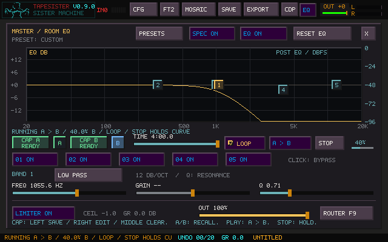
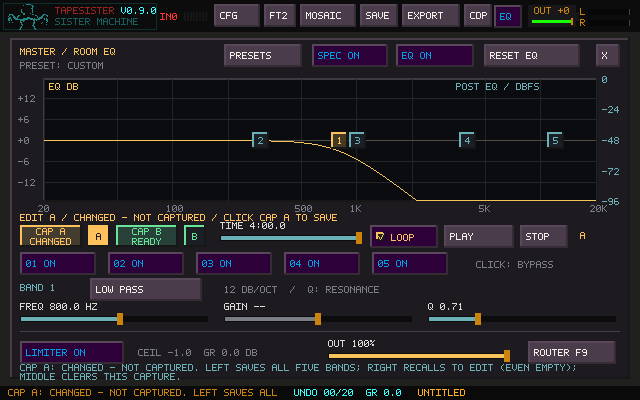

# Whole-EQ A/B transitions

The live **Master / Room EQ** captures all five bands together and moves between
two curves with one timer. This also works when the EQ is used as a processor in
the routing matrix. Canvas tile and Mosaic instance EQ remain fixed, editable
rendered curves.

1. Adjust the EQ and click **CAP A**.
2. Adjust the second curve and click **CAP B**.
3. Set **TIME**, then click **PLAY**. The EQ recalls A and moves to B.

Click the small **A** or **B** button to recall a captured curve for editing.
The selected A/B button is highlighted. Capture buttons use Prism's state colors:

| Capture label | Color | Meaning |
| --- | --- | --- |
| EMPTY | Gray | No stored capture; select it and edit the live curve before saving. |
| READY | Green | A saved capture is available. |
| EDIT | Blue | Its saved curve is recalled for editing. |
| CHANGED | Amber | The selected curve has edits that have not been captured. |

**Left-click CAP** saves all five bands, **right-click CAP** recalls for editing,
and **middle-click CAP** clears only that capture. Clearing stops the timer and
holds the live curve; the other capture stays saved. Empty recall also keeps the
live curve. The small A/B buttons are recall shortcuts. During playback, the
highlighted outline indicates the destination; a solid highlight indicates the
selected editable state when stopped. Capture is protected during playback:
Stop first, or right-click CAP to recall an endpoint for editing.

Both captures are required before Play works; otherwise the button says **WAIT**.
Hover help explains each control in two lines below the output controls. The
status above the buttons always shows the selected edit state or running
phase/direction, including identical captures and EQ bypass. Captures include every
band's frequency, gain, Q, type and bypass, plus the overall EQ bypass. Temporary
band solo, limiter, output gain and routing are excluded.

- **Loop unchecked:** A → B once, holding B afterward.
- **Loop checked:** A → B → A repeatedly. Time is the duration of **each leg**;
  a 4:00 setting gives an eight-minute round trip.
- **Stop:** hold the current curve. Editing a band, choosing a preset, resetting
  EQ, toggling bypass/solo or using an EQ MIDI control also takes over manually.
- **Play:** start at A when stopped. Clicking while already running keeps the
  transition moving. Stop, then Play to restart. **A/B recall** uses the usual
  short EQ smoothing.
- **Reset EQ:** resets the live curve and bypass only. Saved captures stay stored;
  use middle-click CAP to clear each one explicitly.
- Closing or minimizing the EQ view does not stop the sweep. Its clock follows
  processed audio frames, independently of song tempo and source transport.
  Pausing the audio device pauses its clock.
- Changing Loop takes effect on the current leg. Changing Time takes effect on
  the next leg or the next Play, without jumping the current sweep.

Time supports dragging, wheel changes in one-second increments, Shift+wheel in
0.1-second increments, and right-click to restore four minutes (or the configured
maximum if lower). Frequency and Q move logarithmically; gain moves in decibels.
Different filter types and bypass states switch at halfway using the existing
short smoothing. For an uninterrupted low-pass sweep, use a low-pass band in
both captures and change its frequency.

## Extended times and saving

The normal range is **0.1–240 seconds**. Set this in `tapesister.ini` to expose
longer times, up to four hours per leg:

```ini
eq_morph_max_seconds=14400
```

The INI also saves the A/B pair, Loop and Time. Project sidecar version 39 saves
the same settings and the current audible curve. Opening a project restores that
curve with the timer stopped; click Play when ready. Earlier projects load with
empty captures and the four-minute default. A project with a longer saved time
retains it even if the local INI slider limit is lower. Older TapeSister builds
cannot read the new version-39 sidecar; keep the original project when testing.

## Implementation

The sample-counted clock runs inside the shared EQ DSP, including silent input
and matrix routes. Its control update is capped at 100 Hz. Each fixed-pole filter
transition reuses the existing 40 ms smoothing, preserving filter history for
continuous parameter movement to avoid periodic bass-level dips. There are no
new callback locks, allocations, threads, lookahead buffers or changes to the
EQ's saved band layout. UI snapshots and project capture use the output-device
lock; drawing and disk I/O run after unlocking.

Automation phase is separate from explicitly edited settings, so timer motion
does not repeatedly mark a saved project dirty. A capture, manual edit or timing
change does mark it modified.

## Validation

The native DSP and persistence fixtures cover five sample rates (8–192 kHz),
exact one-shot endpoints, ping-pong loops, stop/recall, changes of sample rate,
four-hour settings, malformed input, and old/new project and INI loading. A full
four-minute low-pass sweep checks for unwanted periodic level dips.

The native SDL controller fixture exercises capture/recall, the extended time
range, two-times window scaling, MIDI/manual takeover, hidden-panel playback,
stable dirty-state hashing, and exactly one EQ clock tick per matrix frame.
It also checks Prism-style empty/ready/edit/changed feedback, empty recall,
clear while running, saved-pair preservation, contextual hover help, repeated
Play without restarting, and selection at the completed endpoint. Existing tile
EQ, routing, keyboard, recording and spectrum tests remain in the release gate. Windows and Linux each passed 63 regression tests plus packaging
on the initial implementation (`122c8a4`). The state-feedback update keeps selection and hover help visible and schedules
EQ motion at the animated refresh rate, even without other transports running.

Physical-device listening and low-power laptop performance are not established
by these tests. The image below is the native framebuffer, rendered from the DSP
state at 40% through a four-minute sweep.




