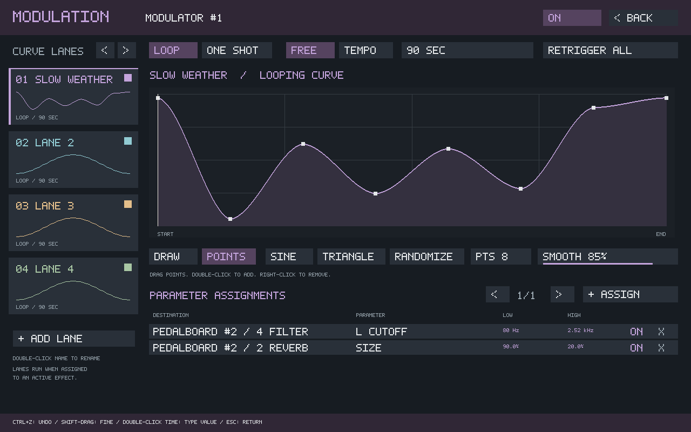
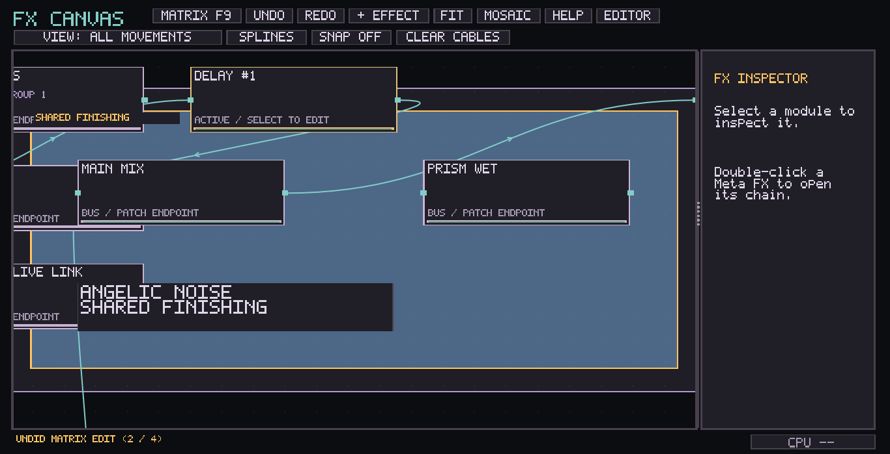
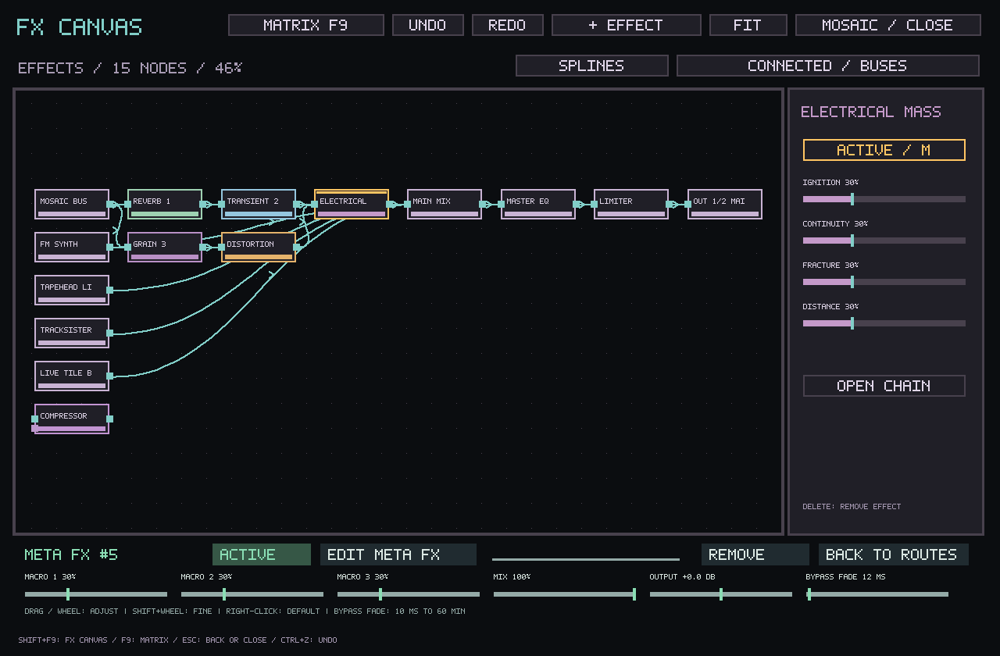
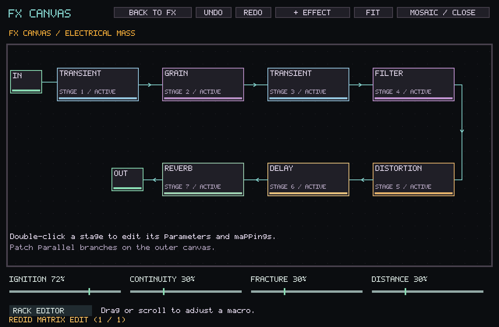
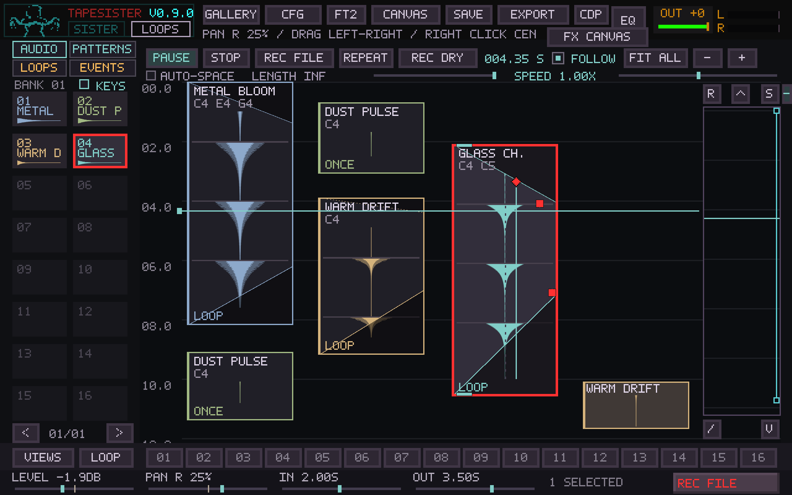

# FX Canvas

The canvas opens maximized with a normal title bar. **Alt+Enter** or **Alt+F11**
toggles fullscreen in the focused window. **F2** opens a compact, draggable
name/color editor, always on top by default. It initially opens beside the card
and keeps your chosen position during the session. Apply commits one undoable
change; Cancel, Escape, or its title-bar close discards the edit.

Open **Mosaic → FX CANVAS** (below the master controls),
**Routing Matrix → FX CANVAS**, or press
**Shift+F9** from any workspace. **F9** switches to the routing matrix; Shift+F9
switches back. The same window, graph, stable processor identities, audio
histories and undo stack are used by both views. Opening either view does not
activate or rewrite saved legacy routing. An inactive graph says SAVED GRAPH;
USE SAVED CHAIN uses the existing preservation-aware importer.

The canvas contains effect instances and input/output endpoints. Samples,
TrackSister patterns and generators continue to live in their existing editors.
Mosaic Bus, TrackSister Bus and Live Tile Bus represent their ordinary audio;
explicit tile/track/card routing overrides appear as individual endpoints.
Inherited track-to-tile routing remains inspectable in the Matrix.

- Drag an output port on the right of a node to an input port on the left.
  Every destination sums its incoming connections. Fan out to multiple effects
  for parallel branches and reconnect their outputs to combine them.
- Input and output squares follow their card's color, including custom colors
  and bypass dimming. The lower input is the sidechain; its cable is purple.
  Existing delayed feedback
  edges are amber. The Matrix's cycle validation and feedback policy apply.
- Click a cable to select it. **Plain wheel always zooms the outer canvas**,
  inside the graph; over an inspector parameter it edits that parameter. It never changes a cable gain. **Shift+wheel**
  adjusts selected cables together by 0.5 dB per step. The group stops at the
  first gain limit to preserve its balance (subject to integer gain rounding).
  Delayed feedback cables retain their lower safety ceiling. X or Delete removes
  only the explicitly selected cables and added effects.
- To change existing connections, select cables and **Ctrl+Shift-click the new
  destination**. Their source endpoints, individual gains, and colors are kept;
  the cards' other sends and the old destination's downstream chain stay intact.
  The entire reroute is one undo step. Click the lower input to move to a
  compressor sidechain; clicking the card body uses its main input. With cables
  selected, this gesture moves those cables even in a mixed card/cable selection.
  With only source cards selected, it adds connections as before.
- Select an added effect to reveal the right-hand inspector and its full
  parameter controls below the canvas. All four Meta FX macros are available in
  the inspector. Sliders release on mouse-up, including outside their controls. Filter also opens its complete editor on double-click. Fixed processors
  retain their existing editors; the Matrix exposes their ordinary routing controls.
- Drag selected nodes to organize them together. Middle-drag pans; wheel zooms
  around the pointer. **Z** frames selected nodes; **Shift+Z**, FIT or Home frames
  the whole graph. Fit includes all endpoints and can zoom below 20%.
  **G** moves the selected modules with the pointer; **S** resizes each card
  around its own center, including its lettering. Move right/up to enlarge,
  left/down to shrink (25–400% of default size). Click or Enter confirms; Escape
  or right-click cancels. Losing focus or leaving the canvas cancels an active
  grab/resize. Ports and cables follow the resized geometry.
  Layout, card sizes, pan, zoom and cable style save with the project. Older
  projects without card sizes load at the default size.
  View edits are undoable and never reset processor histories. The project stores processor and I/O positions, plus up to 256 manually
  positioned track, tile or card sources. Additional sources occupy their own lane. Positions
  use stable effect identities so a replacement instance cannot inherit an old
  processor's placement.
- Every processor stays on the canvas, including a completely isolated effect
  or a chain disconnected from Main. Select a cable and press Delete to remove
  that one connection. You can leave any module unpatched. CLEAR CABLES runs
  the Matrix’s Clear All command and can be undone. Open and named interface
  ports are available to patch. Closed output ports say N/A.
- Undo/Redo and Ctrl+Z/Ctrl+Y are shared with the Matrix. Audition keys pass through
  to the instrument. MOSAIC / CLOSE returns to Mosaic without stopping audio.
- **F10** opens TrackSister and returns to the workspace that opened it on the
  next press, including FX Canvas. **Ctrl+S** keeps FX Canvas open: the existing
  save browser, overwrite confirmation and progress appear over the graph.

## Consolidate and arrange

Right-click a card, cable, group rug, or empty canvas to open **Canvas actions**.
The menu offers consolidation, grouping, arrangement by name or type, name/color
editing, the palette editor, copy/paste, deletion, framing, undo/redo, and the
effect picker. Available actions show their shortcuts; unavailable actions are
dimmed. Right-clicking an already selected card keeps the multi-selection.
Right-clicking empty space also keeps the selection. Use the mouse or Up/Down
and Enter; Escape or clicking outside closes the menu without performing an action.
Middle-drag still pans, and double-clicking empty space still opens the effect picker.

**+ EFFECT** and **Ctrl+N** place new cards in clear space above Main Mix, Master EQ
and Limiter. The area fills in three columns, then grows upward. Adding from a
clicked position uses that point if it fits, or nearby clear space. Placement
checks the full size of existing cards across all movements, including input/output
cards and sources. The new card is selected and brought into view; existing cards
stay where they are.


**Ctrl+Z** undoes editing operations; **Ctrl+Y** or **Ctrl+Shift+Z** redoes them.
Zooming, panning, framing, and resizing the inspector do not enter edit history
or discard redo. Undo/redo keeps the current zoom and pan while restoring effect
settings, routing, card positions/sizes, colors, groups, and other edits. Plain
**Z** frames the selection and **Shift+Z** frames all cards.

On a card, **Select input cards** follows every upstream connection, while
**Select output cards** follows every downstream connection. Both follow branches,
sidechains, control links, and implicit Mosaic bus links, selecting each connected
card once and excluding the starting card. They switch to All Movements so connected
cards outside the movement filter are included. Feedback loops terminate safely;
cards in the loop can be both upstream and downstream. Selection changes no routing.

| Shortcut | Selected cards or selected group rug |
| --- | --- |
| **Ctrl+Shift+P** | Open the consolidate popup and choose Pedalboard or Meta FX. |
| **Ctrl+R** | Arrange on a regular grid by name, using natural alphanumeric order (2 before 10). |
| **Ctrl+Shift+R** | Arrange by card/effect type, then by name. |

The popup offers Pedalboard (native and SunVox effects, up to 20 stages), Meta FX
(up to eight native effects), and Cancel. Enter chooses Pedalboard; Escape or
closing the popup cancels without changing the selection or adding an undo step.
**Ctrl+Alt+P** remains the palette editor shortcut.

Consolidation follows cable order, regardless of selection order or placement.
All outside inputs must enter the first effect, and all outside outputs must
leave the last effect. Internal cables must have unity gain and neutral pan and
width. Multiple sources entering the first effect and multiple outputs leaving
the last are supported. Inputs and output gains, effect settings, bypass states,
and boundary cable colors are retained. Double-click the new card to edit it;
Ctrl+Z restores the original cards and connections. As with replacing an effect,
the new container constructs fresh DSP history; existing reverb/delay tails are
not transferred into its children.

A failed consolidation displays a notification explaining the reason and leaves
the patch unchanged. Separate inputs, parallel branches, intermediate sends,
feedback, sidechains, external modulation mappings, compressors, and nested racks
cannot be represented by these serial containers. Meta FX also cannot retain
SunVox effects, captured transient/filter states or filter locks; use a Pedalboard
for those native states or SunVox chains. Pedalboard storage holds up to 20 stages.
Pedalboard stages share a bypass fade time; Meta FX stages use 12 ms fades.
Selections with incompatible fade times or filter MIDI mappings are rejected
with an explanation as well.

Arrangement keeps card sizes and routing, anchors at the selection's top left,
and leaves enough space for the largest selected card. Unselected objects stay
where they are. Each arrangement is one undo step and saves with the project.

## Modulation curves

Choose **+ EFFECT → MODULATOR**, then double-click its card to open it; adding it keeps you on the canvas. Four curve lanes
open initially; **+ ADD LANE** expands the card to sixteen lanes. A lane can
control several parameters, each with its own low/high range. The card supports
64 assignments in total. Text entry shows a blinking caret and supports arrows, Home/End, Delete, and Ctrl+A. Curve and assignment edits use the shared Matrix undo
history and save with the project.



| Control | Behavior |
| --- | --- |
| **DRAW** | Drag across the graph to draw a curve. Strokes interpolate between pointer events, preserve untouched sampled points, and include the release position. Audio publication is coalesced to UI frames and flushed on release. |
| **POINTS** | Drag a point; double-click empty graph space to insert one; right-click an interior point to remove it. |
| **SINE / TRI / SQUARE / RANDOM** | Replace the selected curve. Random uses the current point count. Square has editable, near-vertical edges. Generated points and the next random seed are saved, so loading never rolls a new shape. |
| **POINT COUNT − / +** | Immediately add or remove points on the current curve (2–64). The wheel also changes the count. The last detailed shape is retained: reducing to two points and increasing again recovers it. A new drawing stroke or generated shape becomes the new reference. |
| **SMOOTH** | Drag to round the transitions between points without overshooting their values. Shift-drag gives finer adjustment. |
| **LOOP / ONE SHOT** | Repeat the curve, or run once and hold its final value. Loop endpoints are joined when drawing, moving an endpoint, randomizing, or switching to Loop. |
| **FREE / TEMPO** | Set cycle duration in seconds (0.05–14,400) or quarter-note beats (1/16–1,024). Free timing also exposes **FREQ** in Hz (1/14,400–20); in **LINKED** mode frequency and seconds are reciprocal. **UNLINKED** keeps them independent: duration × frequency sets cycles across the visible window. Drag, wheel, or double-click either value; Shift gives finer adjustment. Shaded levels show their logarithmic position. Tempo follows F11's master tempo, including the tracker clock when it is the enabled master source. |
| **< M1 >** | Switch among the project’s Modulator instances without leaving this window. |
| **INFLUENCE** | Blend all assignments from their authored parameter values (0%) to the curve ranges (100%). Available in the FX inspector and as another Modulator’s destination. |
| **AUDIO KEY / A / R** | Blend an audio envelope into Influence. Connect audio to the lower input port and increase Audio Key; A/R control attack (1–1,000 ms) and release (10–10,000 ms). |
| **RETRIGGER** | Restart this card's lanes from their first point. Tempo timing controls duration; it does not quantize this command or automatically retrigger at markers. |
| **+ ASSIGN** | Choose an added effect or an individual pedal inside an added Pedalboard, then choose an available continuous parameter. |
| **LOW / HIGH** | Drag the value, use its slider, or scroll over it. Wheel steps are 1%; Shift+wheel uses 0.1%. Each endpoint moves independently. Inverting the endpoints reverses that assignment. Cutoff is shown in Hz and output in dB; other ranges use normalized percentages. |
| Assignment **ON / X** | Bypass or remove that assignment. Click its destination or parameter to change it. |
| Lane square / top **ON** | Bypass one lane or the entire card. Double-click a lane name to rename it. |
| **Esc / BACK** | Return to the window that opened the editor; Esc first cancels an open picker or text entry. |

The ordinary audio path goes through the effects. Dashed lilac cables are
parameter assignments. Adding or connecting a Modulator never opens its editor;
double-click its card to edit. Control cables support click/box selection,
right-click **Cable color**, and Delete; deleting one removes the assignments represented
by that cable. Shift+wheel changes audio cable gain, not control assignments.

The Modulator’s lower audio input is a detector only: it produces no audio
output. Audio Key defaults to 0%, preserving ordinary curve playback. At 100%,
silence removes the Modulator’s influence and a full-scale peak permits full
influence; intermediate levels scale it. The source may be another effect’s
output, including a transient shaper. Influence can also be assigned by another
Modulator. Control chains run in dependency order and direct/indirect control
loops are rejected. Audio detector feedback is causal through the envelope and
next control tick (up to about 6.7 ms at 48 kHz).

In unlinked free timing, generated templates repeat analytically. Editing points
or drawing captures the displayed window into the existing 64-point budget, so
individual cycles can differ. Dense generated patterns lose fine detail when
captured for drawing. Linking again preserves the current window in that same
point budget. Tempo mode keeps its existing beats-per-window behavior.

Inherited card-to-Mosaic-bus cables are selectable and deletable. Disconnecting
creates an explicit silent route, matching F9. Select cards and use **TO MOSAIC
BUS** in the inspector to restore bus routing; equivalent controls are available
for tracks and tiles. These operations share F9’s route data and undo history.

Supported targets include native pedal controls, continuous Character Filter
controls, added compressor controls, Meta FX macros, and host Mix/Output for
SunVox effects. SunVox's internal controllers, the fixed legacy Pedalboard,
and Fallout's internal modulation are outside this first version. Fallout keeps
its existing local LFO/envelope behavior. One external assignment owns each
parameter; already assigned parameters are omitted from the picker.

Assignments use stable effect and child-pedal identities, so moving a pedal
does not change its target. A deleted or replaced target remains visibly missing
and inactive until repaired or undone. Copying a selected Modulator together
with its targets reconnects the copies; copying it alone drops external links.
The authored parameter value remains intact and returns through the processor's
smoothing when its assignment is bypassed or removed.

Lanes advance on the audio clock when assigned to an enabled, awake effect.
Unassigned lanes and targets suspended by Gallery do not advance. A one-shot
holds its last value until retriggered; engine Stop freezes progression. Pause
keeps the existing tails/engine behavior. Closing the editor changes neither
the sound nor the clock. Control targets update at 150 Hz, independently of UI
redraws, with existing DSP smoothing; modulation does not rebuild the routing
graph or allocate memory in audio processing.

Validation includes native editor interaction and a captured SDL screenshot,
random-curve project round trips, stable pedal identities, missing targets,
bypass restoration, tempo/one-shot/sleep behavior, and sample-for-sample Matrix
span comparisons with modulation active. For a local DSP cost comparison, run
`tapesister_modulation_tests benchmark`; its eight neutral pedals/four lanes/eight
assignments exercise parameter publication and processing, not UI drawing or a
complete live project. Real cost also depends on the destination DSP.

Manual listening check: route a playing card through an added Pedalboard,
assign a slow curve to its Filter cutoff, invert a second assignment, and compare
lane/card bypass. Then save/reload, reorder the pedal, switch Gallery movements,
and use Pause/Stop and Retrigger while checking F12 and listening for clicks.

## Text labels

Ordinary box selection includes visible text labels and movement headings along with cards. Shift adds to the selection; G, S, drag, and Delete operate on the selected objects together. Ctrl-drag remains a cable-only selection. Escape cancels a box or movement; Undo/Redo restores grouped edits.

Press **T** at the pointer, or choose **TEXT LABEL** from the add menu (double-click
empty space, right-click then **Add effect**, or **+ EFFECT**). Type a label and press Enter to save.
**Shift+Enter** inserts a new line; Escape cancels. The editor supports arrow keys,
Home/End, Backspace/Delete, Ctrl+A and Ctrl+V. Labels accept up to 255 printable
ASCII characters, including line breaks, matching the canvas font.

Click a label to select it. Drag or **G** moves it; **S** resizes it (25–400%).
Click/Enter places a G/S edit; Escape/right-click cancels. **Double-click or F2**
edits the text. **X or Delete** removes the selected label. Labels have no audio
ports and deleting them cannot remove effects or cables. Up to 64 labels, their
positions and sizes save with the project; edits share the Matrix undo history.
They remain visible across movement filters so they can describe shared routing.

## Rug groups

Select cards and/or text, then **Ctrl+G** to create a lightly shaded rug.
This shortcut belongs to the focused window: in FX Canvas it groups objects;
in Mosaic it opens Gallery. If grouping is unavailable, Ctrl+G stays in FX Canvas.
Drag its title, border, or empty background to move every member, including
members hidden by a movement filter. Cards and labels remain individually
editable; their movement and scaling stay within the rug. **Alt+G** dissolves
the selected rug (or the rugs of selected members), retaining object positions.
Escape cancels a drag; Ctrl+Z restores a group edit.
Selections, deselection, and group color/opacity edits refresh immediately,
including when the cable geometry stays unchanged. The cable raster cache
tracks the rug background as well as its cables.

An object belongs to one rug. Regrouping selected objects transfers their
membership; rugs do not nest. They may overlap visually, with smaller rugs drawn
last and winning background/title hit tests. Shift-drag still box-selects inside
a rug, and Ctrl-drag selects cables. Right-click a rug and choose **Name / color**,
or select it and press F2,
for its name, color, and opacity. Empty rugs can be selected and ungrouped.

Up to 64 rugs and their memberships save with the project. Full project recall
preserves them. Pasted modules and modules imported from another project start
ungrouped to avoid adopting unrelated rug identities. Grouping has no effect on
audio routing, modulation ownership, or DSP processing.



## Pane widths

Drag the grip between the graph and inspector to resize the panes. Release to
keep the width, press Escape to cancel, or double-click the divider to reset it.
The position is saved with the project and survives closing/reopening the FX
window. Older projects use the original width.

Pane resizing keeps text size, graph zoom, pan and module positions unchanged.
The inspector's labels wrap and its sliders expand to use the space. Fit and
zoom operate within the resized graph. Pane width is separate from routing
Undo/Redo and A/B, and dragging the divider does not acquire the audio lock.
The inner Meta FX chain keeps its full-width view.

## Canvas controls and SunVox audit

Reviewed the official [SunVox manual](https://warmplace.ru/soft/sunvox/manual.php),
particularly **Control**, **Keyboard shortcuts**, and **Modules**. These desktop
editing gestures apply to the FX workspace; Z, Shift+Z and M follow Mosaic.

| Gesture | FX Canvas behavior |
|---|---|
| Double-click empty space | Effect picker; choosing a type places it at that world position |
| Right-click a card, cable, rug, or empty space | Open Canvas actions; Escape cancels |
| + EFFECT or Ctrl+N | Open the effect picker; Escape cancels |
| Left-drag empty space | Box-select intersecting modules |
| Shift+click | Add/remove a module or cable; mixed selections are supported |
| Ctrl+click a module | Also add/remove that module |
| Ctrl+left-drag empty canvas | Select cables crossing the box, including spline bends |
| Shift+box-select / Ctrl+Shift+box-select | Extend module / cable selection |
| Ctrl+A | Select all visible nodes, including endpoints |
| Drag a selected module | Move the selection together; release to place, Escape to cancel |
| G / S | Grab / resize selected modules; click or Enter confirms, Escape cancels |
| Ctrl+C / Ctrl+V | Copy / paste independent effects with settings and internal wiring |
| Shift+drag a module onto another | Connect/disconnect that route using Matrix validation |
| Ctrl+Shift+click destination | Move selected cables to its input; with only cards selected, connect every selected source. One undo reverses the whole operation |
| Drag output port to input port | Connect; the lower input port receives sidechain audio |
| Middle-drag / wheel | Pan / zoom around the pointer, regardless of cable selection |
| Shift+wheel | Adjust all selected cables by the same dB amount within gain limits |
| Z / Shift+Z | Frame selection / frame all |
| M | Bypass selected added effects; gray blocks remain patched |
| X / Delete / Backspace | Remove explicitly selected added effects and/or cables; fixed buses and endpoints are protected |
| Ctrl+Z / Ctrl+Y / Ctrl+Shift+Z | Shared Matrix undo/redo |
| Double-click Meta FX | Enter its chain; Escape or BACK TO FX returns |
| F2 / right-click then Name / color | Edit name and color; with multiple selected cards, apply color to the selection with names disabled |
| F2 on selected cables / right-click then Cable color | Edit cable color, or the selected cable group; colors save with the project and support Undo/Redo |
| E (KEYS off) | Open/focus FX Canvas from Mosaic or an effect editor; press E again in FX Canvas to return to Mosaic |
| F | Toggle FLOW in the outer FX Canvas |
| Grave (backtick) in FX Canvas | Return directly to Mosaic |
| Escape in FX Canvas | Return to Mosaic; active gestures/dialogs cancel first |

Cable rerouting selects the moved cables at their new endpoints. Select only one
cable per source when moving to one input: two parallel cables cannot retain
independent gains/colors at the same endpoint. If a source already connects to
the new input, or the final graph would introduce a cycle, the entire move is
refused with an explanation and the existing routing stays intact. Existing
delayed feedback cables retain their delay and gain when moved between processor
inputs; bulk rerouting never inserts feedback delays or clamps cable gains.
Delete continues to disconnect the explicit selection directly.

Deleting an added effect asks **Retain links?** **Yes** connects its upstream
sources to its downstream destinations, including cards in other Gallery
movements. For example, samples → distortion → compressor becomes samples →
compressor. **No** disconnects the deleted effect's inputs and outputs; the
compressor's remaining chain stays connected. Cancel leaves the graph alone.
Only explicitly selected cables are deleted. Each confirmed operation is one
undo step. Retained cable gains multiply through the removed effect and add to
existing parallel links. Unsupported feedback rewrites or gains above the limit
are rejected atomically; choose No or Cancel instead.

Select an added FX card and use **REPLACE**, beside Remove in its parameter panel,
to choose another native, Meta or SunVox effect. Its identity, audio connections,
position, name, color and common mix/gain/bypass settings stay in place. The new
effect starts with its default type-specific settings. Compressor sidechain
inputs are removed when the new type has no sidechain; Undo restores them.
Fixed engine buses/processors are not replaceable cards.

Card properties offer a palette and RGB sliders. An empty name restores the
original source/type label; Reset restores the original label and automatic
type color. Names/colors are saved with the project and copied with effects.
They affect FX Canvas presentation, not sample filenames. Both card-name and
text-label editors show a blinking insertion cursor.

**Flow Color** in **Name / Color**, or **Flow color...** in the canvas menu,
sets one dot color across the project. **Reset** then **Apply** restores the
cable colors. **F** toggles the moving dots. Long active cables show more dots
so the direction stays visible when zoomed into the middle of a route.

Delete protects fixed buses and hardware endpoints. Their selection still supports
positioning, resizing and framing. Cable selection does not select either endpoint.
Fixed processors retain their existing power controls.
Generators, sample editing and pattern operations remain in their source editors.

Copy/paste includes added effects, Meta FX racks, and SunVox instances. The copies
have new identities and independent DSP state, with the same saved parameters,
card sizes, internal audio/sidechain routes and explicitly delayed feedback edges.
Connections to anything outside the copied group are omitted. Fixed processors,
buses and hardware endpoints are not copied. Pasted modules are selected and
slightly offset; press G to place the branch. The whole paste or mixed deletion
is one undo step. If there is insufficient capacity, nothing is pasted. A copied
feedback branch requires Matrix feedback to be enabled in the destination project.

## Project routing and fresh sessions

Routing and added effects belong to the saved project. Quitting without saving
and restarting begins with default routing. Loading a saved project restores its
graph, effects, node positions, zoom and cable style. General settings saves no
longer write the live graph into `tapesister.ini`; startup also ignores graph data
from older settings files. Hardware port names and audio-device settings persist.
The standalone configuration codec remains compatible with existing files.

## Entering a Meta FX

Double-click a Meta FX node to enter its internal chain. The breadcrumb names
that rack; BACK TO FX or Escape returns to the outer graph. Its four macros can
be adjusted directly without replacing the running processors. Double-click a
stage or click RACK EDITOR for the complete stage, mapping, A/B, preset and file
controls. Existing `.tsmfx` files remain compatible.

This first internal view displays the existing eight-stage serial rack. Parallel
branches are fully supported on the outer canvas. Packaging arbitrary parallel
subgraphs, nested racks, and editing internal connection topology are subsequent
extensions; the canvas does not silently flatten a branched graph into a chain.

The canvas uses Mosaic's dark background, purple panels and colored module
accents. Audio cables are teal, sidechains purple, and delayed feedback amber.
Selected modules have an amber border; bypassed effects are gray. STRAIGHT /
SPLINES switches the cable path used for both drawing and selection.

Node titles wrap across two lines when space permits. The inspector shows the full
selected name or cable endpoints and level. Selecting a node emphasizes its cables;
selecting a cable highlights that path. The FX window draws its bitmap lettering
at the display resolution so small strokes remain visible on a laptop screen.

Cables and arrowheads also draw directly at the display resolution. Enlarging
the window gives curves finer detail instead of enlarging their stair steps.
Stroke width follows display density independently of canvas zoom; a narrow
antialiased edge surrounds the solid stroke without filtering the rest of the
interface. Direction arrows follow each curve, including returning connections.
Clicking retains the existing generous selection distance, and wire box
selection follows the same curve used for drawing. Meta FX chain cables and
selection outlines use the same fine strokes.
Quiet cables reuse their rendered image until the view or connections change.
[Rendering validation and performance notes](validation/fx-canvas-strokes.md)
describe the scaling checks and dense-graph benchmark.

The screenshots below are native application captures. The [laptop overview](screenshots/fx-canvas/laptop.png) shows the inspector and shortcuts at 1366 × 699 and 70% zoom.





## Texture processor levels

Resonator previously averaged six .35-excited combs, leaving its fully wet output
about 17 dB below the test input. A fixed **+12.04 dB wet makeup** follows that
network. Feedback, excitation, damping and dry/bypass behavior are unchanged.
This is a fixed calibration, not an adaptive gain rider or compressor.

Dispersion measures unity RMS at 100% wet after settling. Its dry/wet phase
interference is intentional, so no blanket boost is applied. The normal OUTPUT
control remains available.

Factory Meta FX presets now store visible makeup in their final stage's OUTPUT
control. New/cycled presets receive these trims; saved and custom rack controls
are loaded literally. Serial processing remains equivalent to the same individual
processors. Re-select a factory preset to get its revised output trim.

| Factory rack | Final-stage output trim |
|---|---:|
| Arc | 0 dB |
| Pale Cloud | +4 dB |
| Shimmer Ash | +2 dB |
| Iron Choir | +6 dB |
| Spring Dust | +5 dB |
| Glass Thread | +2 dB |
| Broken Halo | +4 dB |
| Slow Weather | +3 dB |
| Charcoal | 0 dB |
| Resonant Room | +5 dB |

`cmake --build BUILD --target tapesister_fx_gain_probe` builds a reproducible
noise/two-tone RMS and peak report: 48 kHz, ten seconds per condition, measured
across the final five seconds. This is signal-dependent calibration, not a claim
that all sources or macro settings have identical perceived loudness. The regular
Meta FX DSP gate checks steady broadband level, stereo isolation, bypass, preset
bounds, serial equivalence, persistence and lifecycle behavior.

## SunVox processing blocks

The SunVox editor's **BLOCK** button cycles through 64, 256 and 1024 frames.
256 is the default for a newly selected factory or imported patch. Each instance
saves its own choice; older projects without this setting retain 64 frames.
Audio Health lists the patch name and processing block for each SunVox instance.

| Block | Added delay per instance at 48 kHz | Use |
| --- | --- | --- |
| 64 | 1.33 ms | Low latency and exact legacy block behavior |
| 256 | 5.33 ms | Balanced CPU cost and response |
| 1024 | 21.33 ms | Heavy sustained processing where more latency is acceptable |

Larger blocks amortize SunVox graph traversal and module dispatch. They do not
change sample rate, effect quality settings, module count, or render audio ahead
of live input. Wet and dry/bypass are delayed together. Delay accumulates through
serial instances; parallel branches are not globally latency compensated.
Parameter and note changes are applied at the instance's next processing boundary.
Some patches can respond differently to block boundaries, so old project recall
is not silently migrated.

Changing BLOCK warms a replacement instance before the existing short lifecycle
crossfade, restarting its internal state/tail without an unfilled-buffer gap. Set this before a performance.
Undo/redo restores the setting. Projects using 256 or 1024 require this version
or newer; 64-frame instances omit the new save key and remain readable by the
previous SunVox integration.

The callback benchmark accepts an optional last `SUNVOX_BLOCK` argument (0 keeps
saved settings), with `-` for no PCM dump:

```sh
build/tapesister_audio_benchmark song.tsr 600 400 48000 1024 4 - 256
```

Compare 64, 256 and 1024 serially with the same project and device layout. The
headless fixture excludes UI/device scheduling; hardware stability must also be
checked with Audio Health during real playback.

Very large effect blocks with a much smaller device buffer concentrate work into
fewer callbacks. If callback peaks worsen, use a smaller effect block or a larger
device buffer. The initial Keter measurements are recorded in
[the validation data](validation/keter-live-fx.json).

## Live navigation and active sources

Gallery movement headings become editable text objects automatically when an
older project is first displayed in FX Canvas. Their initial names and positions
are retained. Double-click a heading or select it and press F2 to edit; drag or G
moves it, S resizes it, and Delete removes it. These edits support Undo/Redo.
Save the project to retain the conversion, including deleted headings, on reopen.

Heading edits are independent of Gallery names. Their movement identities keep
them associated with the correct VIEW filter, including CURRENTLY PLAYING.
Existing free text is preserved; converted headings have their own storage and
do not consume the 64 free-text slots. New movements receive a heading when they
first have source cards in FX Canvas.

Editors remember their entry workspace: Escape from a pedalboard, Sister Machine,
Prism or Fallout returns to the window that opened it. A board opened from FX
Canvas returns there; one opened with Tab from Mosaic returns to Mosaic. E returns
to FX Canvas when KEYS is off and no text field owns the key. Press E again in the
outer FX Canvas to return to Mosaic, carrying the card selection back. Holding E
does not repeatedly switch windows. Both Linux and Windows accept the E letter
or its physical key position; text editing and modified shortcuts keep their keys.
In Mosaic, Backspace
stops the engine without seeking; double Backspace within 500 ms also returns to
the start. Escape is navigation/cancel and Space pauses with tails.

VIEW → CURRENTLY PLAYING shows playing source cards and their downstream routing,
including both movements during a Gallery crossfade. Their colors gently pulse
green. Positions, routing and transport stay unchanged; returning to ALL MOVEMENTS
restores the complete map. This view follows audio-published activity rather than
inferring playback from the visible playhead.

Opening FX Canvas from Mosaic transfers its selected cards. Returning transfers
selected cards only when all selected card identities belong to the currently
active Gallery canvas. A selection spanning movements, or belonging to another
movement, clears the Mosaic selection without switching movements.

## Hostile Recall Send

Add **Hostile Recall Send** from the effects list. Cable a TrackSister lane to it and set the **TapeSister In** node in Hostile Recall to the send card's number. A visual tap preserves a lane's existing audible route, including an inherited tile route. The card has one input and no output. Its ID is stored in the TapeSister project.

A direct tracker cable supplies a **Hit** on every note start, including a silent note, and **Level** follows signal amplitude and cable gain. A cable from an audio effect supplies its processed level. Give the kick and snare separate send cards to control visuals independently. For example, patch kick Hit to reconstruction, snare Hit to pool advance and snare Level to scatter in Hostile Recall.

The default OSC destination is `127.0.0.1:9011`. To use a separate graphics machine, start Hostile Recall there with `--lan` and set `TAPESISTER_RECALL_HOST` to its numeric IPv4 address before opening TapeSister. Set `TAPESISTER_RECALL_PORT` when using a custom port. The audio thread collects hits and peaks. The interface thread sends them over UDP.
