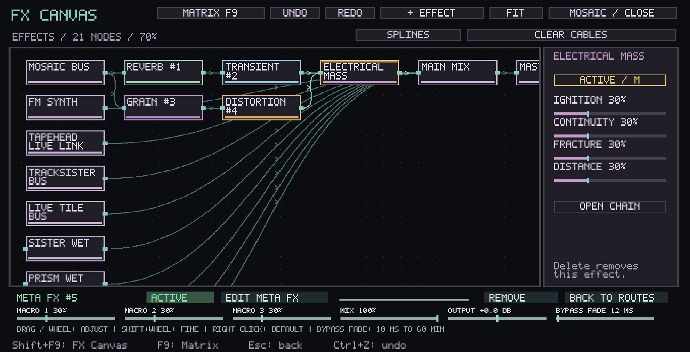
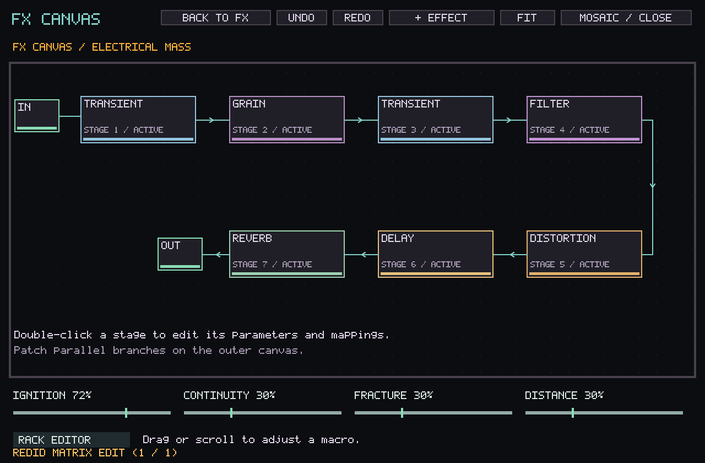
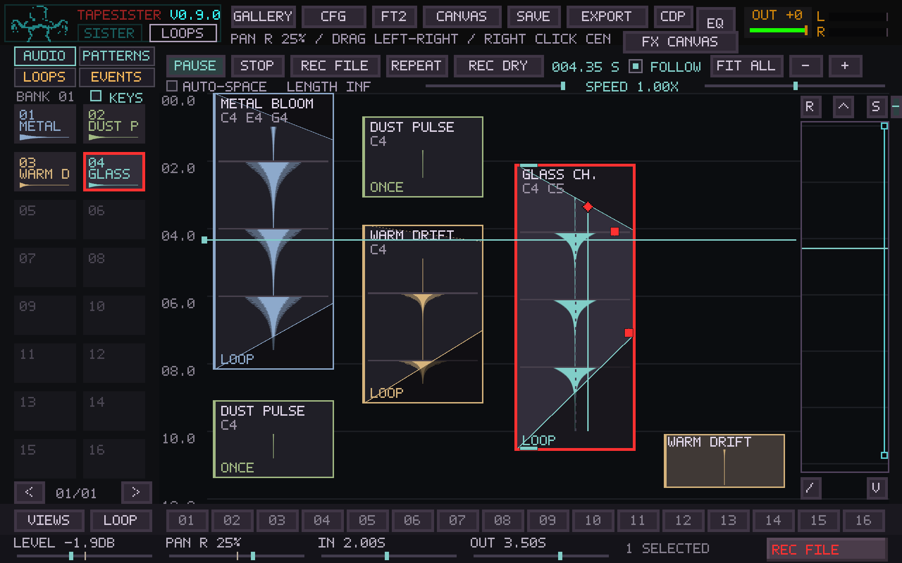

# FX Canvas

Open **Mosaic → FX CANVAS** (left of the output meter),
**Routing Matrix → FX CANVAS**, or press
**Shift+F9** from any workspace. **F9** switches to the routing matrix; Shift+F9
switches back. The same window, graph, stable processor identities, audio
histories and undo stack are used by both views. Opening either view does not
activate or rewrite saved legacy routing. An inactive graph says SAVED GRAPH;
USE SAVED CHAIN uses the existing preservation-aware importer.

The canvas contains effect instances and input/output endpoints. Samples,
TrackSister patterns and generators continue to live in their existing editors.
Mosaic Bus, TrackSister Bus and Live Tile Bus represent their ordinary audio;
explicit tile/track/card routing overrides appear as individual endpoints.
Inherited track-to-tile routing remains inspectable in the Matrix.

- Drag an output port on the right of a node to an input port on the left.
  Every destination sums its incoming connections. Fan out to multiple effects
  for parallel branches and reconnect their outputs to combine them.
- Purple ports/cables are compressor sidechains. Existing delayed feedback
  edges are amber. The Matrix's cycle validation and feedback policy apply.
- Click a cable, then wheel to change its level (Shift: fine). Delete disconnects
  the selected cable. Click empty space to release cable selection before zooming.
- Select an added effect to reveal the right-hand inspector and its full
  parameter controls below the canvas. All four Meta FX macros are available in
  the inspector. Sliders release on mouse-up, including outside their controls. Filter also opens its complete editor on double-click. Fixed processors
  retain their existing editors; the Matrix exposes their ordinary routing controls.
- Drag selected nodes to organize them together. Middle-drag pans; wheel zooms
  around the pointer. **Z** frames selected nodes; **Shift+Z**, FIT or Home frames
  the whole graph. Fit includes all endpoints and can zoom below 20%.
  Layout, pan, zoom and cable style save with the project.
  View edits are undoable and never reset processor histories. The project stores processor and I/O positions, plus up to 256 manually
  positioned track, tile or card sources. Additional sources occupy their own lane. Positions
  use stable effect identities so a replacement instance cannot inherit an old
  processor's placement.
- Every processor stays on the canvas, including a completely isolated effect
  or a chain disconnected from Main. Select a cable and press Delete to remove
  that one connection. You can leave any module unpatched. CLEAR CABLES runs
  the Matrix’s Clear All command and can be undone. Open and named interface
  ports are available to patch. Closed output ports say N/A.
- Undo/Redo and Ctrl+Z/Ctrl+Y are shared with the Matrix. Audition keys pass through
  to the instrument. MOSAIC / CLOSE returns to Mosaic without stopping audio.

## Canvas controls and SunVox audit

Reviewed the official [SunVox manual](https://warmplace.ru/soft/sunvox/manual.php),
particularly **Control**, **Keyboard shortcuts**, and **Modules**. These desktop
editing gestures apply to the FX workspace; Z, Shift+Z and M follow Mosaic.

| Gesture | FX Canvas behavior |
|---|---|
| Double-click empty space | Effect picker; choosing a type places it at that world position |
| Right-click empty space, + EFFECT or Ctrl+N | Open the effect picker; Escape cancels |
| Left-drag empty space | Box-select intersecting modules |
| Ctrl+click | Add/remove a module from the selection |
| Ctrl/Shift + box-select | Extend the selection |
| Ctrl+A | Select all visible nodes, including endpoints |
| Drag a selected module | Move the selection together |
| Shift+drag a module onto another | Connect/disconnect that route using Matrix validation |
| Drag output port to input port | Connect; the lower purple port receives sidechain audio |
| Middle-drag / wheel | Pan / zoom around the pointer |
| Z / Shift+Z | Frame selection / frame all |
| M | Bypass selected added effects; gray blocks remain patched |
| Delete / Backspace | Remove selected added effects and their incoming/outgoing routes, or disconnect a selected cable |
| Ctrl+Z / Ctrl+Y / Ctrl+Shift+Z | Shared Matrix undo/redo |
| Double-click Meta FX | Enter its chain; Escape or BACK TO FX returns |

Delete protects fixed buses and hardware endpoints. Their selection still supports
positioning and framing. Fixed processors retain their existing power controls.
Generators, sample editing and pattern operations remain in their source editors.

## Project routing and fresh sessions

Routing and added effects belong to the saved project. Quitting without saving
and restarting begins with default routing. Loading a saved project restores its
graph, effects, node positions, zoom and cable style. General settings saves no
longer write the live graph into `tapesister.ini`; startup also ignores graph data
from older settings files. Hardware port names and audio-device settings persist.
The standalone configuration codec remains compatible with existing files.

## Entering a Meta FX

Double-click a Meta FX node to enter its internal chain. The breadcrumb names
that rack; BACK TO FX or Escape returns to the outer graph. Its four macros can
be adjusted directly without replacing the running processors. Double-click a
stage or click RACK EDITOR for the complete stage, mapping, A/B, preset and file
controls. Existing `.tsmfx` files remain compatible.

This first internal view displays the existing eight-stage serial rack. Parallel
branches are fully supported on the outer canvas. Packaging arbitrary parallel
subgraphs, nested racks, and editing internal connection topology are subsequent
extensions; the canvas does not silently flatten a branched graph into a chain.

The canvas uses Mosaic's dark background, purple panels and colored module
accents. Audio cables are teal, sidechains purple, and delayed feedback amber.
Selected modules have an amber border; bypassed effects are gray. STRAIGHT /
SPLINES switches the cable path used for both drawing and selection.

Node titles wrap across two lines when space permits. The inspector shows the full
selected name or cable endpoints and level. Selecting a node emphasizes its cables;
selecting a cable highlights that path. The FX window draws its bitmap lettering
at the display resolution so small strokes remain visible on a laptop screen.

The screenshots below are native application captures. The [laptop overview](screenshots/fx-canvas/laptop.png) shows the inspector and shortcuts at 1366 × 699 and 70% zoom.

## Texture processor levels

Resonator previously averaged six .35-excited combs, leaving its fully wet output
about 17 dB below the test input. A fixed **+12.04 dB wet makeup** follows that
network. Feedback, excitation, damping and dry/bypass behavior are unchanged.
This is a fixed calibration, not an adaptive gain rider or compressor.

Dispersion measures unity RMS at 100% wet after settling. Its dry/wet phase
interference is intentional, so no blanket boost is applied. The normal OUTPUT
control remains available.

Factory Meta FX presets now store visible makeup in their final stage's OUTPUT
control. New/cycled presets receive these trims; saved and custom rack controls
are loaded literally. Serial processing remains equivalent to the same individual
processors. Re-select a factory preset to get its revised output trim.

| Factory rack | Final-stage output trim |
|---|---:|
| Arc | 0 dB |
| Pale Cloud | +4 dB |
| Shimmer Ash | +2 dB |
| Iron Choir | +6 dB |
| Spring Dust | +5 dB |
| Glass Thread | +2 dB |
| Broken Halo | +4 dB |
| Slow Weather | +3 dB |
| Charcoal | 0 dB |
| Resonant Room | +5 dB |

`cmake --build BUILD --target tapesister_fx_gain_probe` builds a reproducible
noise/two-tone RMS and peak report: 48 kHz, ten seconds per condition, measured
across the final five seconds. This is signal-dependent calibration, not a claim
that all sources or macro settings have identical perceived loudness. The regular
Meta FX DSP gate checks steady broadband level, stereo isolation, bypass, preset
bounds, serial equivalence, persistence and lifecycle behavior.
