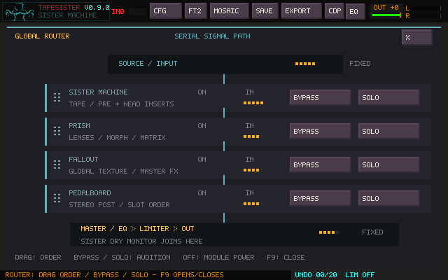
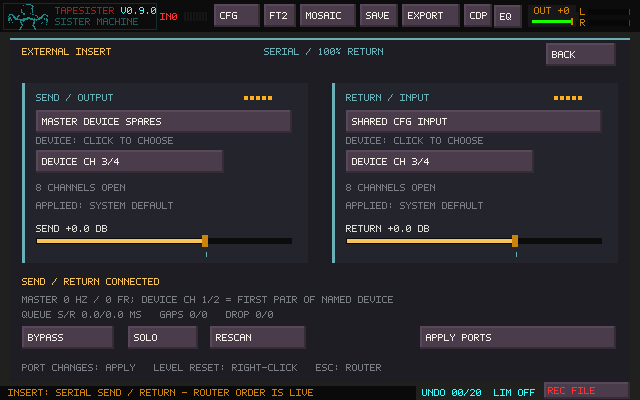

# Legacy serial routing and External Insert

This reference describes the earlier Router/Insert panels and the serial engine
retained for existing projects. Its old F9 navigation and screenshots are
historical: **F9 now opens the routing matrix**. It is not a setup recipe for a
new matrix project. See [Routing Matrix](ROUTING_MATRIX.md) for current operation.

Existing legacy projects retain their saved audio path until **Use Matrix**,
**Clear All** or **Reset to Default** is selected. Use Matrix preserves supported
ordinary serial chains; it refuses unsupported conversions without changing audio.
Clear All and Reset intentionally replace routing. In matrix mode, serial order,
Router bypass/solo/timers, legacy Insert assignments and Sister source switches
do not control the graph. Matrix outputs also bypass the legacy Ambisonics stage.
The old state sequencer does not sequence matrix connections.

## Serial Router

Press **F9** from Main, FM, Mosaic, or Sister, or open **EQ → GLOBAL ROUTER**.
The Router shows the serial processing path from top to bottom. Opening or closing
it leaves playback running; physical QWERTY/MIDI notes and Shift+Space ARP transport
remain available. Escape closes the page, or cancels an active drag first. File
browsers, text fields, and confirmation dialogs retain their keys.

The default order is **Source → Prism → Sister → Fallout → Pedalboard → INSERT → Master**,
with INSERT initially bypassed and unassigned.
Drag a module by its name or grip to change its position. The amber line shows
where it will land; release to apply, or Escape to cancel. Source and Master are
fixed. In Main Mix mode, Master Insert is also fixed after recombination and
before EQ/limiter. Advanced direct mode retains all 120 serial orders.
**F9 → Main Mix…** shows the final path and shared return controls; see the
[legacy tile/track routing guide](SOURCE_ROUTING.md). The order changes the
audio: moving Prism below Sister refracts the tape's output, while placing it above
Sister prints the refraction into newly arriving tape material.

| Control or indication | Meaning |
| --- | --- |
| BYPASS | Pass the stage's input onward while retaining its controls |
| SOLO | Hear this optional stage alone; click again to restore previous bypasses |
| Another SOLO | Move solo to that stage; only one is soloed at a time |
| BYPASS during solo | Leave solo and change the chosen stage's bypass; clicking the soloed stage bypasses it |
| ON / OFF | The subsystem's own power state; Router controls do not change it |
| BYPASS / SKIP / SOLO | Saved bypass, temporary exclusion by solo, or the soloed stage |
| IN lights and lit connectors | Audio reaching this position, independent of the processor's switch state |
| INSERT S / R lights | Separate SEND and RETURN activity; SETUP opens ports, levels and status |

An OFF processor passes its input through. Solo does not power on an OFF subsystem.
INSERT has no separate power switch: unbypassing or soloing it selects the external
return, including silence when its ports are unavailable.
An IN indicator can therefore glow on an OFF or bypassed module: audio is passing
that point. Hover controls for delayed help. Source selection still belongs to the
existing workspaces: powered Sister uses its source switches and trims; with Sister
off, the ordinary tile/FM/Mosaic/Live Link/monitored-input mix supplies the chain.

**Pedalboard remains one module.** Its stereo POST slots move together, keeping their
internal slot order, duplicates, mixes, gains and transitions. PRE and H1/H2/H3 are
local Sister inserts and remain at those named locations. Router Pedalboard bypass
also gates those inserts. They require Sister; a soloed Pedalboard auditions its POST
chain, while a soloed Sister excludes Pedalboard inserts. **MASTER FX** continues
to gate the Pedalboard and Fallout independently of Router controls.

**Sister's DRY monitor normally returns separately to Master**; WET monitors the
serial wet path. Set Sister DRY to zero when comparing pure
Sister-to-Prism or Sister-to-Pedalboard processing. Sister's internal tape/feedback
controls remain local. The bounded FX-feedback return uses the processed wet tap
when Pedalboard is downstream of Sister; upstream effects are already printed into
Sister's input. A configured downstream INSERT merges the monitoring returns
immediately before its position, so no undelayed dry signal can bypass the external
loop. That merge remains in place while INSERT is bypassed for consistent A/B.
FX/Fallout feedback taps stay before that merge and do not automatically recirculate
the external return. H1/H2/H3 captures remain
internal head taps; MIX follows the routed wet result with linked peak safety.
FILE OUT and Mosaic OUTPUT
record the final stereo mix, including dry monitoring, EQ, limiter, and OUT,
before the optional Ambisonics speaker stage.

Order changes fade down and back up over about **10 ms**. Bypass/solo crossfade
over about **10 ms**. These are short safety transitions, not performance timers.
Processor histories are not reset: bypassed stages continue ticking with silence
so tails and modulation advance. Bypassing Sister does not turn its POWER off.
The final EQ, limiter and OUT fader remain after the Router in every configuration;
the tuning reference retains its existing direct path to Master.

Order, saved bypasses and solo persist in the project/session and configuration.
Older files with no Router keys load the default order with only INSERT bypassed
and no solo. Four-stage Router files retain their previous order/bypasses/solo and
append the bypassed INSERT. Sound presets do not overwrite routing. Audio-device
recovery preserves it.

### Ambisonics output

**F9 → AMBISONICS**, or **Ctrl+F9**, opens a modeless output window after the
stereo chain. It encodes the complete mix into a horizontal first-order field,
transforms it, and decodes to 3–16 assigned speakers. It starts disabled.
The bypass pair selector can send ordinary stereo to each side of a quad room:
1–2, 2–3, 3–4 or 4–1. Speaker numbering follows the room; hardware outputs
are assigned separately. FIELD, ARRAY and MOTION pages cover visual manipulation,
calibration, slow LFO/Rise motion and A/B morphs. Closing the window leaves audio
running. [Full setup, routing and limitations](AMBISONICS.md).

### Router Performance

**F9 → PERFORMANCE** adds A–Z participation states, 64 steps with individual
STEP TIME, FOR/AFTER Bypass/Solo timers, live countdowns and MIDI-learn commands.
Manual participation changes keep the sequence running and last until the next
step. Timers layer over the current sequence; expiration reveals the current
underlying state. STOP holds that state; RESTORE explicitly returns to the manual
state captured before PLAY. Stage order is locked during playback. Projects save
configuration and manual base, never active timers or a run flag.

See [Router Performance](ROUTER_PERFORMANCE.md) for controls, precedence, persistence,
Insert/recording behavior, screenshots and a practical four-step example.

## Legacy External Insert

**Master INSERT processes the combined main mix at 100% return**, before Master
EQ and the limiter. It leaves TapeSister, passes through an external application
or hardware processor, and returns to final processing. In advanced direct mode,
Insert retains its movable serial-chain position; direct outputs bypass it. The returned signal replaces the input;
there is no dry/wet control and TapeSister does not host plugins.

Open **F9 → INSERT → SETUP**. Master output and the audio backend stay in
**CFG**. The Insert panel has independent SEND and RETURN device selectors, then
channel-pair selectors for each device. Left-click cycles forward; right-click
cycles backward. Click **APPLY NOW**, and use **CFG → SAVE CONFIG** to remember
device choices. Changes are refused during recording; levels, bypass and solo
remain available while playing. Saved unavailable choices are never reassigned
silently. **Selected CH** shows the pending choice; **Active CH** and the device
below it show the applied stream. A pending banner remains until Apply.
Audio backend, ASIO driver and buffer changes apply with **CFG → SAVE CONFIG**
without closing TapeSister. Finish or cancel recording first. See [ASIO setup](ASIO_AUDIO.md).

| Setting | Behavior |
| --- | --- |
| SEND device | **MAIN DEVICE: SPARE OUTPUTS**, or a separate named playback endpoint |
| SEND pair | Unassigned, or exposed channels: shared Master offers 3/4, 5/6, 7/8; a separate device also offers 1/2 |
| Master output | Fixed on 1/2 of the CFG output; a separate SEND cannot select that same endpoint |
| RETURN device | **INPUT DEVICE FROM CFG**, or a separate named capture endpoint |
| RETURN pair | One exposed stereo pair within the selected device: 1/2, 3/4, 5/6 or 7/8 |
| SEND / RETURN level | −24 to +12 dB; 0 dB is unity; right-click resets; changes are smoothed |
| BYPASS | Internal path; SEND fades to zero and RETURN is ignored |
| SOLO | Existing Router solo: audition INSERT with the other optional stages bypassed |
| S / R lights | Independent outgoing and incoming signal activity |
| BACK / Escape | Return to Router; playback continues |

**Channel numbers are local to the named device.** A Windows endpoint called
`Out 3-4 (MOTU M Series)` has local channels 1/2, representing physical sockets
3/4. It does not need four channels open. For the M6 stereo-endpoint layout:

| Role | Device | Pair |
| --- | --- | --- |
| Master in CFG | `Out 1-2 (MOTU M Series)` | 1/2 |
| Insert SEND | `Out 3-4 (MOTU M Series)` | SELECTED CH 1/2 |
| Insert RETURN | `In 5-6 (MOTU M Series)` | SELECTED CH 1/2 |

Connect physical outputs 3/4 to the processor and its output to inputs 5/6, apply
the choices, then unbypass Insert. CFG's ordinary input can remain a different
endpoint. An input shown as **CLOSED** means no current consumer has opened it;
TapeSister does not use cable detection to decide which channels exist.

With **INPUT DEVICE FROM CFG**, the RETURN pair is reserved from ordinary EXT
monitoring and Sister's EXT source while SEND is assigned, even during bypass.
Other input channels remain available; raw EXT recording retains its source tap.
SEND UNASSIGNED releases this reservation. A separate RETURN leaves CFG's input
available for normal live sources. Choosing the same capture endpoint by name
reuses the shared stream and its reservation rather than opening it twice.

For software processing, select a virtual playback endpoint for SEND, route it
through the other application's processor, and select that application's virtual
capture endpoint for RETURN. Master can stay on speakers or the interface.
Two-channel endpoints work when SEND has its own device. Confirm the physical or
virtual mapping in the driver/routing software; TapeSister supplies no parallel
dry mix at INSERT.

**No return means silence while INSERT is active.** A stopped external app,
disconnected cable or intentionally silent processor can look identical to the
activity detector. The panel distinguishes unavailable ports from no signal
activity, but cannot diagnose the external application. Use BYPASS to hear the
internal path. Named SEND/RETURN failures preserve the choices and never open a
substitute device. Reconnection or APPLY retries them. A shared SEND stays disabled
on temporary Master fallback; a separate SEND remains tied to its explicit name.

**Sister monitoring:** when a configured INSERT follows powered Sister, DRY and WET
join just before INSERT, including when INSERT is bypassed. Downstream processors then hear
that complete monitor result. When INSERT precedes Sister, Sister receives the
returned material. Existing tape/head feedback remains local. The macro FX and
Fallout feedback taps are held upstream of the monitor merge/external loop;
this feature does not create an external feedback return.

**Latency:** shared-device SEND adds no separate queue. A separate SEND uses a
stereo FIFO with rate conversion and clock-drift handling. Both SEND and RETURN
target two of the larger producer/consumer callback bursts, converting their
durations to the FIFO's source sample rate (bounded 128–8192 frames). RETURN
accounts for Master's actual callback size even if the capture driver delivers
smaller blocks; SEND likewise accounts for the actual auxiliary output callback.
At 48 kHz with matching 256/512/1024-frame buffers, each queue targets about
11/21/43 ms, in addition to device and external processing latency. **QUEUE S/R**
shows those priming targets, not a measured round-trip delay. Reconfiguration
discards stale audio and reprimes. There is
no automatic round-trip compensation. Bypass crossfades over about 10 ms; its
brief transition can blend paths with different delays. Steady active INSERT is
entirely returned audio. Reordering retains the Router's short fade through zero.

**Troubleshooting delayed or crackling returns:**

- A tile marked **44100 HZ** describes its sample data. TapeSister requests
  **48000 Hz** playback and resamples tiles to the obtained stream rate. Check
  the Insert panel's live rates before changing the interface clock. For an
  interface already running at 48 kHz, start with the external app explicitly
  set to 48 kHz too.
- **GAPS S/R** counts queue underruns; **DROP S/R** counts discarded overflow and stale-backlog
  frames. Watch for increases while listening. Applying/reopening devices resets
  these counters. They diagnose TapeSister's bridges, not every driver or external
  app dropout. `--diagnostic-audio` adds detailed SEND/RETURN queue measurements
  to `tapesister-diagnostic.log` every five seconds.
- Test one direct physical cable loop from TapeSister SEND to RETURN, bypassing
  the external application. If that is clean, restore the application's loop
  with its effects bypassed, then enable processing. This separates TapeSister's
  I/O path from the extra application's buffers and processing.
- Monitor only the final Master path while testing. Keep return inputs out of
  direct-monitor mixes feeding the send; watch levels for clipping. Larger
  buffers add latency and cannot correct routing feedback or a rate/driver issue.
- In the external app, Auto does not identify the actual driver. If choosing
  MOTU ASIO there, first verify that the driver permits it alongside TapeSister's
  Windows backend. TapeSister also offers native ASIO; sharing depends on the driver.

**Backend limits:** Master, a separate SEND, the ordinary CFG input and a separate
RETURN can use different endpoints within the selected backend (SDL or native Linux JACK). Insert
supports stereo pairs in the first eight channels of negotiated layouts, including wider interfaces. Devices must be available
for simultaneous use; unsupported layouts stay unavailable. Native channel
negotiation prevents an unsupported SEND from being silently downmixed onto
Master. See [SDL audio negotiation](https://wiki.libsdl.org/SDL2/SDL_OpenAudioDevice).

Windows offers native ASIO plus installed SDL backends, including
Auto/WASAPI/DirectSound and WinMM. ASIO uses one shared duplex driver; independent
SEND/RETURN endpoints apply to the other backends. There is no separate exclusive-mode selector. Separate stereo endpoints exposed by the M6 or virtual audio drivers
can be selected independently. Another application using ASIO/exclusive access
can still prevent a driver from sharing an endpoint. On Linux, the selected
backend and sound-server/device profile determine the available devices and
channels. This does not aggregate drivers into a new system-wide audio device.

| Recording path | Relationship to INSERT |
| --- | --- |
| FILE OUT; Mosaic REC OUT / output bounce | Final audible result, after INSERT, remaining stages, EQ, limiter and OUT |
| Sister MIX capture | Complete routed result with linked peak safety; includes returned audio where applicable |
| Sister H1/H2/H3 capture/stems | Named head tap; includes INSERT only if it precedes Sister |
| Ordinary tile/group Capture; REC DRY/SYNTH | Existing earlier source taps; no downstream INSERT print |
| REC EXT; Live Link source capture | Existing raw source tap; independent of downstream routing |
| Sample export/transform | Existing sample data; does not run an external processor offline |

Mosaic output bounce is a real-time REC OUT operation, so the external processor
must remain connected during the take. Configuration saves the global device
names, Insert pairs and levels. Project state v24 introduced saved Insert pairs/levels and
Router state; it uses the currently configured Master, SEND and RETURN devices. Sound presets leave
Insert setup alone. SEND/RETURN are linked peak-bounded and sanitized, but external
hardware/software routing remains under your control.

