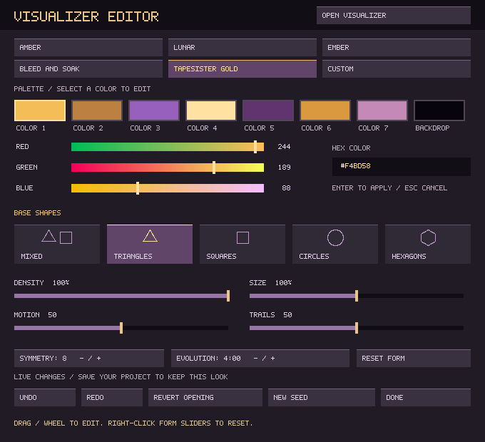
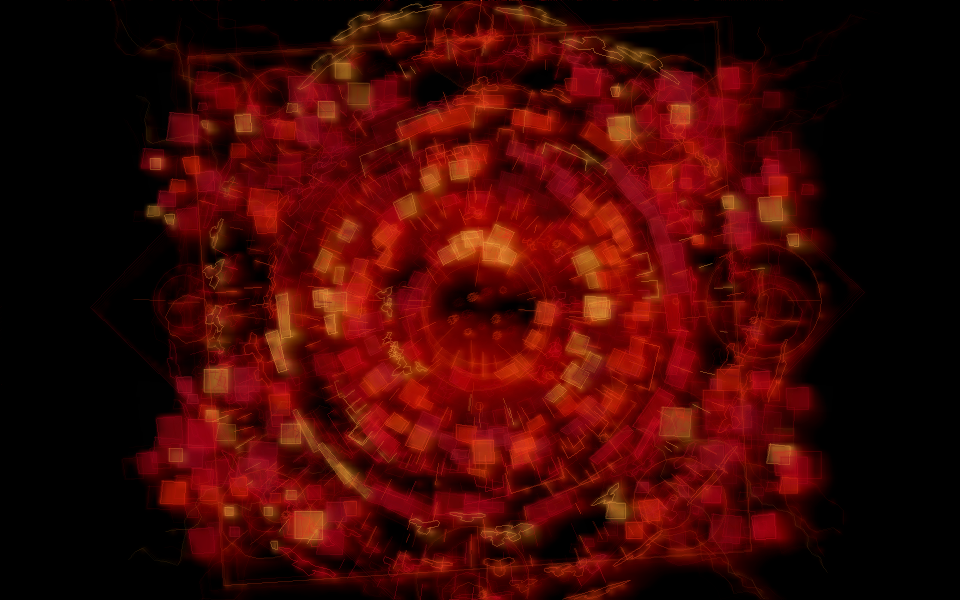
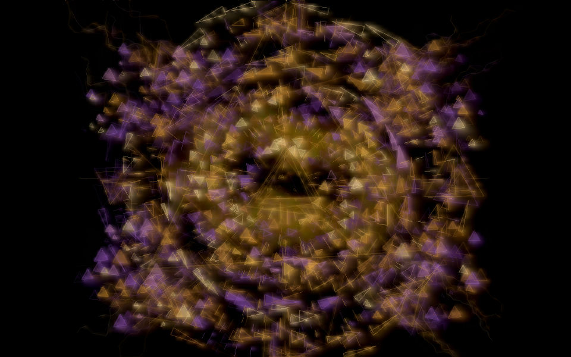

# Visualizer editor — 16 October 2026

Source revision: `0f7e1d02eceb2a8718355cfff91c60c059a48c44`, based on main
`fa0c76542c1f27aaa36b59a33cd55753a4a44350`.

**F11 → EDIT VISUALIZER** opens the modeless editor. Its two new palettes are
Bleed and Soak and TapeSister Gold. Seven ink colors plus a backdrop are editable
with RGB sliders or hex input. Five shape choices and four form sliders give
simple control while the original seeded layout and effect response remain.
[Full controls and project compatibility](IMPERMANENT_MANDALA.md#palette-and-shape-editor).



| Bleed and Soak / Mixed shapes | TapeSister Gold / Triangles |
| --- | --- |
|  |  |

These are actual native SDL captures, not mockups. Both visuals use seed 314159,
900 frames / 60 simulated seconds, identical synthetic audio features and
combined diagnostic effects at 70% wet. Palette selection itself does not engage
audio effects. The dialog screenshot is taken from the application fixture.

## Validation

The local Release build completed with GCC 13.3 and SDL 2.30. All four focused
tests passed in 6.18 seconds:

| Test | Relevant coverage |
| --- | --- |
| `tapesister_mandala_tests` | Custom colors/form persistence, v1 and pre-Mandala migration, invalid bounds/version rejection, stable seed, existing audio analysis |
| `tapesister_mandala_queue_tests` | Bounded concurrent queue ownership and disabled/drop paths |
| `tapesister_mandala_controller_tests` | Actual editor events, custom RGB/hex, preset visits, undo/redo/revert, project replacement, dirty-state hash, unchanged routing and continuing transports, all five bounded shape paths, scalar updates without rebuilding; existing child stall/crash/reopen checks |
| `tapesister_new_project_tests` | Existing project reset/discard/save guard regression |

[Raw local test output](validation/mandala-editor-tests.txt).
Linux and Windows both passed 66 selected regression tests, the separate package
guard, portable bundle assembly with CDP8, and checks of the exact downloaded
archives. Linux also passed the downloaded executable's startup check with a
desktop stack limit; Windows passed shell extraction and one-extraction package
checks. The full-suite step is skipped for PRs. See
[the source-revision workflow and downloadable builds](https://github.com/Ehule/TapeSister/actions/runs/38931879077).

The three software capture runs used Standard 960×600 internal resolution and
the combined effects described above. The diagnostic capture path does not use
automatic load shedding:

| Palette / shape | Mean frame ms | Maximum frame ms |
| --- | ---: | ---: |
| Bleed and Soak / Mixed | 21.733 | 41.255 |
| TapeSister Gold / Triangles | 22.814 | 47.132 |
| TapeSister Gold / Circles | 25.571 | 58.025 |

The first Gold capture overlapped the local controller tests and measured
21.240 ms mean / 124.480 ms maximum. It was repeated without those tests running;
the resulting BMP was byte-identical. Both timing records are retained in the
raw output. These container measurements are not a clean 30 FPS guarantee.
Circles involve more vertices than the
other simple polygons. The existing quality budgets and load shedding remain in
effect during performance. Model storage is 97,304 bytes; Standard history pixel
storage is 2,304,000 bytes and existing effect texture storage is 1,088,000 bytes.
The renderer adds no new textures. The editor has a fixed 680×620 pixel buffer
and matching UI texture, with a bounded 32-state undo history.
[Raw capture measurements](validation/mandala-editor-render.txt).

No callback/DSP changes were made. The existing runtime snapshot, audio queue and
renderer IPC remain bounded. This follow-up does not repeat the earlier long
soak or certify physical audio/projector/DPI behavior or X220/HP A8 performance.
Those hardware checks remain manual.

Reproduce the captures from a normal build:

```sh
SDL_VIDEODRIVER=dummy SDL_RENDER_DRIVER=software tapesister --mandala-capture bleed.bmp 314159 900 5 3 0
SDL_VIDEODRIVER=dummy SDL_RENDER_DRIVER=software tapesister --mandala-capture gold.bmp 314159 900 5 4 1
tapesister_mandala_controller_tests --editor-capture editor.bmp
```
