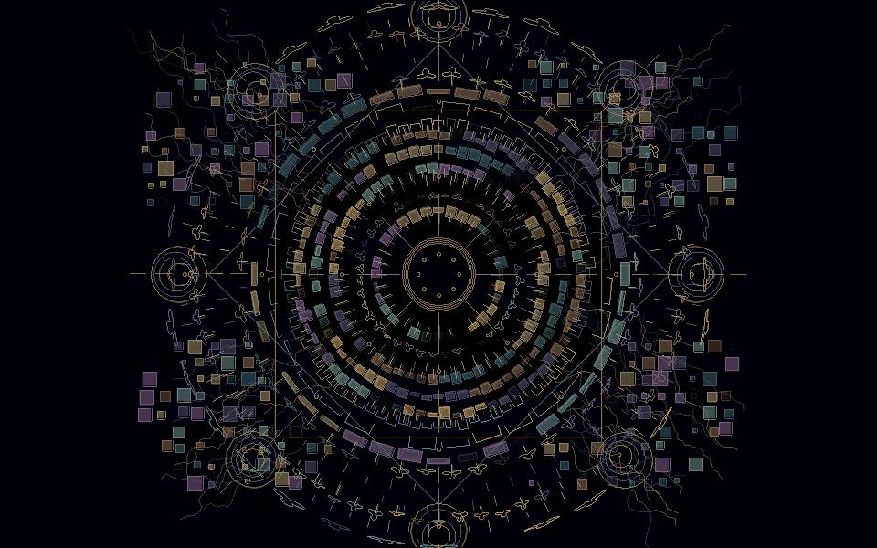
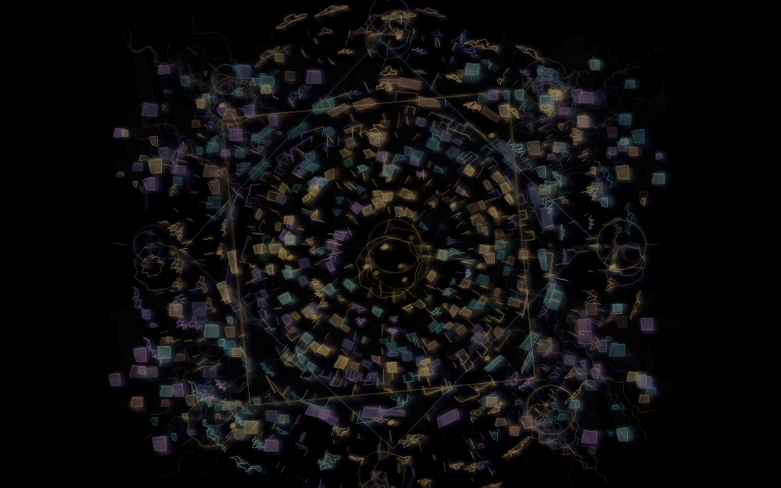
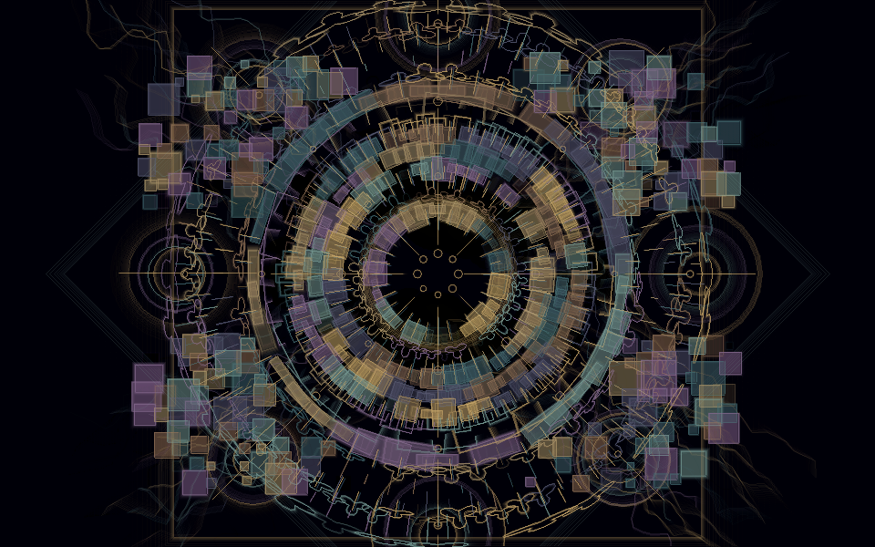
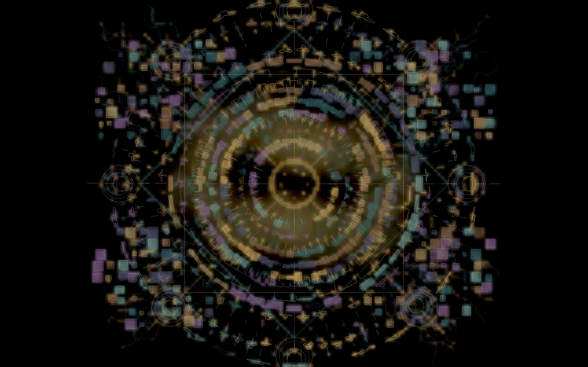
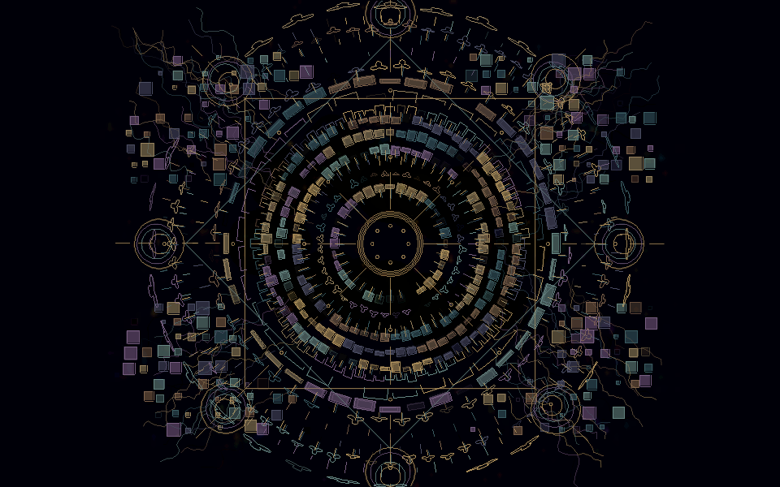
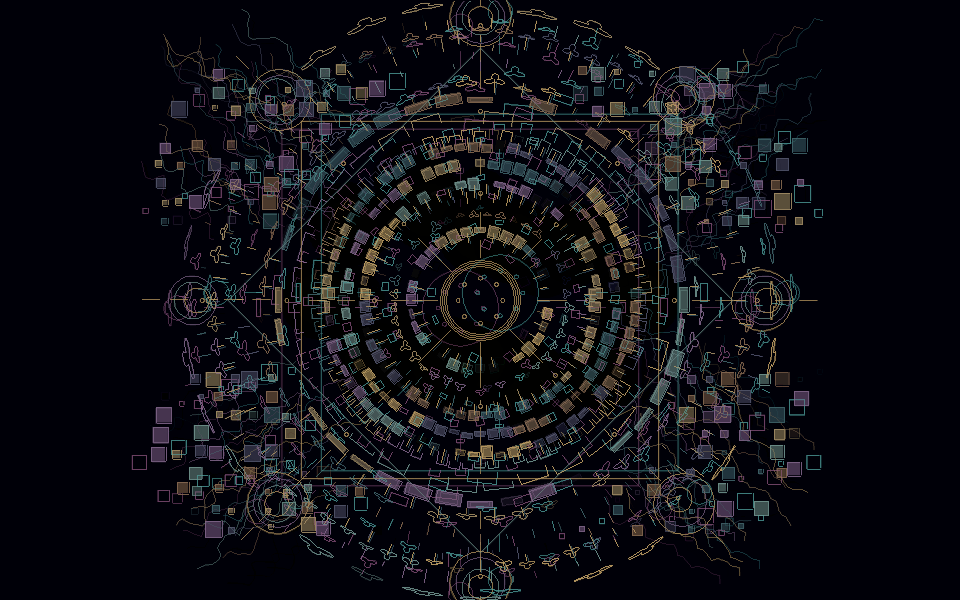
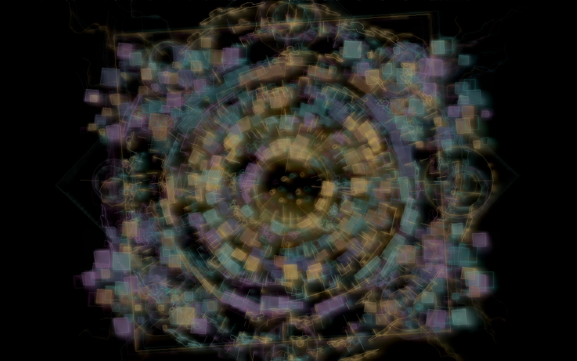

# Mandala effect response — 13 October 2026

Source revision: `faa8756530df75c3efb14f3d9c9b5df028ac7cd9`.
This follow-up makes the visual respond to current Pedalboard and Prism states.
Amplitude still drives brightness and presence. Distortion separates and bends
edges with diffusion; grains change motif scale; reverb adds haze and traces;
delay adds expanding echoes; Prism displaces colored outlines. EVOLUTION remains
an independent slow cycle. See [controls and architecture](IMPERMANENT_MANDALA.md)
for the parameter mapping and signal-meter gating limits.

Current DSP values drive the image, including slot engage, Master FX engage and
both endpoints of an effect-type crossfade. A four-minute distortion fade changes
the visual gradually, followed by 450 ms of visual easing. Activity meters are
an artistic approximation, not isolated per-slot audio or proof that each
internal route reaches the speakers. Final-output amplitude preserves the
silence response.

## Validation

Both Linux and Windows release jobs passed 53 selected regression tests, the
separate package guard, and portable archive assembly with bundled CDP8.
[Workflow and downloadable archives](https://github.com/Ehule/TapeSister/actions/runs/38340870169).
The CI full-suite step is skipped for PRs. The prior full local suite and six
failures reproduced on the unmodified base remain documented in
[the baseline report](MANDALA_VALIDATION.md); that full suite was not repeated
for this follow-up.

The five focused local Release tests passed in 6.32 seconds:

- `test_sister_post_fx` processes an actual 240-second DSP fade offline, checking
  the distortion readout every 60 seconds, then the distortion-to-grain type
  crossfade and Master FX fade. This verifies DSP time, not a four-minute wall
  wait or physical audio output.
- `test_sister_runtime` covers the existing runtime regression fixture.
- `tapesister_mandala_tests` checks bounded/nonfinite-safe controls, easing and
  stale-control decay in addition to the existing visual model checks.
- `tapesister_mandala_queue_tests` retains bounded concurrent packet ownership.
- `tapesister_mandala_controller_tests` checks the atomic effect snapshot,
  activity gating, hidden-transport updates, closed/frozen readout gating and
  new texture recreation, alongside the real child stall/termination/reopen
  and ongoing transport checks.

[Raw test output](validation/mandala-effects-tests.txt).

## Actual renderer comparisons

All seven captures use the same seed (`314159`), synthetic audio features,
Standard 960×600 internal texture and 900 frames (60 simulated seconds). The
selected effect has wet=1, size=0.8 and character=0.7; combined uses wet=0.7
for all five effects. The capture path exercises the actual final composition,
including diffusion, and has no automatic load shedding. These are diagnostic
states, not captures from a physical performance or the supplied concept art.

| Dry | Distortion | Grains |
| --- | --- | --- |
|  |  |  |

| Reverb | Delay | Prism |
| --- | --- | --- |
|  |  |  |



The software renderer was measured in a Linux x86_64 container with GCC 13.3,
Release/O3, SDL 2.30 dummy video/audio. Costs include scheduling variation.

| Diagnostic state | Mean render ms | Maximum render ms |
| --- | ---: | ---: |
| Dry | 8.132 | 13.385 |
| Distortion | 14.611 | 22.785 |
| Grains | 9.873 | 46.161 |
| Reverb | 17.287 | 37.258 |
| Delay | 11.406 | 23.291 |
| Prism | 9.049 | 38.173 |
| Combined | 22.537 | 48.281 |

The model occupies 97,224 bytes and Standard history pixel storage is 2,304,000
bytes. Four fixed 320×200 echo textures and a reused 160×100 diffusion/compositing
texture add 1,088,000 bytes of pixel storage. These figures exclude SDL/window
buffers and do not imply measured GPU allocation or process RSS. Diffusion is
bounded by internal resolution. Echoes are composited at 160×100 before one
internal-size pass; their total reinjection gain stays below trace decay.
No growing history or frame-time allocation/readback is added to performance
rendering. Heavy effect combinations still rely on existing load shedding on
slower systems. [Raw renderer output](validation/mandala-effects-render.txt).

To reproduce with a built executable:

```sh
SDL_VIDEODRIVER=dummy SDL_RENDER_DRIVER=software tapesister --mandala-capture capture.bmp 314159 900 5
```

Omit the last argument for dry; use reverb=0, delay=1, distortion=2, grains=3,
Prism=4, or combined=5. Convert the BMP to PNG only for documentation storage.

## Callback comparison with active effects

`tapesister_mandala_controller_tests --soak 30 --effects` runs six 30-second
measurement periods, each following a two-second warm-up. It uses the existing
48 kHz / 512-frame, four-output workload with TrackSister, 16 Mosaic loops, ARP,
Sister, Prism, Fallout and external input. All four Pedalboard types are settled
and active at 0.3 wet, with identical DSP across every visual mode. No transport
reset occurs between periods.

| Period | Callbacks | Mean ms | p50 ms | p95 ms | p99 ms | Max ms | Deadline misses | Gaps >16 ms |
| --- | ---: | ---: | ---: | ---: | ---: | ---: | ---: | ---: |
| 1: OFF | 2236 | 3.318 | 3.192 | 3.994 | 5.244 | 8.111 | 0 | 13 |
| 2: ECONOMY | 2212 | 3.457 | 3.279 | 4.477 | 5.716 | 16.838 | 4 | 22 |
| 3: STANDARD | 2214 | 3.446 | 3.268 | 4.507 | 6.027 | 12.937 | 2 | 24 |
| 4: STANDARD | 2218 | 3.430 | 3.265 | 4.475 | 5.575 | 9.273 | 0 | 16 |
| 5: ECONOMY | 2233 | 3.333 | 3.204 | 4.077 | 5.194 | 13.467 | 1 | 11 |
| 6: OFF | 2194 | 3.546 | 3.296 | 4.859 | 8.173 | 21.714 | 9 | 47 |

The process finished in 194.02 seconds with all three musical transports active,
151.34 seconds of audio timeline and zero dropped visualization packets. Across
the visual-on periods, 1,917 frames averaged 12.161 ms with a 27.091 ms maximum;
no load-shedding tier was entered. Callback deadline misses mean execution over
10.667 ms. Arrival gaps are separate; dummy audio cannot report physical-device
underruns and its period includes callback execution.

Timing spikes occurred both with visuals on and off. These samples demonstrate
continuity and bounded queues in this environment; they do not establish clean
real-time acceptance, zero contention, or performance on the X220/X230 or HP A8.
The original 24-minute run predates these effect layers and was not repeated.
Physical audio, older-hardware, projector/DPI and OBS acceptance remain pending
as listed in the baseline report.
[Raw callback output](validation/mandala-effects-callbacks.txt).
