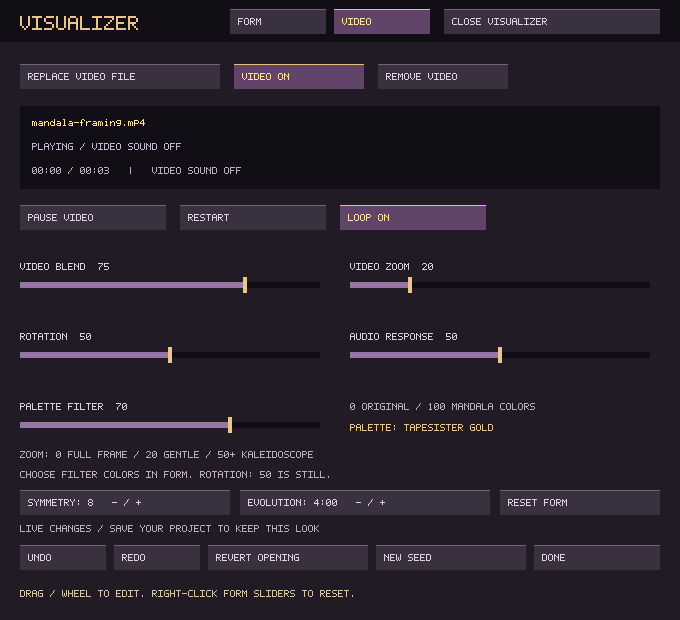
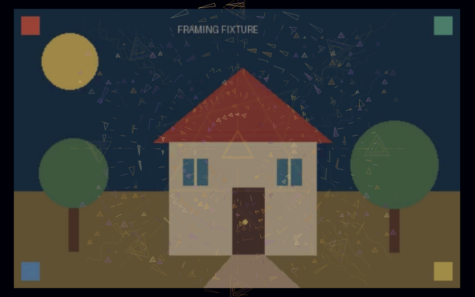
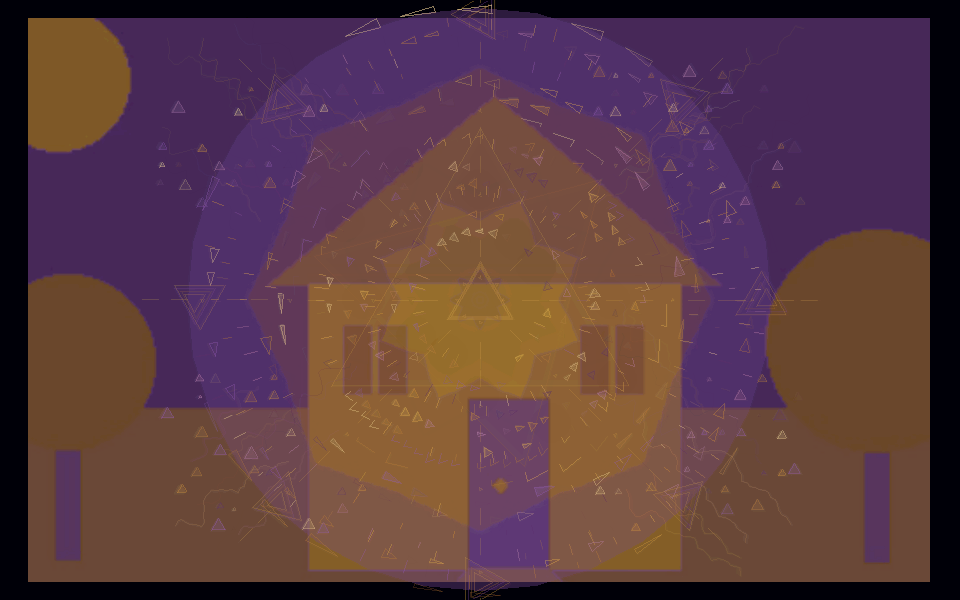
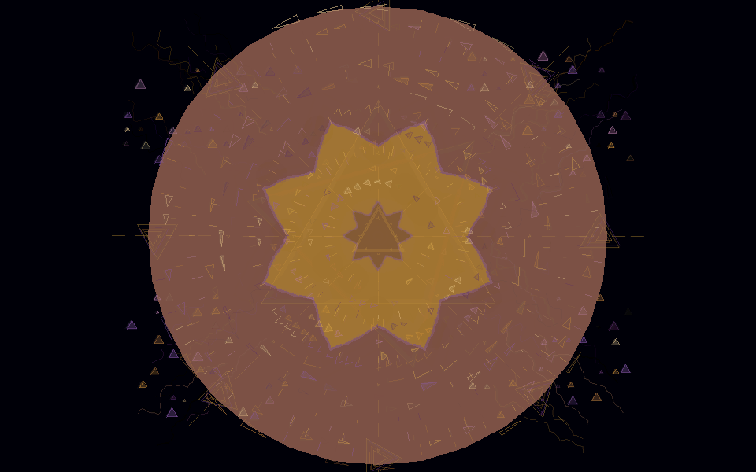

# Video through the mandala

Mosaic can now drive this same window with file/folder change objects. The VIDEO
editor has **MANDALA ON/OFF** and **COLOR / BLACK & WHITE** controls. See
[Mosaic video changes](MOSAIC_VIDEO.md) for random positions, scatter, transitions
and automatic preparation.

Open **F11 → EDIT VISUALIZER → VIDEO → ADD VIDEO FILE**. The existing file
browser opens in TapeSister's main window. Choose a clip, then **OPEN VISUALIZER**.
The footage can move from a recognizable full frame into a reflected radial kaleidoscope, underneath
the mandala's geometry and inside its trails, haze and echo treatment. The clip's
movement, seeded crop drift and musical activity evolve independently, so a loop
need not repeat the same visual composition.

| Control | Behavior |
| --- | --- |
| Add / Replace Video File | Reference a local clip; no upload or copy |
| Video On / Off | Enable the source or return to procedural geometry |
| Remove Video | Clear the project reference; never delete the file |
| Pause / Play Video | Hold/release the source frame while music and geometry continue |
| Restart | Return to the beginning and resume video |
| Loop | Restart at EOF, on by default; off holds the last frame |
| Video Blend | Mix the footage into the geometric mandala |
| Video Zoom | 0 fits the full frame; 20 keeps recognizable footage with gentle folds; 50–100 is the fully folded kaleidoscope |
| Rotation | 50 is still; either side changes direction and speed |
| Audio Response | Amount of level, stereo and effect-driven deformation |
| Palette Filter | 0 keeps original colors; 100 maps shading into the current mandala palette; values between blend the two |
| Symmetry | Number of reflected sectors, including continuous odd symmetry |

Video sound is always ignored. Existing final-output audio features drive the
lens; this does not create another sound source, mixer route or audio device.
**Freeze Visual / Space** freezes both footage and geometry. Minimizing the
visual window pauses video decoding/presentation until it returns.

**To see your footage clearly**, pull Video Zoom all the way left. The entire
frame fits with its original aspect ratio, including portrait and widescreen
clips. This endpoint has no automatic source drift or rotation, and Form Size
does not crop it. The lower half of the slider gently magnifies the centered
source and blends in the mirrored lens; 50–100 retains the earlier abstract
range. New projects start at 20. Saved zoom values are retained, so pull an
existing project's slider left to try the new framing.

**To match the mandala's colors**, raise Palette Filter and choose a palette in
FORM. Custom colors work too. The filter maps dark-to-light image detail through
a smooth gradient of the eight current swatches, then blends that result with
the original image. It changes color, not the frame's geometry. You can adjust
it on a paused video frame. It defaults to 0 and saves with the project. Trails,
haze, echoes and geometric overlays still affect both filtered and original
footage; a low Zoom value does not bypass those shared visual treatments.

The project recalls the file reference, enable/loop switches and look controls.
Playback position and temporary pause are not saved. Reopening visuals starts
at the beginning. Put clips beside the project (or inside its sidecar folder)
to save relative references and move them together. Other files retain absolute
references. Media is not embedded in `.tsr` or automatically copied into a bundle.
Missing or unsupported media shows a player message while procedural visuals
and musical playback remain available. Use Replace Video File to relink it;
Restart retries a failed source after the file becomes available again.

Mandala settings use version 5. Versions 1 and 2 load with video off and retain
their original look; version 3 retains saved controls with Palette Filter off.
Versions 1–4 retain geometry enabled and global monochrome off.
Older TapeSister builds reject version-5 visual settings;
keep a copy before overwriting a project you need to open with an older build.

## Media and performance

The picker lists MP4/M4V/MOV, MKV/WebM, AVI, MPEG/TS and GIF. Container extensions
do not guarantee a supported codec. The bundled decoder supports H.264, HEVC,
VP8/VP9, MPEG-1/2/4, MJPEG, raw video, FFV1, ProRes and GIF. AV1 is not included.
For older performance machines, start with a 640×360 or 960×540 H.264 MP4 at
24–30 fps. Larger inputs still incur their full decode cost before scaling.
Frames above 4096×2160 are rejected. Mosaic video cues automatically prepare smaller local playback copies in the
visual child; a manually selected visualizer-only clip still plays directly. Clips with unusual rotation metadata are displayed in encoded
orientation; prepare a correctly oriented copy if necessary.

Only the visualizer child opens files and decodes video, on one low-priority
worker thread. The audio callback and its packet size are unchanged. Three
preallocated BGRA frame slots (about 6 MB) transfer the newest frame without
blocking the renderer. One additional bounded raw frame (about 1 MB) lets the
renderer recolor paused footage without readback or cumulative filtering;
source decode/reference buffers are additional. A cached 256-entry gradient
maps pixels only on a new frame, filter/palette edit or texture restoration.
With the filter off, pixels use a direct copy. Each source SDL
texture is at most 960×540. The textured lens has at most 1,728 vertices. Uploads
are capped at 15 fps in Economy, 30 otherwise, and 8 while shedding load.
Source timestamps pace playback; late converted frames are skipped. Looping
never resets the visual seed or the mandala's clock. A stalled visual process
can be closed/killed by the host without waiting in the audio callback.

The release builds bundle replaceable LGPL FFmpeg shared libraries and exact
source/license material. Keep `video/lib` with the Linux executable, or all
FFmpeg DLLs beside the Windows executable. A development build can use installed
FFmpeg development packages with `-DTAPESISTER_BUNDLE_VIDEO=OFF`.

## Validation

`test_mandala_video.c` exercises a synthetic H.264 clip with B-frames and an AAC
sound track: decode/scale, pacing, pause/resume, EOF hold, loop, restart, bounded
backpressure, missing files and repeated teardown. The controller test uses the
actual file picker, editor and child process while musical transport runs. It
checks video-only pause against full visual freeze and error fallback. Pixel
checks cover full-frame landscape/portrait framing, original-color restoration,
filter strength, continuous shading, paused palette edits and texture recovery.
Project tests cover filter persistence and migration from versions 1–3. Existing
queue, visualizer lifecycle, project-state and audio regression tests remain in
place. Dummy/software SDL checks do not establish latency or frame rates on a
physical X220, HP A8, projector or Windows audio interface.

## Captures from the implementation

The editor and framing captures use `tests/fixtures/mandala-framing.mp4`, a
synthetic scene generated by the adjacent Python script. The renderer captures
hold its first decoded frame with seed 314159, TapeSister Gold, triangles, Blend
75 and synthetic musical activity after 240 visual frames (no pedal effects).
These are captures of the implemented SDL code. No user's footage is included.



Zoom 0, Filter 0: the whole scene and all four corner markers are visible.



Zoom 20, Filter 100: the scene remains recognizable as the reflected lens enters,
and its colors follow the gold, copper and plum mandala palette.



Zoom 50, Filter 100: the fully abstract lens remains available.



To reproduce each renderer capture, set `zoom` and `filter` to the values above:

```sh
SDL_VIDEODRIVER=dummy SDL_RENDER_DRIVER=software build/tapesister \
  --mandala-capture output.bmp 314159 240 -1 4 1 \
  tests/fixtures/mandala-framing.mp4 zoom filter
```
