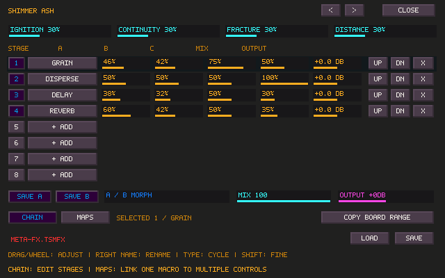
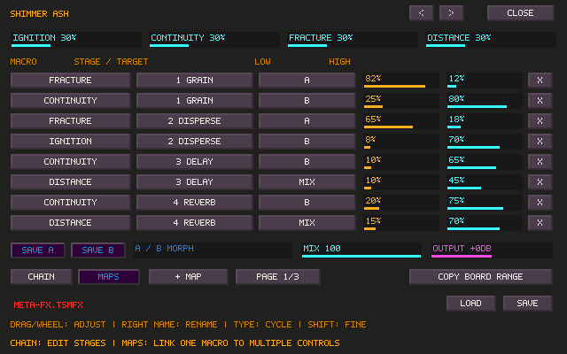

# Meta FX and texture processors

Meta FX is an independent F9 Matrix processor with an editable serial rack of
up to eight stages. Each stage uses TapeSister's existing DSP: Reverb, Delay,
Distortion, Transient, Grain or Filter, plus the new Dispersion and Resonator.
Duplicate stages have independent histories. There is no second audio engine.

Open **F9 → ADD EFFECT + → META FX**, patch a source into its column and patch
its output row to Main or another destination. Click **EDIT META FX** to open
the modeless editor. New Matrix effects start unpatched. Meta FX is available
as a Matrix insert/send in this version; the pedalboard itself still holds
individual processors. Parallel internal branches, nested racks, external
plugins and arbitrary internal feedback are later extensions.

## Playing and editing a rack

- The four named macro sliders can each control several internal parameters.
  Drag or wheel; Shift makes fine adjustments. Right-click a macro name or the
  rack name to rename it; Ctrl+A replaces the text and Enter finishes.
- CHAIN shows the eight ordered stages. Click a type to cycle; wheel it in
  either direction. An unused row adds a stage. The numbered button bypasses
  that stage, UP/DN reorder it, and X removes it. Parameters marked `*` follow
  a macro and show its target value; edit their ranges on MAPS.
- MAPS supports 24 assignments, on three pages. Select a chain stage first,
  then choose **+ MAP**. Click the macro, stage or target to cycle its binding;
  drag LOW/HIGH to set its range. LOW greater than HIGH reverses the response.
  One parameter has one macro owner. Filter assignments also expose its
  individual filter controls. Normalized mappings retain each processor's
  musical frequency/time scaling.
- **SAVE A / SAVE B** capture the four macro positions. Drag **A / B MORPH**
  between them. A manual macro edit continues from the displayed blend.
  These are macro states for one topology; they retain the existing audio
  histories. Mix and Output remain independent of the macro states.
- Ctrl+Shift+M enables MIDI learn. Click a macro, then move the controller.
  Saved MIDI targets use the rack's stable Matrix identity, so removing it
  never redirects the mapping to a new rack in the same row.
- Preset arrows cycle ten factory racks: Arc, Pale Cloud, Shimmer Ash, Iron
  Choir, Spring Dust, Glass Thread, Broken Halo, Slow Weather, Charcoal and
  Resonant Room. These are original TapeSister combinations. Shimmer Ash
  uses pitched grains; it is not an exact recreation of a SunVox patch.

**COPY BOARD RANGE** copies settings and order into the rack, leaving the
original board in place. Wheel the button to choose the first physical slot;
Shift+wheel chooses 1–8 slots. Click to copy; empty slots are skipped. The
copy becomes a serial chain, without the board's PRE/head/POST placements,
global gates or live buffer history. Patch the rack deliberately to avoid
processing through both the original board and the copy unintentionally.

Click the path field and enter a `.tsmfx` path, then SAVE or LOAD. Ctrl+A
replaces the path. Files contain the complete rack, mappings and macro states;
no external samples or SunVox installation are needed. Writes replace the
file atomically. Malformed or incomplete imports leave the current rack
unchanged. Project/config persistence and Matrix Undo/Redo include the rack.

## New building blocks

**DISPERSE** is eight cascaded stereo all-pass sections. FREQ moves their
center, Q increases the concentration of phase delay, and SPREAD separates
their tuning across the stages and stereo channels. At fixed settings and
100% wet, it changes phase and transient shape while preserving the magnitude
response. A dry/wet blend intentionally produces interference coloration.

The coefficient construction is adapted from SunVox's Filter Pro support
code (`psynth_dsp.cpp`, MIT). The eight-stage network is informed by the
bundled NR Dispersion patch. TapeSister supplies its own stereo spread,
controls, smoothing and integration. The source notice is preserved in
`third_party/sunvox/LICENSE` and `THIRD_PARTY_NOTICES.md`.

**RESONATOR** is six damped, fractional-delay combs excited by the input.
ROOT spans MIDI 36–84, including fractional notes. The relative tunings are
0, 7, 12, 19, 24 and 31 semitones: fifths and octaves that fit major or minor
material. DECAY controls feedback and DAMP darkens successive recirculations.
It is an original implementation informed by the tuned-delay construction of
SunVox's bundled TB Resonator/HarmVerb effects, not a measured emulation.

Both new processors are also available individually in the pedalboard and
Matrix. Existing processor, MIDI and routing IDs retain their saved meanings.

## Runtime and validation

Rack preparation and topology replacement allocate only the chosen child
processors on the control thread. The Matrix uses its existing 12 ms lifecycle
crossfade for changed topology; old nodes are reclaimed off the callback.
Macro target updates run at approximately 150 Hz and the processors retain
their own smoothing. A/B macro blends keep the same running processors.
The rack's ordinary bypass uses the Matrix effect's configured fade.

The pedalboard prepares resonator buffers at device setup, as it already does
for its delay/grain/reverb states, so live type cycling allocates nothing.
This adds approximately 3.4 MiB at 48 kHz across its reserved 20 slots and five
locations, plus small fixed dispersion states. Standalone Matrix nodes allocate
only their selected processor. Grouping effects does not remove their DSP cost.

`tapesister_meta_fx_tests` checks all-pass impulse energy, independent stereo
histories, resonant tails, exact dry bypass, nonfinite input, five sample rates,
all ten factory racks, deterministic grain seeds, exact serial-chain
equivalence, independent instances, interrupted macro-state editing,
portable/project round trips, invalid imports and lifecycle crossfades.
`tapesister_meta_fx_controller_tests` drives the real SDL editor, including
macros, state capture, preset cycling, mappings, file import/export, stage
changes, resizing, closure and stale IDs. Both are Linux/Windows PR gates.
Hardware listening and CPU headroom on the X220 still require evaluation.

