# Mosaic

Mosaic arranges sample events on a free canvas. Time runs downward. Horizontal
position and width organize the picture; they do not change timing or pan.
The arrangement is another input to TapeSister's existing global effects,
Sister Machine and output recorder.

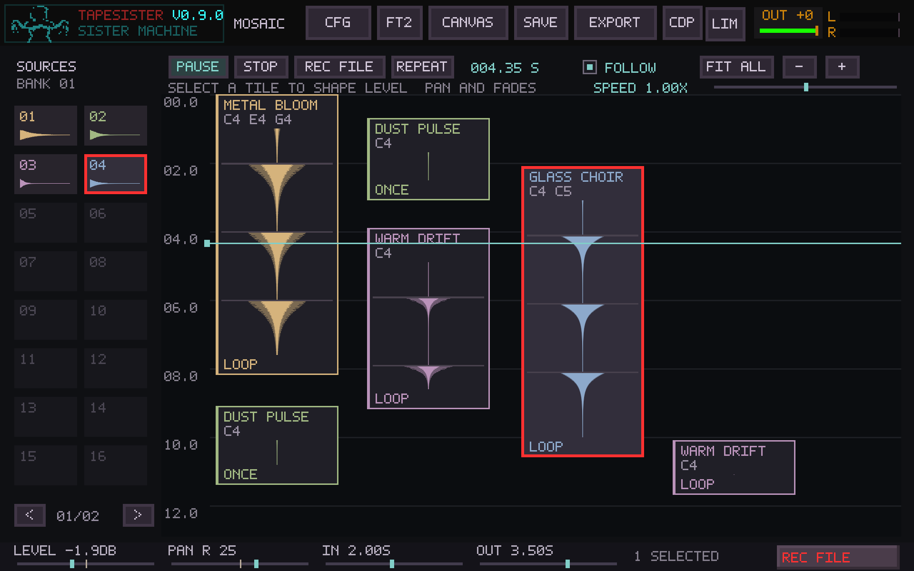

## Playing and arranging

Open **MOSAIC** in the main toolbar, or press **grave** (the backtick
key). The same shortcut returns to the main canvas or finishes editing an event;
**Ctrl+M** remains available. From Sister, the shortcut brings Mosaic forward,
even when it was already open behind Sister. From FM, it visits Mosaic and returns
to the same FM patch on the next press. **Shift+grave** opens FM directly from
Mosaic; pressing it again returns to Mosaic. **Tab** continues to visit Sister
without changing the open event, and **Escape** in Sister restores the main
application window. Escape from an event editor still returns to Mosaic.
**Ctrl+Shift+P** also reaches the Portal from these workspaces. Destination dialogs
retain keyboard focus until resolved.

Sources browses **all Sample banks**, including banks created in FM or the main
canvas. **BANK 01**, **BANK 02**, etc. retain their original slot numbers and empty
slots. The arrows underneath move through banks, then **EVENTS** pages containing
the audio versions used by placed events. Browsing sources does not switch the
main editor's active Sample bank or change routing. New banks appear on the next
refresh; returning from FM shows its active bank with the correct page number.

Drag an occupied source onto the canvas. Click a source to select it and clear the
timeline selection; dragging shows a ghost of the proposed event. **A** previews
the selected source without adding a card or moving the playhead; press **A** again
to stop. When a timeline instance is selected, its assigned notes and individual
settings take priority over the source highlight.

**Right-click a source** to select all of its placed instances, retaining the primary
when it belongs to that source. **Double-left-click a source** to open its main
canvas editor: bank sources open their actual Sample bank and tile; EVENTS sources
open the existing instance editor with its update-instance/update-all choices.
Modified clicks continue to select and drag source groups. An accepted audio edit appears in
the EVENTS pages. Shared originals and the original Sample banks remain available.

| Action | Gesture |
| --- | --- |
| Audition selected instance, otherwise selected source / stop preview | A |
| Open a source in the main canvas editor | Double-left-click source |
| Select every placed instance of a source | Right-click source |
| Fit selection / restore previous view | Z |
| Select all / select every instance of the current source | Ctrl+A / Shift+A |
| Nudge selection by 0.1 s / 1 s | Up/Down / Shift+Up/Down |
| Nudge selection horizontally by 1 / 10 units | Left/Right / Shift+Left/Right |
| Align starts / ends to primary | Alt+Up / Alt+Down (at least two cards) |
| Align every start / end to playhead | Alt+Left / Alt+Right |
| Add/remove a card in the selection | Shift-click |
| Cycle through overlapping cards | Alt-click |
| Enable or disable horizontal collision spacing | AUTO-SPACE; enabling requires confirmation |
| Tidy selected cards horizontally once | T |
| Scatter cards or copies with a preview | Ctrl+R |
| Select multiple sources | Shift-click; drag any selected source to add the row, or Ctrl+R for Scatter |
| Select / move an event | Click / drag its body |
| Extend the event's playback window | Drag its top edge earlier or bottom edge later |
| Change visual width | Drag its right edge |
| Shape one card's fade | Drag its IN handle down or OUT handle up |
| Pan one card | Drag the diamond on its pan line left/right; right-click centers |
| Align starts, ends or midpoints | Hold Alt while moving or extending |
| Edit the event | Double-click |
| Box-select a group | Shift+left-drag on empty canvas |
| Move a selected group | Drag any selected event body |
| Copy an event or selected group | Hold Shift when starting a drag on a tile |
| Cancel a move / copy drag | Escape |
| Mute / unmute selected events | M |
| Solo / unsolo selected events | S |
| Mute / solo every instance sharing the selected sources | Shift+M / Shift+S |
| Clear every solo, including offscreen events | CLEAR SOLO in footer |
| Set selection level, pan and fades | LEVEL / PAN / IN / OUT in footer |
| Global tape speed, 0.5×–2× | SPEED slider above canvas |
| Reset a mix or speed control | Right-click or double-click |
| Copy / paste at the playhead | Ctrl+C / Ctrl+V |
| Delete | Delete or Backspace |
| Undo / redo arrangement edits | Ctrl+Z / Ctrl+Shift+Z or Ctrl+Y |
| Play / pause | Space or PLAY/PAUSE |
| Stop and rewind | Escape or STOP |
| Select a time range | Shift-drag the vertical ruler in either direction |
| Adjust / clear the time range | Drag either ruler handle / right-click the highlighted range |
| Set range from selected cards | Shift+L |
| Toggle range or whole-arrangement looping | L or REPEAT |
| Enter exact start/end times | Double-click the ruler |
| Seek | Middle-click the canvas or click the time ruler |
| Scroll with playback | F or FOLLOW |
| Center the view on the playhead | H (does not seek) |
| Move the view earlier / later, with overlap | Page Up / Page Down |
| Pan the view freely | Middle-button drag; a click still seeks on release |
| Return to the beginning | Home |
| Scroll through time | Mouse wheel |
| Scroll horizontally | Shift+wheel |
| Zoom around the pointer | Ctrl+wheel |
| Fit the arrangement | Shift+Z or FIT ALL |
| Save / recall a view | Click one of the five numbered buttons beneath Sources |
| Replace / clear a saved view | Shift-click / middle-click its button |
| Record the final output | REC FILE or Ctrl+Shift+F |

The **first selected card is the primary**: its border uses the selection color
(red by default). Other selected cards use a lighter shade. Shift-click adds a
card; Shift-clicking an already selected card removes it. Removing the primary
promotes the earliest remaining selection. Clicking or dragging a selected member
keeps the primary; clicking an unselected card without Shift starts a new selection.
Shift-dragging an empty area adds a selection box while retaining the primary.
Shift-dragging a card still copies the group; the primary's copy becomes primary.
Rapid Shift-clicks and repeated Shift-drags stay in selection/copy mode; only an
unmodified double-click opens the event editor. Copies remain selected for the
next drag. If the whole group would exceed the 1,024-card arrangement limit, nothing
is copied or moved: the status line shows the required and available free slots.
Audition, Copy and single-card reference values use the primary.

**Left/Right** nudges the whole selection horizontally by one layout unit;
**Shift+Left/Right** uses ten. These are independent of zoom and support key repeat.
Relative positions stay fixed, and the group stops at the left edge. AUTO-SPACE
applies as it does for other group moves.

**Alt+Up/Down** aligns every selected start/end to the primary's start/end, keeping
card durations. With fewer than two cards, a **SELECT MORE THAN ONE CARD** dialog
appears and no edit is made. Enter, Escape, Space or OK dismisses it.
**Alt+Left/Right** aligns every selected start/end to the current playhead, including
a single card. If any new start would be before zero or beyond 24 hours, nothing
moves. With AUTO-SPACE on, secondary cards can move horizontally to avoid collisions;
the primary and unselected cards stay in place. Each nudge/alignment is undoable.

In **Sources**, click the first source, then Shift-click more in the desired order.
Drag any selected source into the canvas: the row starts at the drop position,
with all tops aligned, ordered left to right by source selection. All new cards
are selected, and the first source becomes primary. AUTO-SPACE shifts the row
horizontally if needed. The whole drop is one undo step; insufficient room adds
nothing. Source selection is then cleared, so **Ctrl+R** works on the new canvas
selection. Ctrl-click remains available for selecting sources for Scatter.
Identical sounds in different source cards remain separately selectable.

Time-range and Scatter number fields show a **blinking cursor** while editing.

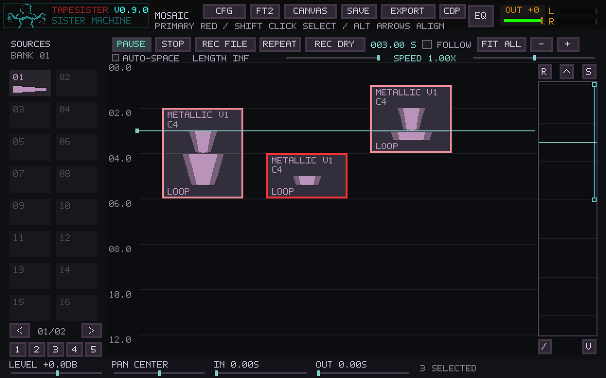

Navigation changes the view while playback and card selection continue. **Shift+Z**
fits the whole arrangement, framing the cards' horizontal bounds instead of empty
space before them; **Z** fits the selection and returns on the next press.
Dragging selected cards into either horizontal canvas edge scrolls the view while
you hold there. Scrolling speeds up nearer the edge and works for Shift-drag copies.
The group keeps its spacing; the entire drag remains one undo step. Release stops
scrolling, and Escape cancels the move. The left edge stops at the layout origin.
**Ctrl+S** and the header **SAVE** button show the save browser or overwrite dialog
over Mosaic. Saving or cancelling keeps the workspace, zoom, scroll and selection.
**H** centers the playhead in the view. **Page Up/Down** move by about 90% of a
screen, leaving some overlap for orientation. Holding a page key repeats the move.
Fit, page navigation, panning, and recalling a saved view turn FOLLOW off so the
view stays where you put it; **F** resumes following. A middle press only seeks
when released without dragging. Escape or loss of window focus cancels the press.

The five numbered buttons beneath Sources store the horizontal and time positions
and both zoom levels. Click an empty button to save, click a stored one to recall,
Shift-click to replace, or middle-click to clear. A small underline marks a stored
view and the matching view is highlighted. Views save with the project; older
projects open with five empty slots. Capturing or clearing a view marks the project
modified, but browsing/recalling does not. Saved views are independent of arrangement
undo/redo and do not store the playback position, selection, or FOLLOW setting.

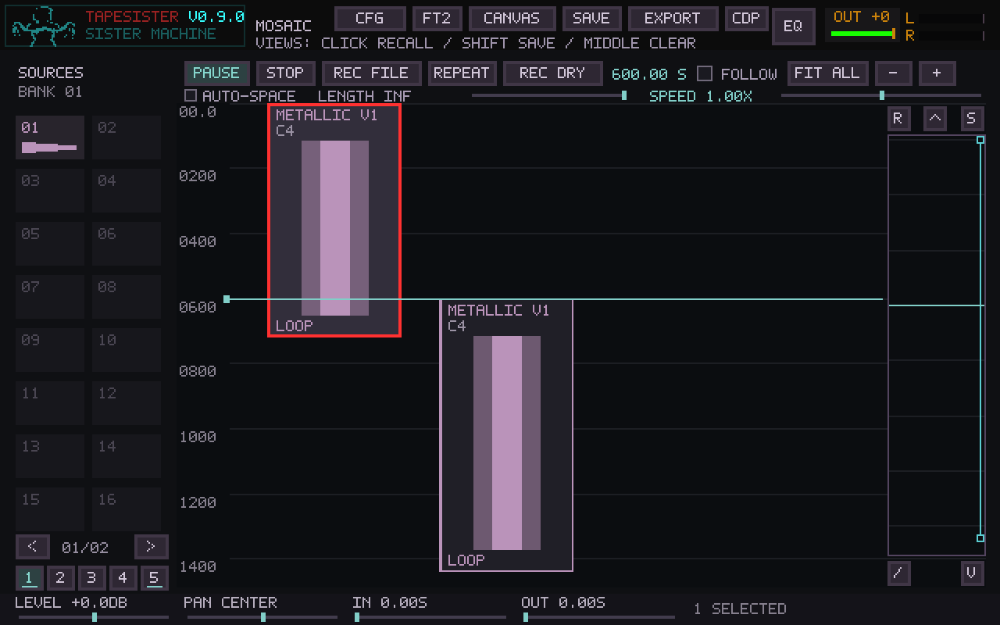

**Resize selected cards together:** grab the top or bottom edge of any selected
card. Normal dragging adds or subtracts the same duration from every selected
card, preserving their length differences. The bottom edge keeps each start
fixed; the top edge keeps each end fixed. The entire group stops at the first
card's minimum duration, maximum duration, or timeline-start limit.

Hold **Alt** during a group resize to make every selected card match the grabbed
card's current length. That grabbed card is the parent for this gesture, even
when another card was selected first. Alt can be pressed or released while the
pointer stays still: releasing it returns to relative length changes calculated
from the opening geometry. On top-edge drags, the shared length is bounded so no
card starts before zero. The status line shows the duration change or matched
length in seconds.

Each completed group resize is one Undo step. Escape restores the opening
geometry and keeps the group selected; focus loss or a dialog ends the gesture.
Shift-drag still copies the group, including when it starts on an edge. Fade and
pan handles still edit only their own card. AUTO-SPACE shifts the group together
against outside cards, preserving its horizontal spacing. Audio and pattern
cards use the same operation; loop/one-shot behavior, source material, mix and
routing settings are retained. Bottom-edge edits preserve running playheads.

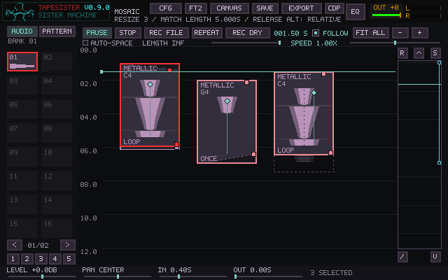

New arrangements start with **AUTO-SPACE off**, allowing cards to overlap visually.
**Alt-click** cycles through cards at the pointer and brings the selected one forward.
Older projects retain automatic spacing; the preference is stored with the arrangement.
Enabling AUTO-SPACE asks for confirmation before separating cards horizontally.
Start times and durations are preserved, and one Undo restores the layout and preference.
**T** tidies only the selection without enabling ongoing spacing. With AUTO-SPACE on,
a small invisible gutter separates intersecting cards. Group moves preserve relative
times and positions, shifting the whole group sideways when necessary. Shift-dragging a
tile duplicates the selection, keeping its relative timing, spacing and playback
settings. The originals stay in place. A click without movement creates no copies;
one Undo removes the copied group. If there is not enough capacity for the whole
group, nothing is copied. Hold Alt **after starting** a drag for optional time alignment
during a move or single-card resize. A dashed waveform
ghost marks the original position while moving. Events may meet exactly end to end. There are no tracks,
beats or mandatory snapping. Click an unselected event to return to a single
selection. Selected tiles and Sources previews use the bright red highlight color by default. Muted events and events excluded by
solo are dim; MUTE/SOLO appears on the relevant cards, and excluded cards say
SOLO OUT (EXCL on narrow cards). CLEAR SOLO stays visible in the footer whenever any event is soloed,
including events outside the viewport. Shift+M / Shift+S target all cards using
the selected cards' shared audio sources, including offscreen cards. A separately
edited source is independent. Each action is one undo step. Multiple events may be
soloed together. Mute takes precedence over solo. These switches use a short
fade, and all voice clocks continue while inaudible, so unmuting resumes their
current phases. Delete applies to the selection; copy/paste uses the last
clicked event. FOLLOW keeps the playhead in view while playing and suspends
scrolling during a drag.

Each event supports one to five notes. A C5 voice traverses the source twice as
fast as C4; C3 takes twice as long. Every voice keeps its own phase. Extending
a looping event increases its available repetitions without restarting its
voices or changing their pitch. The waveform drawing shows source repetitions
at the C4 reference rate; chord voices can cross those visual divisions at
different times. Event and source waveforms render at the window's actual pixel
resolution, with antialiased edges, while the surrounding pixel UI stays familiar.
The brighter body shows typical energy and the outer envelope preserves peaks.
Waveform detail follows fixed sample intervals attached to the event. Scrolling
moves each complete tile—waveform, labels, borders and repeat dividers—together
in single physical-pixel steps. The tile keeps its height and waveform shape;
header and footer spacing stays attached as it crosses the canvas edges.
Tiles that meet end to end share the same drawn boundary. The time ruler and its
labels scroll with the grid, keeping their alignment with the tiles.
Overview drawing reuses cached 2,048-bin peak/RMS envelopes; close zoom reads
actual sample ranges instead of enlarging those bins. Source thumbnails cache
extrema at their displayed width. None of this analysis runs in the audio callback.

## Loop a passage

**Shift-drag the vertical time ruler** to select a passage. Drag either end handle
to refine it; the status line shows start, end and duration in seconds. Card selection
is independent. **Shift+L** sets the range to the earliest start and latest end of
selected cards, including gaps between them. Press **L** or **REPEAT** to loop it.
Selecting a range does not start playback or enable Repeat; **Space** plays/pauses.

**Double-click the ruler** to enter exact start/end times in seconds. Tab switches
fields, Ctrl+A clears the current field for replacement, Enter applies, and Escape
cancels. A range must be at least 0.001 seconds long, within 0–1,000,000 seconds.
The dialog also shows its duration. Drag previews do not affect playback until
release; Escape or loss of window focus cancels a drag. FOLLOW pauses during dragging.

**Right-click the highlighted ruler range** to clear it. Repeat then uses the whole
arrangement again. Toggling Repeat off keeps the range for later. Range edits,
clearing and Repeat changes support Ctrl+Z/Ctrl+Y. The range and Repeat setting save
with the project; earlier project formats open with no time range.

With range Repeat on, playback stays within that range, including any selected
silence after the last card. Starting outside it begins at the range start.
Crossing cards resume at the correct elapsed source position on each wrap, with
short audio smoothing on the Mosaic bus and custom routes. The volume envelope
keeps its position relative to the entire arrangement; it is not stretched to the
loop selection. STOP/Escape still stop and rewind to zero without clearing the range.

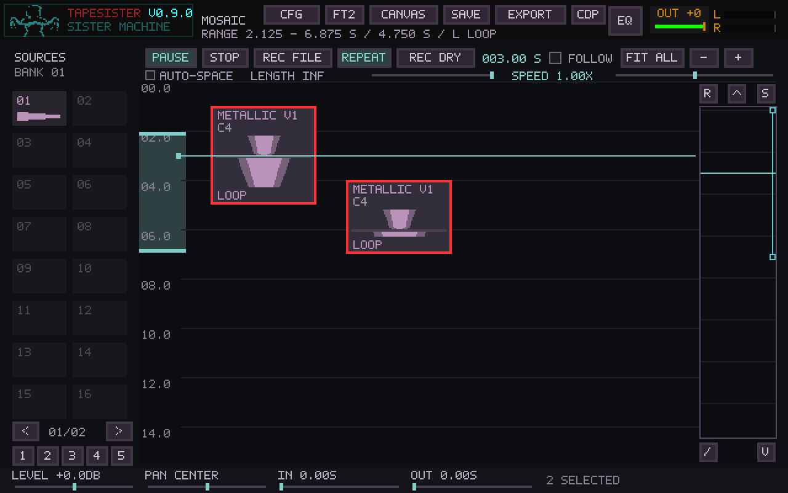

## Arrangement volume envelope

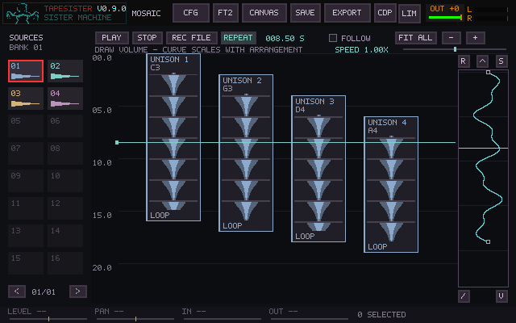

The narrow lane at the right follows the arrangement timeline vertically.
**Left-click and drag** to draw volume: left is silence, right is full level.
The curve has its own border, with every tool button outside it. Small square
handles mark the start and end when visible; drag sideways at either endpoint
to set its exact level. **FIT ALL** reveals both endpoints. The lane fits the
same visible time range into its smaller drawing area and has its own time
guides and playhead marker, keeping the curve clear of the buttons.
The envelope is multiplied with event levels and fades before Mosaic enters its
normal effects/recording route. Live curve changes receive a short gain slew.

The curve is stored from 0–100% of the entire arrangement. Moving or resizing
its last event stretches or shrinks the envelope with the new total duration.
Scrolling and zooming only change the view. Follow temporarily pauses while
painting so the timeline does not move under the stroke.

| Control | Action |
| --- | --- |
| R, top left | Reset to full level |
| S, top right | Smooth the curve, keeping its endpoints |
| Top arrow | Make the beginning match the end |
| V, bottom right | Make the end match the beginning |
| /, bottom left | Draw a straight ramp between the endpoint levels |

**REPEAT** links the endpoint levels. Enabling it initially matches the end to
the beginning; drawing either endpoint then moves both. This prevents a gain
jump caused by the envelope at wraparound. Audio content still needs its normal
loop fades/crossfades. With Repeat on, a straight ramp between the equal endpoints
is flat; turn Repeat off to draw an unequal start-to-end ramp.
The status message explains when Repeat already links the endpoints or a ramp
is flat because the endpoint levels are equal.

Each stroke or tool action is one undo step. **Escape** cancels a stroke, and
Ctrl+Z / Ctrl+Y undo and redo it. The curve was introduced in Mosaic format 4; current saves use format 12; older
arrangements open with a flat, full-level envelope. Failed loads leave the current
arrangement intact.

## EQ and coordinated transport

Double-click a card and use **EQ** beside the waveform display control. Its curve
and pre-EQ audio remain editable through save/load. Returning to Mosaic uses the
usual Update Instance / Update All / Create Tile decision. See [Canvas EQ](CANVAS_EQ.md).

[Performance Transport](PERFORMANCE_TRANSPORT.md), opened from CFG or
F11 or Ctrl+Shift+Space, groups ARP, SisterTracker and Mosaic under Shift+Space. Ordinary
Space remains local. This shares start/stop without changing tempo or tape speed.

## Performance controls

Each card has two small fade handles near its right edge: **IN** starts at the top,
**OUT** at the bottom. Drag IN downward to lengthen the fade-in, or OUT upward to
lengthen the fade-out. The diagonal line and darkened wedge show the linear gain
envelope immediately; more shading means more attenuation at that point in time.
The handles stop where the two fades meet. The status bar shows the fade in seconds.
Right-click or double-click a handle to remove that fade; Escape cancels a drag.
Each drag edits only that card and is one undo step. Handles appear when the card
is large enough to grab; zoom in on small cards. The shaded envelope remains visible
when zoomed out, and existing footer edits update it too.

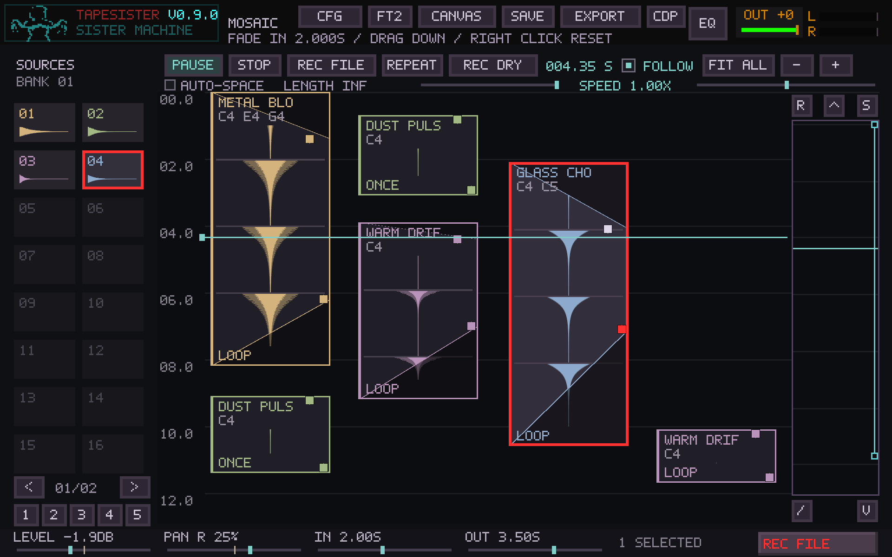

Cards also show a **pan line** and a faint dotted **center reference** through the
waveform. Drag the small diamond just below the card's name/notes left or right to
balance that card. The line follows the setting, with a small center snap and
**CENTER**, **L %** or **R %** feedback in the status bar. Right-click or double-click
the diamond centers it; Escape restores the opening value. A drag is one undo step
and keeps live playback running. The rest of the waveform remains available for
moving the card, and fade handles retain priority where controls meet. Zoom in if
the card is too small for the pan grip. Footer PAN edits update the lines too.

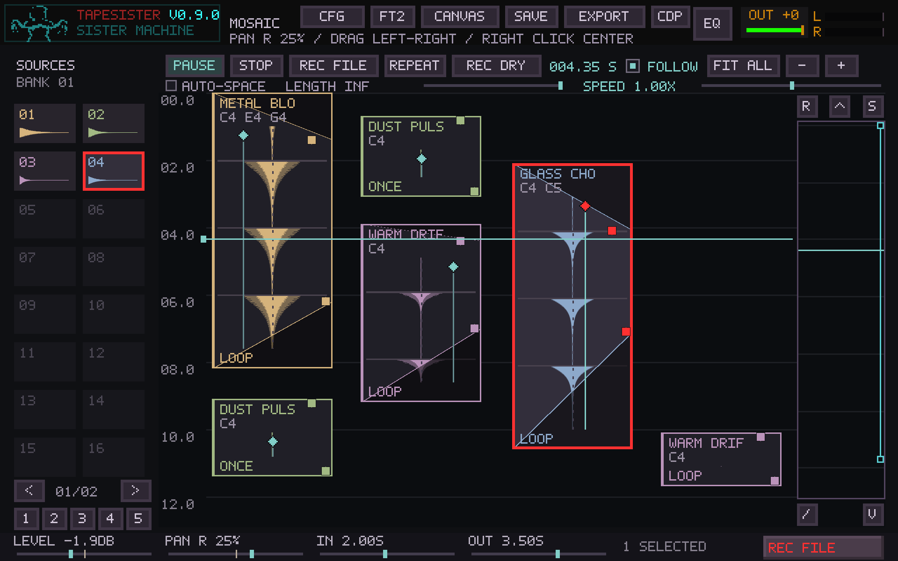

Select an event, then use **LEVEL**, **PAN**, **IN** and **OUT** in the footer.
A selected group receives the same adjustment in one undoable gesture. These controls
shape the event's playback without changing its source audio or restarting its voices.
LEVEL runs from silence to +6 dB (center = 0 dB). PAN is a stereo balance: center
preserves both original channels, and moving to either side attenuates the opposite
channel without summing it into the other. Mono samples can also be positioned this way.
IN and OUT set linear fade times in arrangement seconds, from zero to the selected
event's duration. For a group, each fade is capped at that member's duration. Fades
that overlap after editing or shortening a tile scale proportionally to fit its length.

**SPEED** above the canvas is global tape speed: left = **0.5× / one octave down**,
center = **1× / C4 reference**, right = **2× / one octave up**. Movement is continuous
and smoothed; the playhead, starts, durations, fades and every note's source phase
advance together. Chord intervals and relative event placement stay intact. It affects
Mosaic before the shared effects, so pedalboard delays and reverbs retain their own
settings. A stopped arrangement uses the selected rate when playback starts.

Drag a control, or wheel over it for increments. Speed wheel steps are one semitone;
LEVEL steps are 1 dB, PAN steps are 5%, and fade steps are 0.1 second. **Shift+wheel**
uses one-tenth steps. **Right-click or double-click** resets to unity level, center pan,
zero fade or 1× speed. **Escape during a drag** restores its initial setting; Undo/Redo
also includes these controls. The saved project includes level, pan, fades and speed;
older projects start with center pan, zero fades and 1× speed. Projects saved with
these controls use Mosaic format 3 and need this version or newer to reopen.

## Mosaic colors

**CFG → PALETTE** has a compact **MOSAIC** swatch strip: **HILITE** and **1–5**.
Click one, then use the existing RGB sliders or Tapehead eyedropper to change it.
PgUp/PgDn cycles through the main colors and these six Mosaic entries. The five
source colors consistently color waveforms and tile borders; the highlight color
is separate and defaults to bright red. **Save Shared** keeps all six colors in
`palette.pal`; **Cancel** restores the palette from before editing. Older palettes
that omit these keys use the default Mosaic colors.

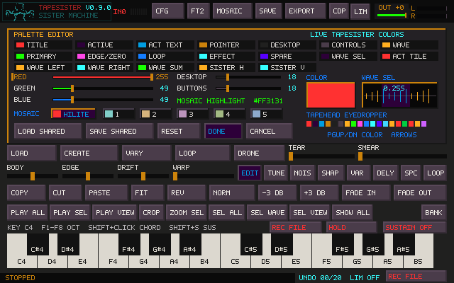

## Editing one event

Double-click opens the familiar main editor for that event. Click the onscreen
keyboard to add/remove persistent chord notes, up to five. One note remains
selected. The **EVENT LOOP / EVENT ONCE** button above the keyboard sets playback
mode. Existing loop handles choose the source region, direction and crossfade.
If no loop is defined, selection or the whole source supplies the region.

A one-shot voice ends after one traversal or at the event's bottom, whichever
comes first. A longer one-shot rectangle therefore reserves time without
retriggering the sound. Each note can finish at a different time.

**MOSAIC** returns to the arrangement. Event voices keep playing while the main
editor, CDP Portal or Sister window is open. Sample editing uses the event's
own document. Copies share source audio; on leaving, choose whether the edited
sound belongs to this instance, all instances using that source, or a new card.
Already-playing QWERTY/MIDI notes, HOLD chords and launched layers also survive
opening and leaving an editor, whether the card matches the selected tile or
uses another sound. They retain their original source while you edit and still
respond to their usual release/stop controls.
Make as many drawing or processing edits as you like, including Warp, Smear
and CDP. The working waveform stays in this event's editor. The destination
prompt appears **once when returning to Mosaic**, only if its audio has changed:

- **CREATE TILE** (Enter or N) keeps the original event and places a new event
  beside it with all the accumulated audio edits. It also places a reusable snapshot
  into a free regular Sample-bank tile, adding a bank if needed. The arrangement
  scrolls to reveal the new event and Sources highlights its bank tile; the status
  names the bank and slot. The main editor's previous selection stays intact.
- **UPDATE INSTANCE** (U) replaces this card's audio without adding another card.
  It creates a reusable source in a free regular Sample-bank tile, adding a bank
  if needed. Other cards and the original source retain their sound.
- **UPDATE ALL** (A) replaces every card using the same source and updates its
  matching Sample-bank tiles in place, across all bank pages. The dialog shows
  the number of affected cards. Notes, timing, loop mode, tuning, level, pan and
  fades stay individual; source regions scale proportionally if the new audio
  length changes. The edited card takes its working region/tuning. Custom names
  on other cards remain intact. A legacy source without a regular bank tile gets
  one. A locked matching bank tile prevents the update before anything changes.
- **CANCEL EDIT** (C) discards the pending audio result and returns to Mosaic.
  The card keeps its published sound; no card or Sample-bank tile is created.
  Immediate per-event changes already applied, such as chord notes, remain.
  This also cancels a save/open/quit action that was waiting on the decision.
- **KEEP EDITING** (Escape) closes the question and retains all working edits.

CREATE TILE and UPDATE INSTANCE use free bank slots. Arrangement Undo restores
the cards together; published Sample-bank sounds remain available, including
the source replaced by UPDATE ALL. Bank publication is not part of arrangement Undo.
If a new bank snapshot cannot be stored, the working edit stays open for another choice.

Undoing all audio edits removes the question. Opening an event and leaving it
unchanged never prompts. Loop/one-shot and chord switches remain immediate
per-event properties; audio-dependent bounds travel with the working audio.
Mosaic keeps playing its existing immutable sources while the working audio
can be auditioned in the editor. Originals and sibling events retain their
samples until a destination is chosen. Allocations and cleanup stay outside the
audio callback. Saving, opening a project or closing the main window waits for
this decision and then continues the requested action.

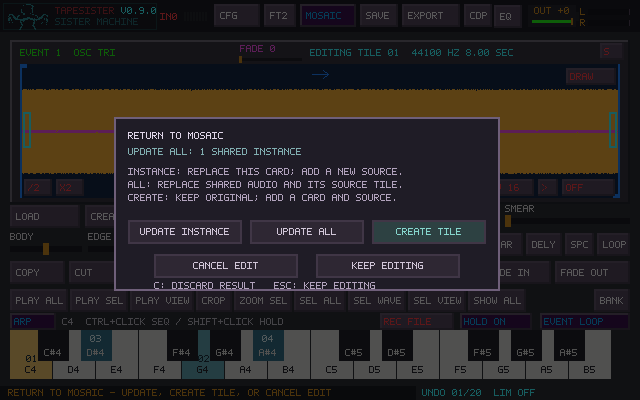

Live distortion, reverb and other effects remain shared processors. In matrix
mode cards feed the **Mosaic bus**, which defaults to Main. **F9** opens the
[routing matrix](ROUTING_MATRIX.md) without stopping the arrangement. Patch the
bus into Sister or shared effects, or use the Mosaic filter to give individual
cards custom destinations. A custom card route replaces its bus feed. Mosaic
does not inherit the routing of the bank tile from which a card was created. Dry
sound needs its own connection. Sister source switches do not select matrix input.
MASTER FX gates Pedalboard/Fallout; it does not create a dry connection where
none exists. Settings, transitions and modulation are retained.

Legacy projects retain the older TILES/serial path until converted: with Sister
on, Mosaic belongs to TILES; with Sister off, it enters the ordinary shared path.
The retained source switches and serial order apply only to that legacy engine.

REC DRY stays upstream of live processing. REC OUT/REC FILE capture the matrix's
OUT 1/2 program, before the final hardware guard, rather than summing every
separate physical output/send. Audio already printed to Sister's tape keeps its
recorded processing.

Workspace switching and audition stop leave Mosaic playback running. The toolbar
MOSAIC button stays highlighted while it plays, and stopping an audition reports
**AUDITION STOPPED - MOSAIC CONTINUES**. Stop the arrangement with its STOP control
or Escape in Mosaic; unprocessed sound remains audible where a dry route is connected.

## CDP ownership

An event render remembers its requesting event ID, project generation, source
revision and source audio snapshot. Closing the Portal or selecting another
event does not cancel that event's worker. Quick-apply returns to the requesting
event; ordinary previews stay available for explicit Apply. Reopening the Portal
shows the retained result and its event label. RELOAD takes a new snapshot of
the currently edited event after the running job finishes.

If the requesting event was edited, deleted or belongs to a previous project,
Apply retains the preview and reports the conflict. It cannot replace whichever
event happens to be on screen. Apply into the currently open event joins its
working edits and uses the same exit-time destination question. A result returning
to a parked event updates that owner directly. Publishing the exact worker input
on exit does not invalidate the job. Creating a new variation retains the original
event document for any job it already requested; incompatible results remain
available for review instead of overwriting another event.
The older Transform workbench must finish its worker before leaving the event.

## Recording and projects

The recording button beside REPEAT defaults to **REC DRY**. Right-click it while
idle to cycle **REC DRY → REC OUT → REC EXT**; the button identifies
the selected source. These choices are independent of REC BANK's source selector.

| Mode | Audio recorded into the new card | Start/stop behavior |
| --- | --- | --- |
| **REC DRY** | Live QWERTY/MIDI instrument: sample voices, selected-source chords, FM, and preview keyboard voices, before Prism, Sister tape, and global effects | Starts immediately; click STOP TILE to keep |
| **REC OUT** | Final stereo output, identical to REC FILE's OUT signal: all audible sources, Prism, Sister/FX, limiter, and OUT fader | Starts immediately; click STOP TILE to keep |
| **REC EXT** | Configured recording input device/channel, preserving its sample rate and mono/stereo format | Starts immediately; uses the independent Mosaic length/silence settings |

All three Mosaic modes start immediately and retain leading silence and gaps
between notes. DRY and OUT require no external input device and preserve stereo.
**LENGTH**, beneath the transport, is independent of `record_max_seconds` and
`capture_max_seconds`; those ordinary tile defaults remain 20 seconds.

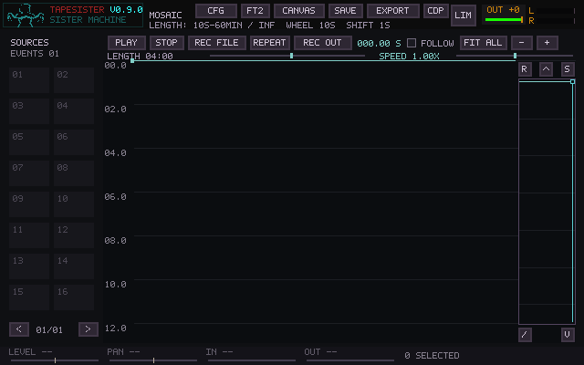

- Drag LENGTH from **10 seconds to 60 minutes**, then **INF** at the right end.
- Wheel changes by ten seconds; Shift-wheel changes by one second. Right-click
  restores INF. The selected length persists in `mosaic_record_seconds`.
- Finite lengths stop exactly at that many recorded frames, including silence,
  for repeatable cards. Length is locked during a take. STOP TILE still keeps a
  shorter take.
- **INF** is the default: no programmed duration cap. After **120 continuous
  seconds below −60 dBFS**, the take automatically stops and is kept. Either
  recorded channel reaching the threshold resets the full countdown. This also
  handles an unattended recording that starts in silence. The quiet tail is
  retained, allowing later trimming.
- INI `[Mosaic Recording]`: `mosaic_silence_seconds=120` (0 disables, maximum
  3600) and `mosaic_silence_db=-60` (−90..0). Lower the threshold for exceptionally
  quiet drones. The silence timer applies only to INF, preserving finite lengths.

Press Escape in the idle arrangement during a take to discard it. Active
gestures keep first claim on Escape. Stopping arrangement playback does not stop
recording. REC BANK retains its separate threshold/preroll/tail behavior, and
REC FILE remains the separate performance-file recorder.

Mosaic writes a float WAV (RF64 when needed) in `Captures/` from the start, using
a bounded two-second queue and a background writer. There is no whole-take
allocation or disk I/O in the audio callback. Disk/queue failure stops the take,
reports the interruption and preserves the contiguous recorded prefix when
possible. Finishing loads the sound into a card and independent Sample tile;
very long takes still need memory for those editable copies. If publication
fails, the WAV remains available. Cancel removes the discarded take's WAV;
normal application exit closes and retains an unfinished WAV for recovery.
Losing the EXT input device stops and keeps the recorded prefix.
The existing editable project WAV format still has its RIFF size limit; the
RF64 recording archive remains available even when a take is too large to save
as an editable project source.

An outlined recording card appears immediately in the canvas, with the source
name and elapsed time. It grows down the timeline and builds a live waveform as
audio arrives; silence remains visible as a flat line. **STOP TILE** and the card
border pulse red while recording, with the stop label readable in both phases.
With **FOLLOW** on,
the canvas follows the growing take even when arrangement playback is stopped.
Turn FOLLOW off to inspect an earlier part of the take. The preview retains the
observed waveform at overview resolution (a UI stall can leave a visual gap,
without interrupting the recording), including stereo signals whose channels have
opposite polarity. It disappears on cancellation and becomes a regular editable
card when the take finishes. The preview itself never plays audio or enters the
saved project.

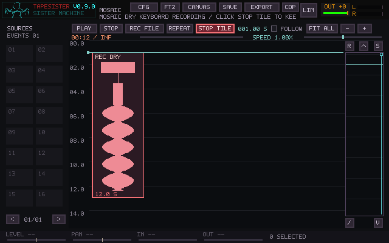

REC DRY excludes arrangement playback, transport audition, tile launchers, and
external input; it follows the live keyboard instrument. FM's own output level is
part of that instrument signal. To print Prism or other effects, choose REC OUT.

**To bounce Mosaic**, choose REC OUT, start recording and play the arrangement,
then click STOP TILE. The completed take becomes a new card only after recording
has finished, so it cannot contribute to its own take. Existing cards remain
intact; mute or stop those sources when you want to audition the bounce on its own.
REC OUT can also combine the arrangement with a live keyboard performance.

The recording button and REC BANK share one recorder; finish or cancel one take
before starting another. Existing sounds and the selected editor remain intact.

The finished take becomes a one-shot card at the playhead position where you
started/armed recording, placed in a free horizontal space near the visible canvas.
It is available on the EVENTS source pages and can be edited, looped, copied,
and undone/redone like other cards. **The same take also becomes an ordinary tile
on the main UI Sample pages**, so you can select it in the waveform editor, process
it, play it or export it with the usual WAV controls. The completion status gives
the Sample page and tile number. Recording uses a free unlocked, unselected slot;
if every page is full, it adds a Sample page. This also works while an event editor
has the main bank parked. Editing this independent Sample tile does not alter
the recorded card, and undoing the card does not remove the Sample tile. Both
the card and Sample tile persist in projects. Recording can continue across workspaces;
return to Mosaic to stop or cancel it. Existing cards and playback keep running.
If an event editor is open at completion, its document and selection remain active.
Every completed take also uses the existing timestamped WAV archive. If the scene
changed or filled during recording, the WAV is archived without inserting into a
different scene or overwriting a card; import the archived WAV when ready.

The header and footer **REC FILE** buttons, or `Ctrl+Shift+F` in the main window,
operate the same recorder. It writes the final stereo OUT signal, including global effects and
master output controls, through the existing asynchronous WAV recorder. It
continues across editor/window navigation. STOP REC finishes the file without
stopping Mosaic, allowing effects tails to be recorded deliberately. Completed
takes use the existing timestamped `Captures/` archive.

SAVE stores event positions, durations, notes, source regions, loop modes,
names, level/pan/fades, mute/solo flags, global speed, volume envelope and arrangement repeat setting in the project transaction. Shared audio
versions are written once each as lossless 32-bit float WAVs under
`project-data/`. Earlier Mosaic projects load with events unmuted and unsoloed; projects from
before Mosaic open with an empty arrangement. A project marked as
containing Mosaic fails to load if its arrangement file is missing, preserving
the current session. Transport position and editor/arrangement undo history
are session state.

Capacity is 1,024 cards, with up to five notes per card. Copies share their source
audio. The playback schedule is prepared once per audio buffer, then visits active
cards and upcoming starts. Total arrangement length/card count and simultaneous
playback load are separate: dense overlaps and effects still use more CPU.
Ordinary sample interiors and settled per-card routes to the Mosaic bus use
shorter playback paths; loop splices and route changes retain their smoothing.
Scatter can still leave many cards sounding together. Performance validation
includes staggered cards with Matrix routing enabled, as well as aligned rows.
F12 Audio Health reports total cards, cards at the running playhead, and their
assigned note count. The latter includes muted cards and finished one-shots;
it describes scheduled work rather than detected sound.

Undo retains 32 steps in a circular history, avoiding a full-history shift when
it fills. Source-browser lookup and source cleanup also scale with larger projects.
Group drags and arrow nudges calculate snapping/spacing before taking the audio
lock, then publish the finished placement together. Copy drags skip redundant
per-card spacing. Project opening decodes banks and Mosaic sources before locking
audio and frees retired samples afterwards; publication resets transport/history
without copying the unused undo backing store. File/manifest preparation failures
leave the current project intact. Runtime/effect setup still needs a locked step.
Existing Mosaic formats (1–12) remain readable; the saved format stays at 12.
Older builds capped at 128 cards cannot load projects containing more than 128.
Wide Auto-Space layouts also require a build with the expanded horizontal range;
earlier loaders reject cards past position 100,000. Current builds preserve those
positions when opening the original project, with no repair or resave needed.
See [performance validation](validation/mosaic-scheduling.md) for benchmark scope
and regression coverage.

## Performance update acceptance

- Smear an event and choose CREATE TILE with enough overlapping cards to fill the view.
  Confirm the new waveform is revealed, selected and present in the regular Sample
  banks. Save/reopen and audition the bank tile and event.
- Solo a card and scroll it offscreen. Check CLEAR SOLO and the other cards' SOLO OUT
  labels; clear solo and confirm deliberate mute switches remain intact.
- Move SPEED during a long chord. Check both octave endpoints, continuous phase,
  pause/resume, repeat, and reset to center. Record a take while moving the control.
- Shape a group with level, pan and fades. Check undo, reset, stereo separation and
  save/reopen. Existing projects should play as they did before these controls.

## First build acceptance

- Place two copies of one fragment with overlapping times. Move and extend them;
  confirm that spacing changes do not move their start times unintentionally.
- On a long loop choose C4, E4 and C5. Listen for independent repeating gestures;
  extend the event while it plays and check that the phases continue.
- Open a copy, set EVENT ONCE and make audio edits. Try CREATE TILE, UPDATE INSTANCE,
  UPDATE ALL, CANCEL EDIT and KEEP EDITING separately; verify the stated card/source scope and
  that UPDATE ALL preserves each card's timing, notes and mix settings.
- Play a held chord, open both a matching and a different card, edit audio and
  cancel back to Mosaic. Check that the chord keeps playing its original sound,
  HOLD remains armed, and Cancel Edit creates no card or bank tile.
- Create a new full bank from FM while the welcome sample remains on the first
  bank. Browse both banks in Mosaic and place a sample from each; confirm that
  the main editor stays on its original active bank.
- Change HILITE and the five Mosaic swatches through RGB and the Tapehead
  eyedropper. Save Shared, reopen and check the colors.
- Enlarge the window and check smooth event/source waveforms, clipping and playhead visibility.
- Left-click CREATE for FM; right-click repeatedly for CDP variations of the same
  source; middle-click during and after rendering to restore that source.
- Start a CDP render, return to Mosaic and open the other event. Confirm that
  the completed result belongs to its requesting event.
- Record while using the editor and Sister/pedalboard. Stop the file recording,
  then audition the saved WAV.
- Save, close and reopen a project. Check event geometry, chords, loops and
  edited source versions before using the build for a longer composition.

## Interaction update acceptance

- Click a source, drag it onto the canvas, and check its highlight and placement
  ghost. Edit one of two shared events and check the separate source previews.
- Shift-drag a box around two events. Shift-drag the selection to copy it, then Undo. Move the pair against another event and
  confirm their relative gaps/times stay intact. Undo the group move.
- Toggle M and S while playing pitched loops; confirm the dimming and smooth
  return at the continuing phase. Save/reopen to check mute/solo state.
- Middle-click inside a tile to seek. Enable FOLLOW and play beyond the visible
  canvas; disable it to scroll freely.
- Adjust the pedalboard, start a long effect transition, and toggle Sister
  power. Check that settings and transitions survive. Use Fallout with Sister
  off, including its power switch, modulation and feedback.

Automated coverage lives in `test_mosaic.c` and `test_mosaic_controller.c`:
independent clocks, 24 seek combinations, one-shots, resizing, source sharing,
undo/redo, geometry, project transactions, background native CDP completion,
and sample-for-sample output WAV capture. Set `TS_TEST_CDP_BIN` to the bundled
`cdp/bin` directory for the native CDP checks. Hardware listening and interaction
on the target machine remain part of acceptance.

## External Insert and recording

The Router's INSERT stage processes Mosaic through its actual position in the
serial chain. **REC OUT** / output bounce and **FILE OUT** capture the returned
audio and remaining processing in real time. Keep the external processor running
during the take. REC DRY, SYNTH and raw EXT retain their earlier source taps.
Missing RETURN stays silent while INSERT is active; use Router BYPASS to return
to internal processing. [Setup and channel limits](USER_MANUAL.md#external-insert).

In the Matrix **Mosaic** filter, select cards and click **To Mosaic Bus** at the
bottom right to remove custom routes. The bus appears alongside the cards.
For quieter QWERTY soloing over the arrangement, open **F11** and lower **Live Tiles**.
Cards reference audio copies in the arrangement, so that live trim leaves the
backing intact.

## Audition, selection and Scatter

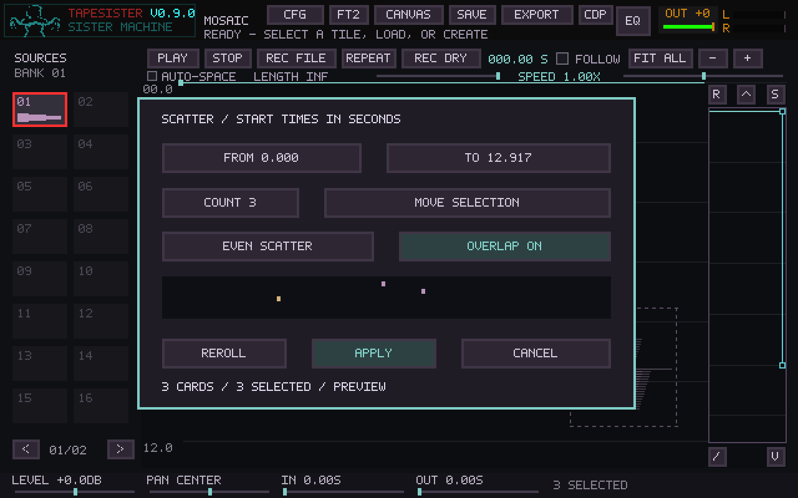

**A** auditions the last-selected card from its beginning, at its assigned note or chord,
through its existing output route. Loop settings, pitch, gain, pan and fades are retained;
arrangement mute/solo flags are bypassed for the preview. The arrangement playhead and
play/pause state stay unchanged. Press A again, STOP, or Escape to end the audition.

**Shift+A** selects every card sharing that source. Selecting does not change settings.
Adjusting LEVEL, PAN, IN or OUT then assigns the edited value across the selection;
Undo restores each card's original value. Fades are limited to each card's duration.

**Ctrl+R** opens Scatter for the selected cards. Alternatively, Ctrl-click one or more
Sources (including across bank pages), then press Ctrl+R to create copies from them.
Set a range of **start times in seconds**, choose Edit Selection or Create Copies,
set the copy count, and choose even scattering or clusters. Cards may extend beyond
the end of the start-time range. Overlap off separates cards horizontally without
changing the generated times. Overlap on permits visual intersections and turns off
AUTO-SPACE when applied.

Click a numeric field to edit it; Ctrl+A clears the field, Enter accepts it, and
Escape cancels the dialog. **Roll Positions** changes only the preview. **Apply** commits the
whole operation as one undo step, including any spacing preference change. Cancel
leaves the arrangement untouched. The 1,024-card limit is checked before applying.

### Scatter fades and pan

Select cards, press **Ctrl+R**, then open **FADES / PAN**. Opening this page directly
keeps the selected cards in place. If you have already changed the arrangement
options, that choice is retained; **KEEP POSITIONS** remains available for Edit
Selection. Create Copies and selected sources use the positions from Arrange / Pitch.

Each control has an independent mode:

| Mode | Result |
| --- | --- |
| **KEEP** | Retains each card's existing value (the default). |
| **SET** | Assigns the same value to every selected card or generated copy. |
| **RANDOM** | Chooses a value for each card between the displayed minimum and maximum. |

Fade values are **seconds**. Pan uses **−100 for left, 0 for center, +100 for right**;
Set displays CENTER or the L/R percentage. Click a number to type, Ctrl+A to replace
it, and Enter to accept. The wheel adjusts fade values by 0.1 seconds or pan by
5 percentage points; Shift makes either ten times finer. Click or wheel the mode
to cycle; Shift-click reverses. Set fades to 0 to remove them, or Set pan to 0 to
center the selection. Keep preserves the original values instead of resetting them.

The miniature previews show the first twelve cards' normalized fade wedges and
pan lines. **ROLL FADES / PAN** rerolls only controls in Random mode; position and
pitch rolls preserve the chosen mix. Changing one mix control does not reroll the
others. **KEEP ALL MIX** restores Keep for all three controls. You can combine mix,
pitch, and arrangement changes in one Apply, or use only fades/pan on the existing
arrangement. Apply is one Undo step; Escape or Cancel discards the preview.

Like the footer controls, each fade is limited to that card's duration, and
intersecting fades scale proportionally to fit. A shorter card can therefore have
a shorter effective fade than the requested Set value. Pan keeps Mosaic's stereo
balance behavior, including the internal panning of pattern tracks. Mix-only
changes preserve playback phase. Applied settings are ordinary card settings,
visible in the handles/footer and saved with the project; source patterns and
samples are untouched.

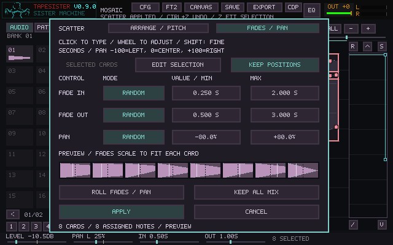

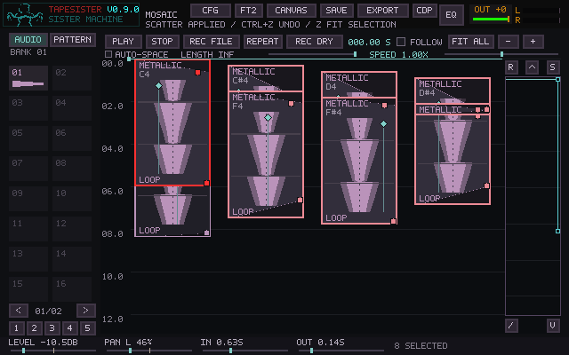

### Scatter pitch

Scatter opens with **KEEP NOTES**, preserving each card's existing notes. Click the
pitch mode to choose **CHORD PER CARD**, **SPREAD CHORD** (one chord tone per card),
or **SPREAD SCALE** (one scale tone per card). Pitch controls also respond to the
wheel; Shift-click steps backward. Numeric start times and Count remain text fields.

- **ROOT** selects C through B. Chords include major, minor, major/minor/dominant
  sevenths, sus2, sus4 and **PRIMARY CHORD**. Primary uses the first selected card's
  intervals above its lowest note; for selected sources it uses the first source.
  Root transposes that voicing. Spread Chord collapses octave doubles into pitch
  classes; Chord per Card preserves the full voicing, up to five notes.
- **SCALE** follows FM's Pitch page: chromatic, major, natural minor, major
  pentatonic or whole tone. Scale mode distributes single notes; it does not put
  an entire scale on each card.
- **LOW / HIGH** bound the pitches from C of the low octave to B of the high
  octave (MIDI limits are C−1 through G9). A whole chord must fit completely.
  If none fits, widen the range before applying. Chord per Card may choose
  different octave placements inside this range.
- **RANDOM** allows repeated choices; **SHUFFLED** visits every available note
  before repeating. **ASCENDING / DESCENDING** cycle in pitch order. Distribution
  follows selection order (primary first), or generated-copy order, independently
  of start times. With whole chords, these choices select chord octaves.
- **ROLL NOTES** rerolls Random/Shuffled pitches without moving cards. **ROLL
  POSITIONS** changes positions without changing notes. Ordered pitches have no
  random roll. The text preview shows the first notes/chord; the bottom line
  counts all assigned notes, not the number sounding simultaneously.
- In **EDIT SELECTION**, enable **KEEP POSITIONS** to reharmonize without moving
  cards or changing Auto-Space. Time, scatter and overlap controls are inactive
  in this mode. Create Copies and source scattering generate new positions.

For example, select one card, Ctrl+R, Create Copies, Count 12, Spread Chord,
Root C and Minor. Set Low C4 / High B4 and Shuffled to distribute C4, D#4 and G4
across the twelve copies. Choose Chord per Card to give each copy all three notes.
The interface displays sharps (D# is E-flat).

Pitch assignment preserves source tuning, gain, pan, fades (unless changed on
Fades / Pan), durations, loop modes, mute/solo and routing. Pitched source material needs its correct root tuning;
Scatter transposes samples and does not detect or retune notes within recorded
chords. Higher pitches play samples faster, following ordinary Mosaic playback.
Full chords add playback voices; spreading one note per card keeps the voice count
lower. Pitch choices are planned on the UI thread, with no new callback work.

Apply commits exactly the preview as one undo step; Escape/Cancel discards it.
Generated notes use the existing project format and survive save/reopen. Each
new Scatter dialog starts with Keep Notes so pitch replacement is deliberate.
