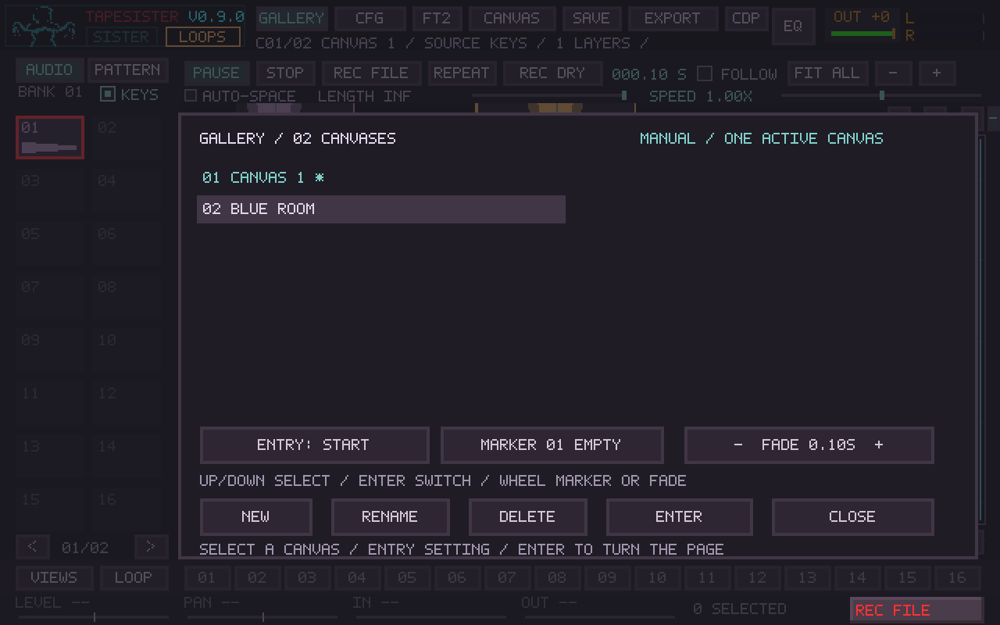
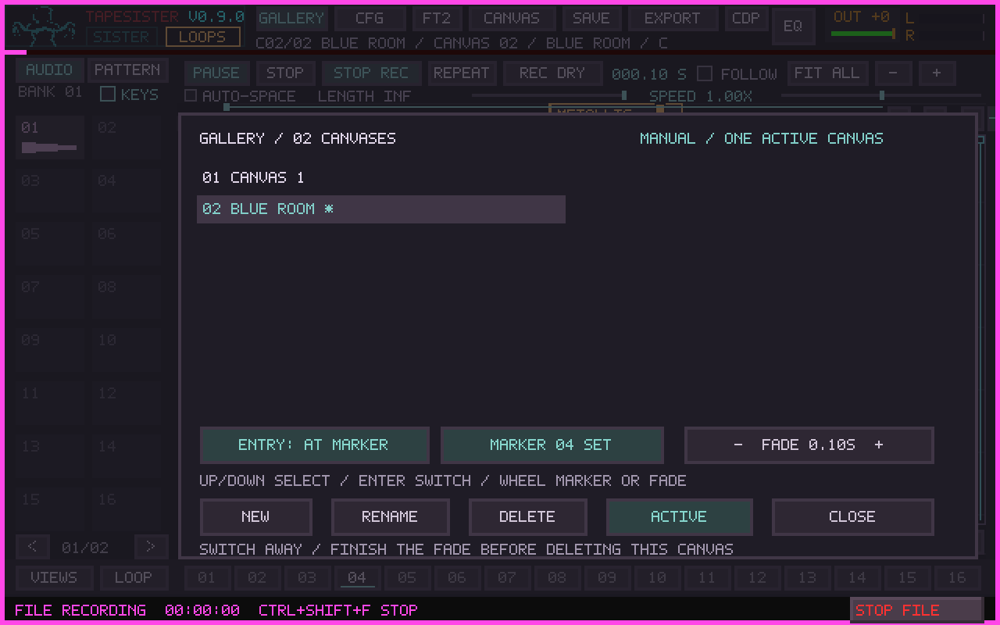

# Mosaic Gallery

A project can contain up to 16 named Mosaic canvases: separate paintings sharing
one sound collection and one effects/output chain. Page changes are manual.

Open **GALLERY** at the top of Mosaic, or press **Ctrl+G**. Click **NEW** to add an
empty canvas. Select a row, choose how it should enter, then click **ENTER** or
press Enter. The asterisk marks the active canvas; selecting a row alone does not
change playback. **Ctrl+Page Up / Ctrl+Page Down** turns to the previous/next canvas
using its entry setting. Ordinary Page Up/Down still scrolls the current picture.

**RENAME** accepts 1–47 printable ASCII characters. Ctrl+A clears the name for
replacement, Enter applies it, and Escape cancels. **DELETE** asks for a second
click and only removes an inactive canvas after a crossfade has finished. The
last canvas cannot be deleted. Names, order, entry choices, selected canvas and
fade duration are saved with the project.

## Turning a page

| Destination entry | Behavior |
| --- | --- |
| START | Rewind to zero and rearm the destination's loop triggers. |
| RESUME | Continue its retained playhead and loop phases from when its previous fade finished. |
| AT MARKER | Rewind/rearm at the selected stored timeline marker on that canvas. An empty marker prevents the switch. |

Click ENTRY to cycle modes. Click MARKER to cycle its 16 slots, or wheel over it
in either direction. The marker must already have been stored on the destination
canvas; existing Mosaic marker controls create and edit those points.

Click the left/right halves of FADE, or wheel over it, to adjust the transition
from 0 to 30 seconds in quarter-second steps. The default is 2 seconds. A page
turn inherits the current timeline's playing/paused state. Paused timelines stay
paused; independently running loops can still crossfade. If everything is silent,
browsing changes pages immediately. A zero-second fade is an immediate switch.

During a fade, the outgoing picture continues while the destination enters. Only
these two canvases render. A further page turn waits until the fade finishes; it
is not queued. The outgoing canvas then parks, retaining its runtime position for
RESUME. Each canvas retains its own cards, loop definitions, sequences, envelope,
markers, saved views and arrangement undo history. The current zoom/scroll also
returns when revisiting a canvas during the session. Runtime playheads, sounding
notes, undo history and current scroll are not restored when reopening a project.

The fade is applied to Mosaic's main signal and every routing/send/reference tap
before the shared effects chain. It uses constant-sum gains so identical pictures
do not gain volume halfway through the transition. Shared effect tails continue.
Space and the F11 Mosaic/Looper controls reach both audible canvases during a fade;
parked canvases remain parked. F11 Reset retains its existing rewind/rearm behavior.

Finish a tile/loop take, card edit or drag before switching. **REC FILE** can run
through the whole Gallery performance, including the page changes. Held source
keyboard notes keep their existing audio until released; the destination's source
KEYS selection starts cleared so subsequent notes use an explicit new selection.
Sample/Record banks, TrackSister, ARP, effects and output controls remain shared.

## Saving and rendering

Save/Open and New operate on the entire Gallery. Opening an older single-canvas
project creates a one-canvas Gallery. A multi-canvas project stores each canvas and
its source snapshots under `project-data/canvas-NNN`, plus `gallery.tsg`. Older
TapeSister builds reject that arrangement rather than silently discarding pages;
use a Gallery-capable build to edit multi-canvas projects.

Offline Render exports the selected canvas from its beginning, alongside the
other chosen instruments. It does not replay manual page turns. Use REC FILE to
capture a Gallery performance. Automated page sequences and canvas jump markers
are reserved for a later version.

## Validation and manual check

Built from main `4a4c846` after #170 merged. Linux Release application/core,
system FFmpeg, CDP/video bundles and physical MIDI backend disabled. Large SDL
controller harnesses used O0 with assertions; core/application remained Release.

- All 23 checks in `.github/pr-regressions.txt` passed (95.84 seconds), including
  Gallery core/controller, existing Mosaic/loop, F11, clock, routing, tracker,
  recording and transactional save regressions.
- The final focused Gallery/loop tests passed after adding CRLF metadata and
  fractional-size modal rendering checks. New-project/reopen and offline export
  integration tests also passed, including a non-root selected canvas.
- Gallery core/storage passed with the complete core built under AddressSanitizer
  and UndefinedBehaviorSanitizer. Leak checking was disabled because this host's
  process namespace prevents LeakSanitizer inspection.
- Audio checks compare both renderers' weighted signal and routing taps sample by
  sample, verify a bit-identical single-canvas fast path, test retained loop
  phase, and read back the actual REC FILE WAV after several page turns.
- Screenshots use production rendering with synthetic audio fixtures. No physical
  MIDI, Windows/ASIO, X220 capacity or subjective listening result is claimed.

Manual check on the target machine:

1. Open an existing project; confirm its original painting appears as Canvas 1.
2. Create/name a second canvas, place different sounds, and switch during playback
   with a two-second fade. Try another switch mid-fade and confirm it waits for
   another deliberate request. Adjust FADE with clicks and the wheel.
3. Try Resume after leaving running loops, Start to rearm them, and At Marker
   with a stored point. Check F11 Pause/Resume/Reset during and after a fade.
4. Start REC FILE, turn several pages, stop and listen to the resulting recording.
   Confirm a tile/loop take prevents a page turn until that take finishes.
5. Save with Canvas 2 selected, reopen, verify both paintings and entry settings,
   then use New and confirm a single empty canvas. Delete an inactive canvas by
   confirming twice; active/last-canvas deletion must remain blocked.

