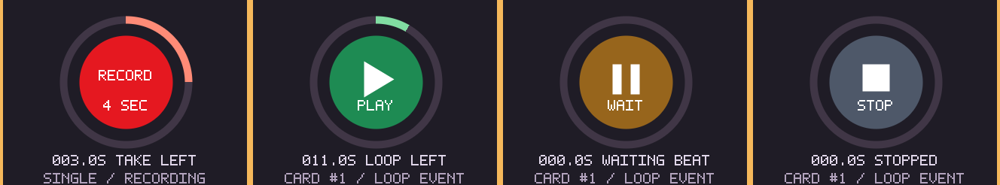

# Mosaic loop sequencer and smooth looper display

This is a separate follow-up to #165. It uses the same Mosaic canvas, existing
audio-card players, routes and Card IDs. Native pattern players, shared Loop
IDs and linked launcher cards remain in [the follow-up plan](MOSAIC_LOOP_ID_PLAN.md).

## Two performance buttons

The outer transport icons now mean **Cycle** and **Finish Pass**. Previous and
Next remain manual navigation. Hover explains the action; MIDI Learn uses
`mosaic.live.cycle` and `mosaic.live.finish_sequence`.

| Action | Result |
| --- | --- |
| Cycle while stopped | Start the sequence at its first member, hand over through its order, then repeat. |
| Cycle while running | Keep the current position and cancel a pending Finish request. |
| Finish Pass while running | Continue through the remaining steps of this pass, then stop the sequence. |
| Finish Pass while stopped | Remain stopped. Cycle then Finish gives one full pass. |
| Previous / Next | End sequence control and launch the addressed card manually. Existing background players retain their phase. |
| Stop Sequence in setup | Quickly release sequence players; leave recording and background loops alone. |
| Simple Stop | Keep the partial recording, stop capture and all live loops, and publish pending takes stopped, as in #165. |
| Pause / Stop Recording | Keep the current take; the sequence and other loops continue. |

The panel displays **CYCLING / LOOP 2 OF 5** or **FINISHING / LOOP 2 OF 5**.
During simultaneous recording it combines the recording and sequence states.
Finish is idempotent. A running/waiting sequence member cannot gain duplicate
voices from timeline encounters, manual launches or group Play.

## Membership, background loops and order

Open **Advanced > Sequence**. Loop cards are listed with their existing Card
IDs, step lengths and sequence order. Click a row; the wheel browses the list.

- **Make Background / Add to Sequence** chooses whether this card participates.
  Background cards remain independently playable and keep sounding while the
  sequence changes steps or finishes.
- **Up / Down** changes performance order without changing a Card ID, MIDI
  target, source, XY position or timeline launch time.
- **All In** restores all live audio cards to automatic Card-ID creation order.
  Existing projects start with this automatic order.

Starting Cycle takes control of its members. Already-playing member cards get
a short 5 ms release before the first step starts. Background cards keep their
players. Order and membership changes require the sequence stopped. The running
order is frozen: newly recorded or copied cards join on the next start, while
new takes can already play independently alongside the current pass.

Deleting a queued card skips it; deleting every member ends the sequence.
Undo does not resurrect running players. Changing a participating card's role
or explicitly stopping/restarting it ends sequence control. Muting or solo
exclusion retains the step's timing, allowing a muted step to act as a rest.

The legacy `first_loop` and `last_loop` MIDI targets retain their original
manual navigation behavior; they have been replaced only on the two visible
outer buttons. Existing per-card toggles and recording mappings are retained.

## Card length, cycles and fades

The source cycle is the trimmed audio. The card's visible duration is the
sequence step length, including for a card that normally plays **Until Stop**.

| Example at original pitch and normal tape rate | Standalone playback | Sequence playback |
| --- | --- | --- |
| 2 s source, 8 s card, Until Stop | Continue until explicitly stopped. | Four source cycles, then hand over. |
| 2 s source, 8 s card, Card Ends | Four cycles, then stop. | Four cycles, then hand over. |

**Step X1 / X2 / X4...** in setup adjusts that duration. The trailing duration
edge of an individually resized loop card snaps to whole source cycles; hold
Shift for free lengths. Existing fractional lengths, leading-edge edits and
group resize retain their free timing. Moving the whole card still moves its
timeline launch location. Resizing never stretches or rewrites the source.

Cycle counts are **base-pitch tape cycles**. Notes/tuning can give the individual
voices different repeat rates; chords do not all share one wrap boundary.
Sequence steps use the same local tape-time duration as the existing Card Ends
mode. The current step snapshots its duration on entry, so resizing it during
playback takes effect at its next entry. A step is at least one output frame;
subsample steps cannot produce separate audible handovers.

- **In** fades once after launch.
- **End Fade** fades toward the known step end. In standalone Card Ends mode it
  works toward the card end. An ongoing standalone player has no scheduled end,
  so its ordinary Out control says **Set an End**.
- **Finish Fade** controls the separate **Finish Loop** action for the selected
  independently running card. For example, 2 s releases an ongoing drone over
  two seconds. It snapshots the current fade level, including an unfinished
  fade-in. Repeating Finish Loop does not restart the fade. Waiting players are
  cancelled. A zero setting uses the usual short release.
- The normal Stop action keeps its fast release, including when interrupting a
  longer Finish Fade. Finish Loop does not interrupt a sequence-owned card;
  use Finish Pass or Stop Sequence for that performance.

Finish Fade supports 0–30 s; the wheel changes it by 0.1 s, a click cycles
presets, and right-click resets it. End Fade and Step Length have the same
wheel/click/reset pattern. Fades, mix and routes remain per card.

## Clock, timeline and recording

Sequence handovers use audio-frame time, not UI polling. Fractional overshoot
is carried into the next step at that step's own tape rate. Source loading,
disk writing, sorting, allocation and waveform work stay outside the callback.

Per-card **Tempo: Free / Master Tape** still sets its rate, with the existing
pitch-changing tape behavior. Main Mosaic speed, pause, seeks and cue repeat do
not reposition the sequence. While owned by the sequencer, card group and seek
flags are suspended and the capture setup labels them **SEQ OWNS**. Their saved
choices become applicable again after sequence control ends. Background cards
continue to honor their own routes/clock/transport choices.

**Launch Next Beat** quantizes the initial sequence launch only. Subsequent
handovers and pass wraps use the chosen step lengths, preserving free-time
combinations without a new wait at every step. The master phase can run with
its transport cursor paused, as before.

External, Dry Keys and Output capture retain their existing taps. In particular,
Output includes the audible sequence; External and Dry Keys exclude Mosaic.
Successive live takes stay separate, can play alongside the sequence, and do
not change the current pass's membership. The take/queue/source-memory limits
and writer/UI return latency remain unchanged.

## Smooth display and projects

The status disc and continuous progress ring are rendered at native window
resolution with antialiased edges. A small cached layer stores coverage and
angles; moving the panel updates its destination, and progress updates reuse
the geometry. Labels keep the TapeSister bitmap style. Allocation/raster work
belongs to the UI. The logical drawing remains an allocation-failure fallback.

The disc reports actual looper activity in both render paths:

- **Red / RECORD**: capturing a new take. Only here does the disc show the
  configured recording length. The ring/countdown uses the current take;
  manual capture shows elapsed time without an invented cycle.
- **Green / play triangle / PLAY**: an active player. Finite loop events use
  their full card duration; sequences use the held current step duration.
  Until Stop players use their source cycle. The countdown follows tape rate
  and source pitch where applicable. A releasing player remains green / END.
- **Amber / pause bars / WAIT**: queued for its launch beat, with no moving
  playback ring. **Amber / ... / PREP** means capture is being prepared.
- **Slate / square / STOP**: no loop player is running or queued. The ring is
  empty rather than showing a leftover take or playhead position.

Recording takes priority over simultaneous loop playback. Otherwise the
current sequence step is shown, then the selected active player, then another
running player (before queued players). Selecting a stopped or ordinary card
therefore cannot conceal ongoing background playback. The displayed Card ID
identifies the player whose progress is shown; card editing controls still
apply to the selection.

The disc still starts a new recording/next layer when clicked, with the same
MIDI target; the hint beneath it says **CLICK DISC: RECORD / NEXT**. Display
changes do not change transport behavior. The existing pause-bars button ends
capture and leaves independent players running; it does not freeze a player's
playhead. Those players continue to show PLAY. The main timeline's pause also
does not pause the independent sequence.

Saving stores sequence membership/order and Finish Fade when used; players and
the sequencer reopen stopped. Nondefault membership/order or Finish Fade uses
Mosaic format **16**, which earlier builds reject clearly. Otherwise the
existing format 14/15 choice is retained. Older projects default to automatic
sequence order and the old quick Stop; ordinary playback does not change until
the new controls are used. Project staging, validation and rollback remain in
the existing save path.

See [validation, measurements and the F12 hardware exercise](validation/mosaic-loop-sequencer.md).
