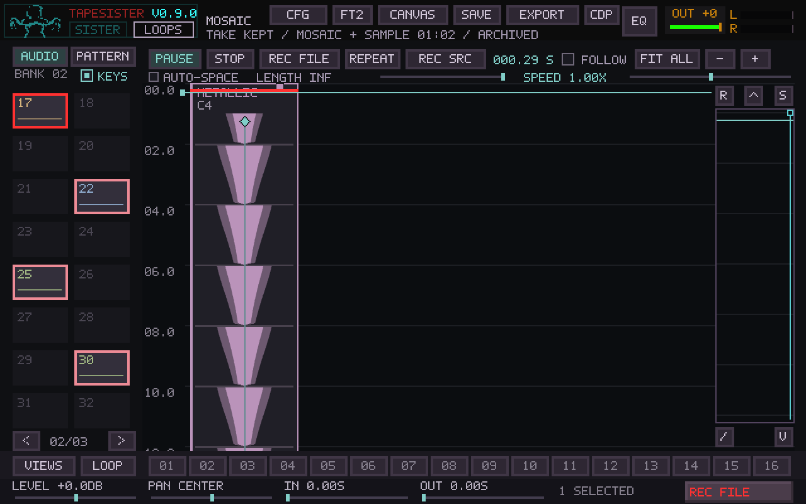
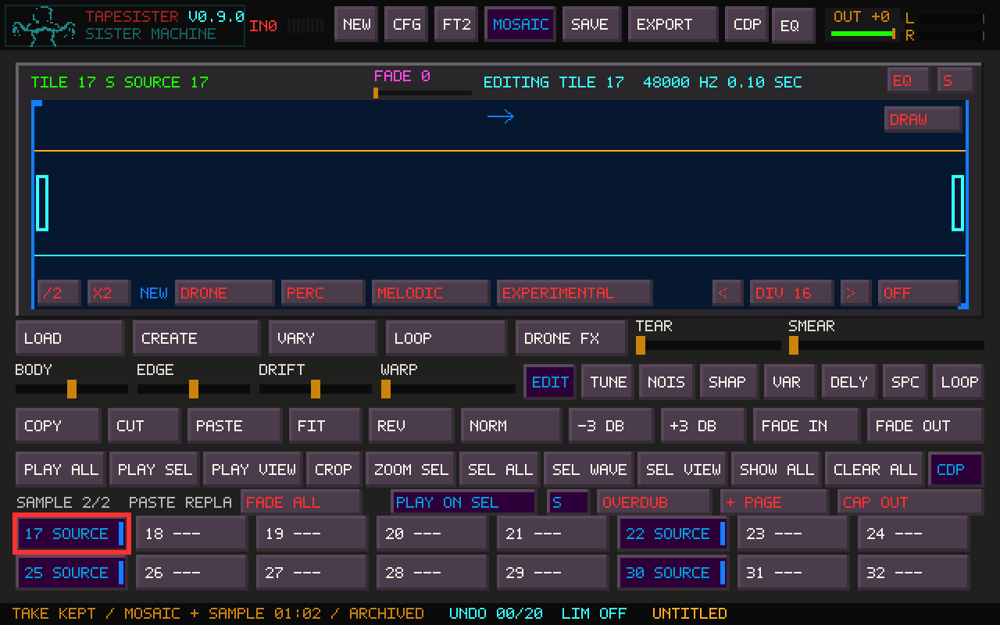

# Playing Mosaic sources from the keyboard

Mosaic's AUDIO browser and the ordinary sample Canvas now show overall sound
numbers: the sixteen positions on page 2 are **17–32**. The page indicator
still tells you where you are. These are display numbers; existing tile IDs,
MIDI launch mappings, routing identities, and sample storage are unchanged.
Event-version sources use an **E + event ID** label, and pattern sources retain
**P + pattern ID**, so those distinct sources do not pretend to be bank slots.

## Select and play

1. Select an audio source in Mosaic. Shift-click adds layers; Ctrl-click toggles
   them. The existing source-row dragging and Scatter gestures still work.
2. Check **KEYS**, beside the bank/page heading. It explicitly sends Mosaic's
   QWERTY, onscreen-note and incoming MIDI note events to the selected audio
   sources. The looper does not need to be open.
3. Play a note: every selected source plays that pitch together, retaining its
   own tuning, sample range, loop/direction/crossfade and output route. For
   example, page-2 positions 1, 6, 9 and 14 play **17, 22, 25 and 30** together.
4. Browse another source page without replacing the group. You can add sounds
   from that page too. Source choices are identified by page/slot/event, rather
   than by whichever thumbnail currently occupies an onscreen position.

A changed selection affects new notes. Held notes keep their original immutable
sound until released. MIDI channels, note-offs, latch/Hold, sustain and panic
retain their normal ownership. Unchecking KEYS restores Mosaic editing
shortcuts and the existing keyboard destination; it does not cut off held
notes. Ctrl/Alt shortcuts remain available while KEYS is checked.

Existing looper **KEYS ON / EDIT** operation is retained. The browser checkbox
adds an explicit selected-source destination, including MIDI, independently of
the looper window. Audio bank sources and placed-event audio versions are
supported; pattern sources continue using their existing pattern players.

## Record the played sources

Right-click the top Mosaic REC TILE button to cycle **REC DRY → REC SRC →
REC OUT → REC EXT**. Left-click to start/stop the chosen take.

| Recording choice | Recorded material |
| --- | --- |
| REC SRC | Only the selected-source notes being performed, including their layer mix, velocity, tuning and looping, before source-route pan/width/levels, shared effects and master output. |
| REC DRY | The existing dry keyboard-performance tap, including other keyboard sources. |
| REC OUT | The existing output capture, including the backing arrangement and processing. |
| REC EXT | The configured external input. |

REC SRC requires KEYS enabled and an audio source set. The arrangement keeps
playing while you perform. The resulting stereo take is archived and added as
a new ordinary card and Sample tile through the existing capture publication
path. It cannot record itself before publication. Existing length, silence-stop,
keep/stop/cancel, save protection and archive retention rules still apply.

## Ownership and limits

Source audio is copied/prepared on selection on the UI thread and reused when
an unchanged source remains selected. Callback voices retain their generation;
deselection or editing cannot free a held note's PCM. Rendering and note-on do
not allocate, hash source audio or write files.

A dedicated fixed pool holds **384 source-layer voices**. Each note needs one
voice per selected sound; a full pool rejects the entire additional note rather
than playing an arbitrary subset. Group gain uses the existing performance
engine's fixed `1/sqrt(layer count)` law, so a shorter layer ending does not
make its siblings jump in volume. More layers and simultaneous notes require
more CPU; selected/held immutable samples require memory. No physical-device or
old-laptop capacity is claimed.

KEYS and its source selection are session controls. A different project/scene
clears that owner; saved projects do not resume keyboard voices. This feature
does not introduce a new project format or Gallery/multiple-canvas behavior.

## Validation

Based on main `61acc3e`, after #166 merged. The Linux Release application and
Release core built successfully; the local Mosaic controller harness used O0
with assertions, SDL dummy devices, system FFmpeg, and CDP/video bundles and the
physical MIDI backend disabled. Real MIDI events still pass through production
note dispatch in the controller tests.

Three CTests passed: performance (**0.02 s**), general Mosaic controller
(**44.82 s**) and focused live Mosaic controller (**2.26 s**). After adding the
Canvas comparison image, the dedicated `--source-keys` case passed again.
Coverage includes:

- Page-2 sounds 17, 22, 25 and 30 played together with the looper closed.
- Selection spanning pages, unchanged held notes while adding/removing layers,
  independent MIDI channel releases/panic, and an empty set staying empty.
- Actual top REC SRC start/stop and stereo card/Sample publication with backing
  playback continuing. Four constant stereo layers produce the expected
  0.2-left/0.1-right steady capture; the backing is excluded.
- Immutable-source lifetime after the original sample and UI selection are
  released, sustain/latch, full fixed-pool rejection and coherent retriggering.
- Scene-epoch mismatch refusing an underlying-Canvas fallback, and fresh owner
  defaults. Existing controller routing, CDP/editor ownership, record taps,
  loop sequencing, MIDI Learn, captures and native rendering cases still pass.

The performance implementation and its test were additionally compiled with
AddressSanitizer/UndefinedBehaviorSanitizer and passed; the rest of the static
core was Release. Leak checking was disabled because LeakSanitizer cannot
inspect this host's process namespace. This is not a whole-application sanitizer
or physical MIDI/ASIO/older-computer test.

The performance test is also included in the unfiltered all-PR baseline.
Images are production-rendered synthetic fixtures. Linux/Windows Release CI and
bundled regressions are reported on the PR for its exact published head.
