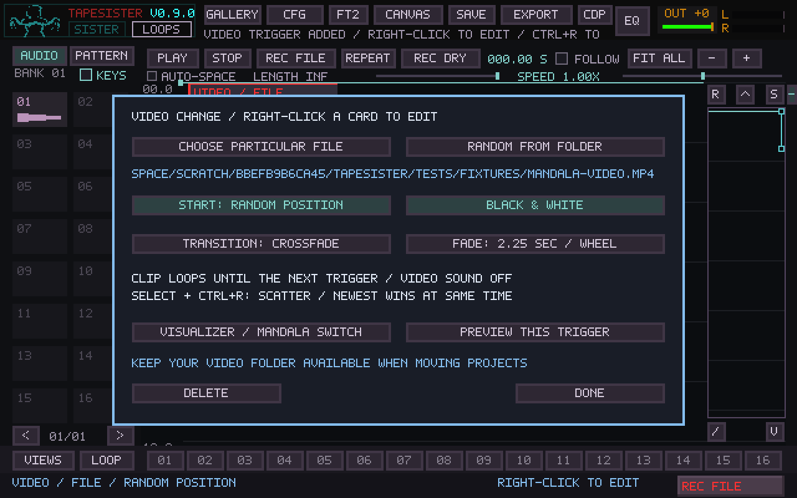
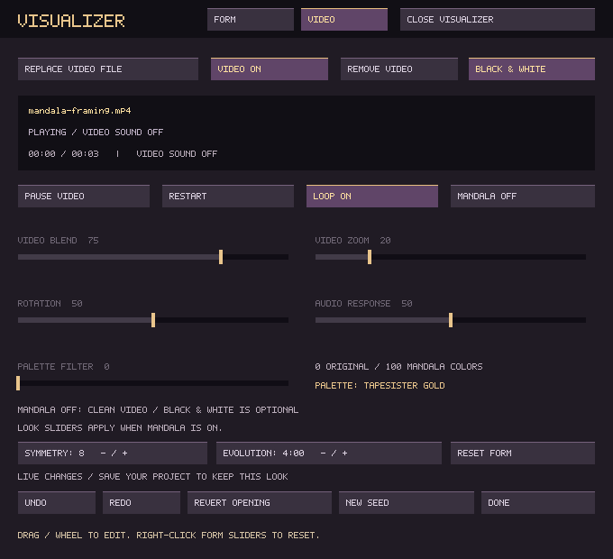
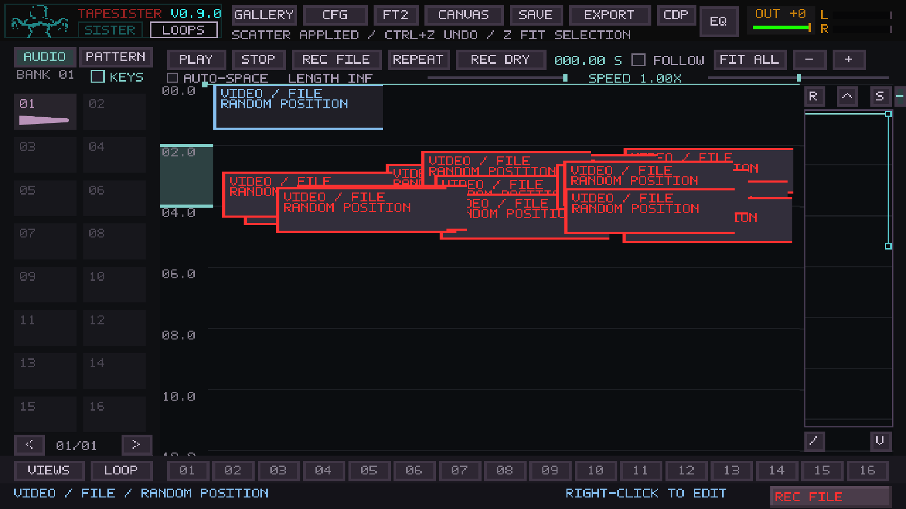

# Mosaic video changes

Use the existing visualizer as a video instrument. Feed it a folder of footage,
place change objects in Mosaic, then let the timeline choose when pictures change.
Video sound is always ignored.

## Place and edit

Drag a local video file or folder into Mosaic. Alternatively, right-click empty canvas space (or press **Ctrl+Shift+V**) and choose a file
or folder. Folder selection
uses the browser's current directory; enter the desired folder and confirm it.
Video file/folder pickers stay above Mosaic. Choosing a source returns to its
video-card settings; cancelling the picker leaves Mosaic available.
The new blue card is placed at the drop location, or at the playhead when using
the shortcut. Its leading time edge is the trigger; horizontal placement only organizes
cards. Its small height is a visible footprint, not a limit on video playback.

Right-click or double-click a video card to edit:

| Setting | Behavior |
| --- | --- |
| Particular file | Play that clip whenever this trigger fires. |
| Random from folder | Shuffle through the recognized files without replacement; avoid an immediate repeat when reshuffling. A one-file folder works too. |
| Beginning / Random position | Independent of file choice. Every encounter can choose a fresh position, including when replaying the same file. |
| Original color / Black & white | Per-trigger grayscale; the visualizer also offers a global monochrome switch. |
| Cut / Crossfade / Through black | The arriving trigger owns its transition. |
| Fade | 0–30 seconds, in quarter-second steps; click/wheel, right-click decreases. Cut ignores this duration. |
| Preview | Audition the visual instruction and open the existing visualizer if closed. It does not seek or start the musical transport. |

The clip plays and wraps within the same file until another trigger arrives.
Reaching its end does not draw a different clip. Main transport Pause leaves the
video running; use the visualizer's video Pause or Freeze Visual to hold it.

**VISUALIZER / MANDALA SWITCH** opens the existing editor's VIDEO tab. **MANDALA
OFF** presents clean, aspect-correct footage on black, without geometry, mirrored
folds, audio response, palette coloring, haze or effect trails. The global Black &
White switch remains available. Turn Mandala back on to restore its treatment of
the same video. Fullscreen/projector controls are unchanged.

## Scatter and performance

Video cards use normal selection, movement, Shift-drag copies, Ctrl+C/V,
Delete, and arrangement Undo/Redo. Select a trigger, press **Ctrl+R**, choose
copies, and scatter them through a range. A selected time range supplies the
initial scatter bounds; otherwise the visible time span is used. Each copy keeps
its file/pool, position mode, transition and color settings. Rapid cuts plus random
positions can fragment a single long video without chopping it into files.

At an identical time, the newest added/duplicated **unmuted** video trigger wins,
using its saved card ID. Overridden cards are labeled. Moving them apart restores
both instructions. Mute disables a trigger; audio solo, gain, pan and envelopes do
not affect video or let video objects affect audio voices.

An interrupted dissolve retains the currently visible composite in one GPU
snapshot and transitions from that image. It never accumulates a chain of video
players. Ordinary dissolves keep both outgoing and incoming clips moving. A new
source starts appearing when its first decoded frame is available. Missing media
keeps the outgoing image and reports an error in the visualizer editor.

Video commands are latched on Mosaic's audio-frame clock and consumed by the UI
and visual child. Commands faster than display/IPC cadence coalesce to the latest
one; arbitrary trigger density does not promise that every cut is displayed.
Economy/Standard quality still limits visual cadence. The audio callback never
opens media, allocates a decoder, scans folders or waits for video.

## Automatic preparation

The visual child automatically prepares a selected source or folder in one
low-priority background worker. Originals remain untouched. Completed local
MJPEG/AVI copies contain independently decodable frames, at up to 960×540 and
25 fps, without enlarging smaller inputs. File timestamps and sizes invalidate
old copies. Original footage can play while preparation proceeds; later triggers
reuse completed copies. A source that exceeds the direct player's size limit can
recover automatically after its prepared copy becomes ready.

The VIDEO editor reports preparation progress. The initial conversion uses CPU
and additional disk space. It is not manual editing and needs no separate FFmpeg
program. Prepared media lives in SDL's application preference directory under
`TapeSister/VideoCache`; it is regenerable and is not a project asset. The bundled
LGPL libraries enable only the native MJPEG encoder and AVI muxer for this work.
Actual X220/X230 capacity still requires testing with the intended videos and
music, especially during initial preparation or dense transitions.

Pools include the current folder's supported video extensions, within the existing
1024-entry browser limit; subfolders are not recursively imported. Reopen the
visualizer to refresh its folder index. A container extension does
not guarantee that its codec can be decoded. Failed preparation retains the
original reference and does not stop musical playback.

## Save, Gallery and transfer

Video instructions belong to each canvas, including its arrangement history.
Gallery save/open and canvas import/export retain those instructions. The active
canvas drives the visual output; outgoing audio canvases do not send later video
cues. Entering a page or seeking reconstructs its preceding video instruction.
If none exists, the configured manual visualizer clip is the fallback, or black
with Mandala off. Page entry uses the destination video's transition settings.

Video files/folders stay **external references**, including in an exported canvas.
Audio/pattern portability from Gallery remains unchanged. Keep the referenced
video folder available, or reselect it in the cue editor after moving machines.
Prepared copies are not a substitute for retaining original footage. Random live
choices and playback positions are not saved. REC FILE/offline audio export do not
encode a movie or record video choices.

Mosaic format 18 stores video cues; older formats 1–17 remain readable. Visual
settings version 5 stores Mandala and monochrome switches; versions 1–4 retain the
mandala appearance. Older builds cannot safely edit projects with these fields.

## Validation

Tests use generated footage and SDL dummy/software devices. New model checks
cover collision priority, mute, seek/repeat, no audio voices, bit-identical audio,
copy/undo, missing references and CRLF storage. Controller checks use the real
browser, right-click dialog, scatter and native framebuffer. Visual checks cover
random seeking, prepared playback, grayscale, moving dissolves, interruption,
black transitions, mode switching and folder shuffling. Existing Gallery,
transactional save, routing and transport regressions are retained. Physical
projector timing, Windows drivers and old-laptop throughput require target-machine
checks.
