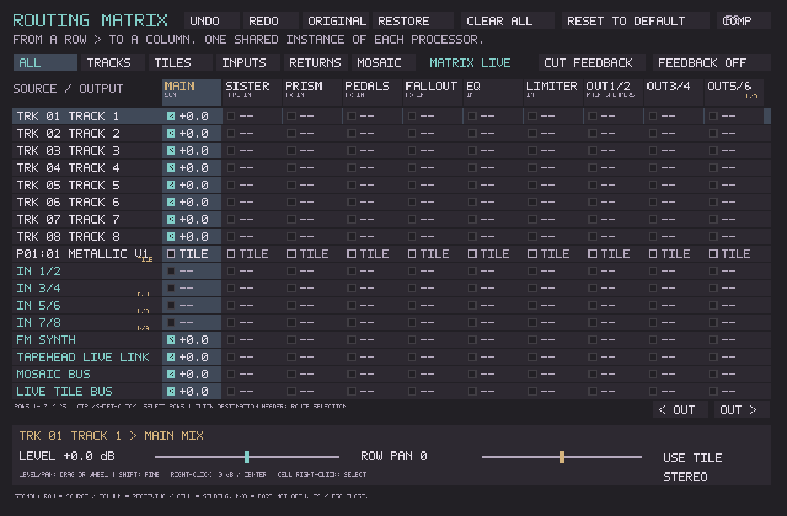
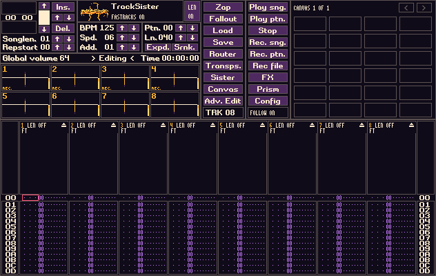
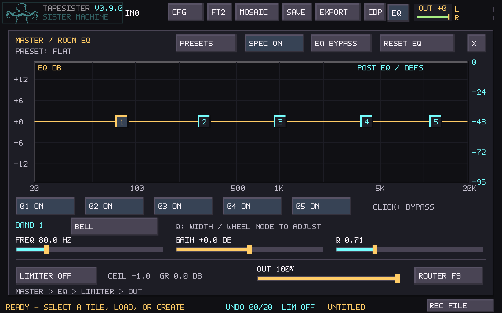

# Palette audit and validation

The implementation is part of PR #138, on top of compressor commit `199362d4`.
The component inventory, inheritance model, controls and file compatibility
are documented in [the palette guide](UNIVERSAL_PALETTE.md).

## Design boundaries

The UI palette is a preset plus optional overall/component overrides. The
existing 32 legacy colors and their 32-bit defined mask are retained unchanged;
theme overrides use a separate array, with zero as inheritance and opaque black
as a real value. No audio callback reads the theme, and no musical project
schema changes are introduced by the palette work.

The floating editor owns its SDL window, renderer, input, browsing and undo
history. It does not set the host's modal `palette_open` flag. Palette changes
invalidate the idle main/Sister/source-route views and update auxiliary windows.
Native TrackSister's indexed framebuffer receives a visual overlay without
rewriting its six-bit preferences, replayer or project bytes. Its tagged palette
indices and sample-selection flag remain intact.

`Original` resolves each drawing call's original color. This retains the
intentional differences between existing workspaces instead of normalizing
their default appearance. Other presets resolve the formerly fixed surfaces
through semantic roles. Existing legacy swatch imports remain usable.

## Automated checks

- Theme tests cover all eight presets, all group/role override round trips,
  inheritance, component reset/isolation, explicit black, independent reverb,
  malformed-load rollback, neutral Original behavior and both directions of
  text clarity. Every new preset's primary text/control pair has at least
  4.5:1 calculated contrast at neutral settings. This is not a claim that all
  secondary text, artwork or arbitrary edits meet that ratio.
- The native palette-window fixture drives real SDL clicks/text/key events:
  preset selection, RGB and hex edits, whole-drag undo, redo, Before/Edited,
  session revert, closing while comparing, shared legacy colors, active-view
  following and modeless event ownership. It covers Save As, overwrite
  confirmation, import and Save Shared. Ctrl+Shift+P remains available to CDP;
  Ctrl+Alt+P opens the editor.
- Component clicks exercise all 16 destinations, repeated selection, pending
  configuration/EQ guards, visible Mosaic edit choices after leaving Portal,
  and parked FM state. Mosaic playback position, canvas
  playback, source samples and master EQ controls remain unchanged.
- Native texture-composition tests reproduce the reported EQ ghosting before
  the fix. Master EQ, tile EQ and the legacy router now fully occlude canvas
  detail under all eight presets at 4x scale; returning to Canvas restores its
  native waveform layer. This does not rely on different background colors.
- Native framebuffer checks keep the unfilled Body, Edge, Drift and Warp slider
  tracks visible under all eight presets, including zero grid visibility and
  a component Control fill override. Original retains its original track color.
- Native TrackSister applies Sister to the actual framebuffer while its 62
  preference bytes remain unchanged, then restores Original. The fixture also
  verifies the plum background after the pattern and scopes redraw, covering
  native clear operations that formerly always filled with black.
- A deterministic comparison against the unchanged compressor build produces
  identical complete framebuffer hashes for **Canvas, FM, ARP, EQ, legacy
  Router, Sister Machine, Pedalboard, Fallout and Prism** under Original.
- The embedded-source importer verifies all 271 vendored files against the
  pinned upstream manifest and the updated adaptation patch.
- Linux Release full regression: **111/117 passed**. The remaining six are the
  same baseline failures documented in [Mandala validation](MANDALA_VALIDATION.md):
  source mask, recursion, three Sister UI fixtures, and canvas boundary.
- Windows and Linux PR CI include the theme, native palette-window and legacy
  palette tests in the required targeted regressions.

## Rendered inspection

The images under `docs/screenshots/palette/` come from the real renderers, with
SDL's dummy video driver, rather than an HTML mockup. Run
`build/tapesister_palette_window_tests --screenshots` from a scratch directory
to regenerate BMP captures of all eight Canvas, Pedalboard and Router presets,
the editor, readability controls and native TrackSister Sister theme. Documentation
uses lossless RGB PNG conversions; the preset overview arranges eight captures
with labels.

Native multi-monitor movement, mixed-DPI desktop scaling and compositor-specific
Always on Top behavior still need checks on physical Windows/Linux desktops.
Automated rendering and event dispatch do not establish those OS behaviors.
