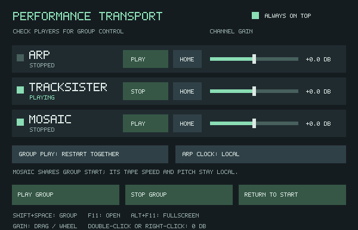

# Performance Transport

Open **CFG → Transport**, **F11**, or **Ctrl+Shift+Space**. **Alt+F11** toggles
fullscreen. This small modeless window mixes ARP,
TrackSister (SisterTracker), and Mosaic while you work elsewhere.

| Control | Behavior |
| --- | --- |
| Channel checkbox/name | Includes that player in group commands; it does not mute it |
| Channel Play/Stop | Starts or stops just that player |
| Channel Home | Stops and rewinds just that player |
| Channel Gain | Silent through +6 dB; drag or wheel, double-click or right-click for 0 dB |
| Always on Top | Keeps the transport above other windows |
| Group Play: Resume | Starts stopped checked players; running players continue |
| Group Play: Restart Together | Restarts all checked players from the beginning on Play |
| ARP Clock | Local timing, or TrackSister quarter, eighth, or sixteenth notes |
| Play Group / Stop Group | Controls only checked players |
| Return to Start | Stops and rewinds checked players |
| Shift+Space | Stops the group if any checked player is running; otherwise plays it |
| Space | Keeps the active workspace's existing play/stop or Follow/live-edit behavior |

Selection, gains, group play mode, clock link, and Always on Top save with the
project. Older projects open at 0 dB with ARP alone checked, Resume selected,
local timing, and Always on Top off. Opening this window does not change sound.
Closing it leaves playback running. Unchecked players remain independent.

Channel gains act before routing, including effects sends, Matrix routes,
direct hardware outputs, and the tracker tape-input route. Changes are smoothed
over at most five milliseconds. ARP's fader trims only its sequenced voices;
manually held notes keep their own levels. Its existing volume/LFO still applies.
A silent channel keeps advancing, and shared effects can finish their tails.

The ARP clock link follows TrackSister BPM, including score tempo commands
within an audio buffer. A tempo change preserves the current note's beat phase.
The link temporarily overrides note intervals without replacing saved ARP slot
timing. Switch back to Local to use those intervals again. ARP slot-change and
LFO timers keep their own seconds settings. When TrackSister is stopped, its
current tempo still supplies the interval. Starting a channel independently does
not reposition another channel; choose Restart Together for a common beginning.

Mosaic shares the group start/stop and optional restart. It keeps its seconds
timeline and tape speed: the ARP clock link does not stretch Mosaic or alter its
pitch. TrackSister remains the tempo source, with its own pattern timing.

Group changes publish under one shared output exclusion so checked players begin
at the same next audio callback boundary. Preparation happens first. If ARP has
no notes/playable audio or Mosaic is empty, group Play reports the problem before
starting the other players. Stop remains available. ARP restarts from its pattern
beginning, even in Resume mode; TrackSister and Mosaic keep their stopped positions.
Text-entry fields and modal dialogs keep shortcut ownership.

In TrackSister, **double-click an occupied tile** to open that tile's editable
canvas, including tiles on another Sample page. Single-click still selects the
tracker instrument. Playback continues; F10 returns to TrackSister. Empty cells,
page arrows, and gutters do not open a canvas. Finish capture and return from a
parked Record/Mosaic bank before opening a Sample tile.
