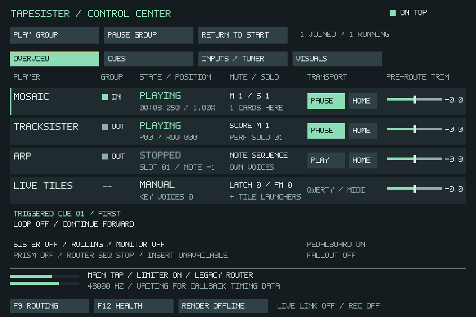
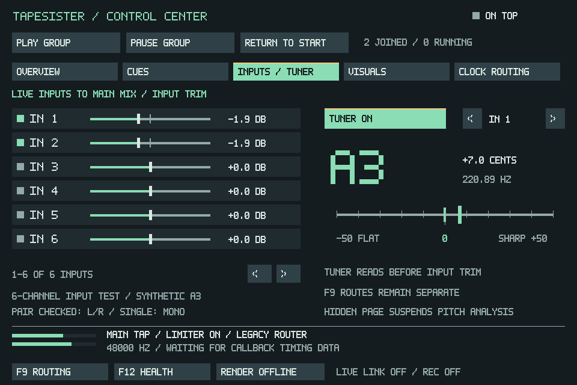

# F11 Control Center

Open **CFG → Transport**, **F11**, or **Ctrl+Shift+Space**. **Alt+F11** toggles
fullscreen. This modeless 960x640 window mixes ARP,
TrackSister (SisterTracker), and Mosaic while you work elsewhere. A fourth
**Live Tiles** fader controls your live instrument without transport buttons.
The Inputs/Tuner page adds the active device's live inputs and an optional tuner.

The screenshot is a native SDL integration fixture, not a measurement of a user's
project or hardware. TrackSister is playing outside the group while Mosaic is
joined. Playing, group membership, mute/solo and trim are separate states.

## Pages and status

The group commands and audio footer remain visible on all five pages. **Tab**
and **Shift+Tab** cycle pages while this window has focus. The original F11 and
Shift+Space shortcuts remain available from other workspaces, respecting text
entry, MIDI learn and modal ownership.

- **Overview:** Mosaic, TrackSister, ARP and Live Tiles; individual transport and
  pre-route trim. Click a player name for its cue/loop, tracker or ARP detail.
  The tracker position is the real playback row even with Follow off. Saved
  score mutes and live performance mutes/solo are reported separately.
- **Cues:** the existing sixteen Mosaic markers, immediate local seek and cue
  loop toggle. Releasing a loop continues forward. No other player is sought.
  A triggered cue label is not a claim that the playhead remains in that region.
- **Inputs/Tuner:** six physical inputs per page, trims and raw-input tuning.
- **Visuals:** all existing visualizer, freeze, seed, editor, symmetry and
  evolution controls. Offline Render remains available on every page.
- **Clock Routing:** optional internal/TrackSister master tempo, individual
  tempo followers, group start/pause and separate Home choices. See
  [Clock Routing](CLOCK_ROUTING.md) for playback and project compatibility.

The processor strip separates Sister on/off, rolling/hold and monitoring from
player transport. The footer reads existing MAIN-tap meter, limiter, routing and
callback diagnostics, with F9/F12 access. MAIN level is not a meter of every
direct hardware output. Recent callback activity and deadline overruns are
observations, not proof of acoustic audibility or a dropout. Card counts mean
cards at the timeline cursor; muted or finished one-shots may be included.

Master tempo starts off and older projects keep their existing timing.
Persistent loop cards remain future work; they must be separate clock/transport
destinations rather than automatically inheriting the main Mosaic playhead.

## Live inputs and Terra tuning

Choose the input device and physical input range in Audio Config. F11 lists the
channels actually exposed by that driver, six at a time; the arrow buttons page
through wider devices. Channels outside the configured range are unavailable.

- Check an input to add it to **Main Mix**, then drag or wheel its trim from
  silent to +6 dB. Right-click or double-click returns it to 0 dB.
- A single checked channel is centered. Checking both members of a physical
  pair (1/2, 3/4, etc.) preserves left/right stereo. Trim and selection changes
  are smoothed. All inputs start unchecked; project files retain their choices
  and trims. Closing F11 keeps checked inputs audible.
- These are additional live monitor feeds. Existing F9 physical-input routes,
  external Insert returns, and raw input recording remain independent. If an
  input already reaches Main Mix through F9, checking it here adds another feed.
- Switch **Tuner: On** and choose one physical input with the adjacent arrows.
  Hold one steady Terra note. The display shows its nearest chromatic note,
  frequency, and signed cents: negative is flat, positive is sharp. The center
  marker highlights within three cents. Reference tuning is A4 = 440 Hz.
- The tuner reads before these trims, so its mixer input may be unchecked or
  silent while tuning. Silence or an unreliable pitch produces no note; chords,
  heavy modulation, or noise may not yield a stable fundamental.
- The tuner starts off, is never enabled by a project load, and suspends when
  its page is hidden or F11 is minimized; closing F11 switches it off. Analysis runs at most ten times per second on the UI
  thread. The audio callback only performs bounded sample decimation/copying
  while tuning is enabled; it never performs pitch analysis or allocates memory.

ASIO duplex input uses the current audio block without an additional FIFO.
Independent capture/output clocks use the existing bounded monitor bridge.
Unavailable channels retain their saved settings but produce no input audio.
Opening Overview alone does not request an unused input device. Entering
Inputs/Tuner requests it; checked monitor feeds remain consumers across pages
and after closing F11.

The tuner screenshot uses a synthetic A3 test tone, seven cents sharp.

Status snapshots use the existing short audio exclusion and never export or
hash the tracker score. Arrangement metadata is UI-owned, cached at four Hz and
traversed outside that exclusion. Existing atomic routing/timing snapshots are
non-consuming; F11 does not drain F9 activity meters. Rendering remains capped
at twenty Hz and stops when the window is hidden or minimized. No callback DSP
or per-sample meter work is added by this cockpit.

| Control | Behavior |
| --- | --- |
| Channel checkbox/name | Includes that player in group commands; it does not mute it |
| Channel Play/Pause | Resumes or pauses TrackSister at its current row and Mosaic at its current time; ARP retains Play/Stop |
| Channel Home | Stops and rewinds just that player |
| Channel Gain | Silent through +6 dB; drag or wheel, double-click or right-click for 0 dB |
| Live Tiles | Shared QWERTY/MIDI and tile-launcher level, independent of the three players |
| Always on Top | Keeps the transport above other windows |
| ARP Clock | Local timing, or TrackSister quarter, eighth, or sixteenth notes |
| Play Group / Pause Group | Resumes or pauses checked players and the master cursor; running players continue on Play |
| Return to Start | Pauses the group and rewinds Home followers; Home initially follows group membership |
| Shift+Space | Pauses the group if any checked player is running; otherwise resumes it |
| Space | Keeps the active workspace's existing play/stop or Follow/live-edit behavior |

Selection, gains, clock links, Home choices and Always on Top save with the project.
Older projects open at 0 dB with ARP alone checked, local timing, and Always
on Top off. A saved legacy Restart Together setting is ignored. Opening this
window does not change sound.
Closing it leaves playback running. Unchecked players remain independent.

Channel gains act before routing, including effects sends, Matrix routes,
direct hardware outputs, and the tracker tape-input route. Changes are smoothed
over at most five milliseconds. ARP's fader trims only its sequenced voices;
manually held notes keep their own levels. Its existing volume/LFO still applies.
Live Tiles trims manual sample/FM notes, tile launchers and Sister tile groups,
including their custom outputs and sends; Mosaic audio and card gains stay intact.
Its default Matrix path is the Live Tile Bus. A silent channel keeps advancing, and shared effects can finish their tails.

The existing direct ARP clock link follows TrackSister BPM, including score tempo commands
within an audio buffer. A tempo change preserves the current note's beat phase.
The link temporarily overrides note intervals without replacing saved ARP slot
timing. Switch back to Local to use those intervals again. ARP slot-change and
LFO timers keep their own seconds settings. When TrackSister is stopped, its
current tempo still supplies the interval. Starting a channel independently does
not reposition another channel; use Return to Start, then Play Group for a
common beginning.

Mosaic shares the group play/pause and explicit rewind. It keeps its seconds
timeline and tape speed: the ARP clock link does not stretch Mosaic or alter its
pitch. The optional master adds internal tempo and rate following without changing
Mosaic's seconds timeline. Scheduled pattern cards keep their own saved timing.

Group changes publish under one shared output exclusion so checked players begin
at the same next audio callback boundary. Preparation happens first. If ARP has
no notes/playable audio or Mosaic is empty, group Play reports the problem before
starting the other players. Pause remains available. TrackSister resumes at its
paused row; Mosaic resumes at its paused time. Repeated Pause does not rewind.
Only Home or Return to Start rewinds these players in F11, including when Mosaic
has reached its end. Mosaic repeat mode still loops normally during playback.
ARP retains its existing pattern-start behavior after Stop. With custom Home
routes, group Return to Start rewinds Home followers separately from group
membership; a checked player ignoring Home pauses at its current position.
Text-entry fields and modal dialogs keep shortcut ownership.

In TrackSister, **double-click an occupied tile** to open that tile's editable
canvas, including tiles on another Sample page. Single-click still selects the
tracker instrument. Playback continues; F10 returns to TrackSister. Empty cells,
page arrows, and gutters do not open a canvas. Finish capture and return from a
parked Record/Mosaic bank before opening a Sample tile.

**Render Offline…** opens the native headless WAV renderer for Mosaic, TrackSister, or both.
It initially copies their group checkbox choices; render selection does not change group
transport. During export the button reads **Render Progress…**. See [Offline rendering](OFFLINE_RENDER.md).
