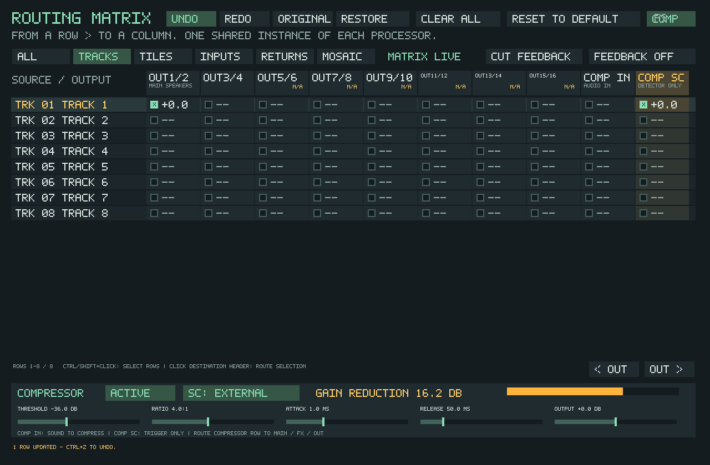

# Routable stereo compressor

Open **F9**, then **COMP** at the upper right. This reveals the compact
compressor panel and scrolls to its two input columns. Selecting the
**COMPRESSOR** return row also opens the controls.

- **COMP IN** receives the audio whose level will change.
- **COMP SC** receives the external detector signal. It never adds that audio
  to the compressor's audible output.
- The **COMPRESSOR** row sends the result to Main, other processors, or a
  physical output. A fresh matrix defaults this return to Main.

There is one shared stereo compressor. Multiple sources feeding COMP IN are
summed and compressed together. The processor starts bypassed and disconnected
at its input, so existing projects keep their sound.

## Kick-driven Mosaic or Prism

1. Keep the TrackSister kick track's normal audible route. Add a connection
   from that same track row to **COMP SC**.
2. Route the **MOSAIC BUS** or **PRISM** return to **COMP IN**. Turn off its
   previous direct Main connection to avoid an uncompressed parallel copy.
3. Route the **COMPRESSOR** return to **MAIN** (already present in a fresh
   matrix). Main normally continues through EQ and limiter to OUT 1/2.
4. Select **ACTIVE** and **SC: EXTERNAL** in the compressor panel.
5. Lower Threshold until the gain-reduction meter moves on each kick.
   Adjust Release to shape how the layer swells back between hits.

Selected Mosaic cards or tiles can feed COMP IN directly instead of using
their shared bus. A processor return, live hardware input, FM, Live Link, or
another individual TrackSister track can also feed COMP SC.



## Controls

| Control | Range | Default |
| --- | --- | --- |
| Threshold | -60 to 0 dBFS | -24 dBFS |
| Ratio | 1:1 to 20:1 | 4:1 |
| Attack | 0.1 to 200 ms | 10 ms |
| Release | 20 to 3000 ms | 250 ms |
| Output | -24 to +24 dB | 0 dB |

Drag or wheel a control; Shift+wheel adjusts finely; right-click restores
that control's default. **BYPASS / ACTIVE** and **SC: INTERNAL / EXTERNAL**
are explicit choices. Internal detection follows the audio at COMP IN.
External detection follows only COMP SC: a silent, stopped or disconnected
trigger releases compression rather than falling back to internal detection.
The amber meter shows attenuation before Output trim, with a 24 dB visual
scale and a numeric readout beyond that range. The COMP SC column has the
same activity indication as the other matrix inputs.

Compressor edits participate in matrix Undo/Redo, Original/Edited audition,
Restore, and the project's unsaved-change indicator. The panel is modeless;
playback continues while it is open. Legacy serial-router projects must first
use the matrix's existing import workflow before this processor can be routed.

## Audio design

The compressor uses a stereo-linked peak detector, a fixed 6 dB soft knee,
and feed-forward gain control. The detector takes the greater absolute
left/right level, preserving stereo balance and avoiding cancellation from
opposite-polarity stereo channels. Controls and bypass slew; detector timing
coefficients use double-precision state to retain accurate release timing.
No lookahead buffer, audio delay, allocation, additional lock, or worker wait
is introduced in the callback. Output trim is manual; there is no automatic
makeup gain. This is functional software compression, not analog 3630 modeling.

Both audio and detector edges participate in graph ordering. The detector is
available on the same sample even when driven by another processor's output.
An unapproved loop through either input is rejected. The existing explicit
feedback mode can instead insert its bounded 64-sample delayed edge at a
maximum gain of 50%; **CUT FEEDBACK** removes these edges too.

## Files and compatibility

All existing matrix IDs retain their meaning: original processors 0–6,
hardware destinations 7–14, and existing source rows 7–14. Compressor audio
is appended at destination/row 15 and sidechain at destination 16. Sidechain
is a destination only, never a processor output or physical output.

New saves use TSR39, TrackSister outer score v8, Mosaic v7 and Sister project
sidecar v36. Readers preserve the original 15-port layouts from older files
and leave the two added sends at zero. Compressor settings also persist in
the application INI. Older application versions cannot open the new project
formats; retain an original project copy when comparing releases.

## Validation

- `tapesister_compressor_tests`: static gain law, attack/release timing,
  five sample rates, linked stereo, nonfinite input, silent external key,
  detector-only silence, parameter/bypass smoothing, graph ordering and
  cycles, control ranges, project/INI/device-rate recall, TSR37/38 migration.
- `tapesister_source_route_controller_tests`: actual native TrackSister
  callback feeding COMP SC while its audible output stays constant; a
  looping Mosaic card ducks and recovers; disconnect, bypass, Undo/Redo,
  Original/Edited, wheel controls and scaled window input.
- Tracker and Mosaic storage regressions cover the new sends and old layouts.

The native controller fixture can also export a screenshot:

```sh
mkdir -p compressor-captures
./build/tapesister_source_route_controller_tests compressor-captures
```

The `compressor-track-sidechain.bmp` capture is the real SDL matrix renderer,
with 16.2 dB reduction in the test fixture. A listening check on a physical
interface and low-power laptop remains useful; synthetic/offline testing
does not establish physical-device dropout performance.
