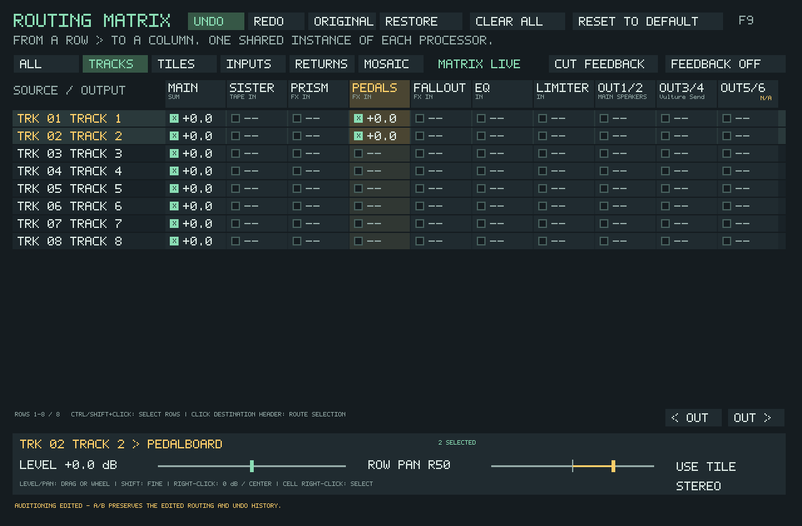
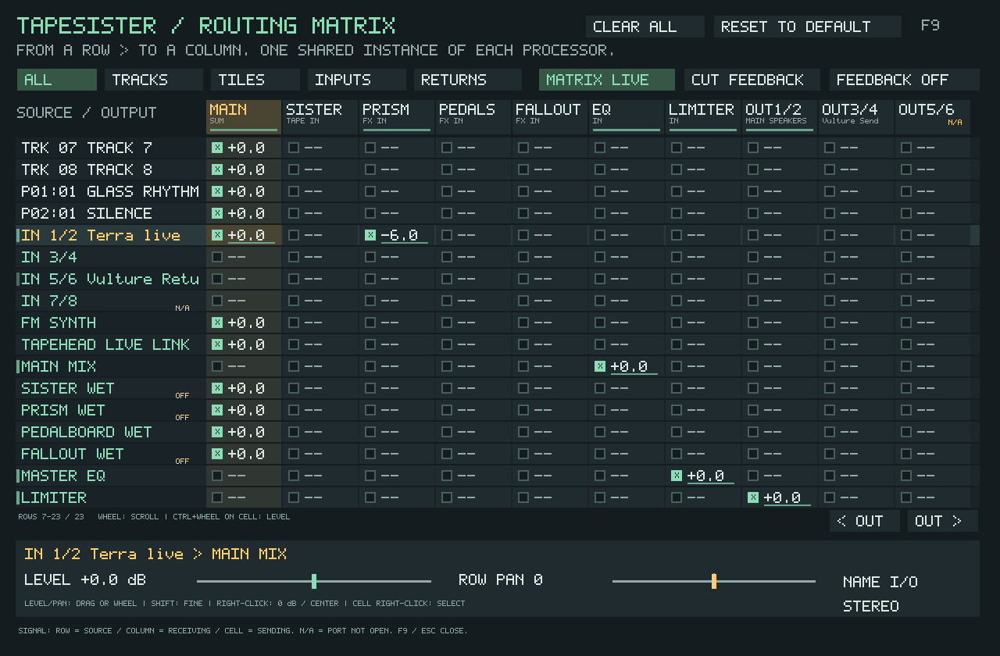

# F9 routing matrix

F9, tile right-click and TrackSister track-header right-click open the same
modeless window. Audio and keyboard playing continue while it is open.

**MATRIX LIVE** is a status indicator: this graph is controlling the audio.
It does not switch routing when clicked. Use **Original / Edited** for A/B listening.
It is not a sequencer. Storing/sequencing different matrix patches is
not implemented. The legacy Router Performance sequencer only affects the old
serial engine; Prism's Morph Matrix is a separate sound-morphing feature.

**Read across a row:** this sound goes to each checked destination column.
Multiple sources feeding a processor are summed into one shared instance.
Prism, Pedalboard and Fallout rows contain only the processed contribution.
Sister's row contains its tape/head mix. Dry audio needs its own connection;
checking a processor does not secretly add another dry copy.

## Normal stereo

New configurations start with tile/track sound, the Mosaic bus and FM/Live Link feeding
**Main Mix → Master EQ → Limiter → OUT 1/2**. External inputs start disconnected.
Track routes take precedence over tile routes. **Use Tile** makes the entire
track inherit the route of each played tile; **Use Track** gives it its own route.
An inherited row says TILE rather than pretending that every note has one route.

**Clear All** disconnects every source, processor and physical output, including
tracks and tiles hidden by the current filter or on other pages. It also cuts
feedback. The matrix stays active and silent so you can patch a new path.

**Reset to Default** restores the normal stereo path above: all tiles/tracks,
FM, Live Link and the Mosaic bus feed Main; Main feeds EQ, then limiter, then OUT 1/2. Effect
returns feed Main, but no source is sent to an effect. External inputs are
disconnected. All tracks own their routes again rather than inheriting tiles.

Both buttons act immediately, center row pan, restore stereo, disable graph
feedback and keep your hardware names. They affect the whole project even when
the grid is filtered. Processor settings, samples and notes are unchanged.
Using either button on a legacy project enables the matrix with the chosen
blank/default routing. Save the project to retain the result.

Older configurations and project files retain the old engine and saved sound.
**Use Matrix** imports a supported ordinary serial chain with its processor order,
bypass choices, dry/wet settings, return trims and existing DSP histories intact.
The initial graph therefore sounds the same before you edit it. Imported effects
say **MIX**, because their output includes the saved dry/wet mix; newly patched
**WET** rows retain the wet-only behavior described above. For example, a Mosaic
project using Prism and delay/reverb imports as Mosaic → Main → Prism MIX →
Pedalboard MIX → EQ → limiter → OUT 1/2. It does not start a dry default patch.

The importer currently supports ordinary Main-source serial chains. Live Sister,
parallel/direct source or send-return arrangements, an active external Insert,
Ambisonics, monitor/reference paths, and running Router transitions/automation
are not yet safely translated. In these cases **Use Matrix leaves every route
unchanged** and displays the reason. Clear All and Reset to Default remain
explicit ways to build a different patch; neither is a preservation operation.

The original routing is captured before your first Matrix edit. Original/Edited
compares it during this session; Restore replaces the edited version with it.

## Selection, undo and A/B

Ctrl-click row labels to select separate sources; Shift-click selects a range.
Click a destination header (with multiple rows selected), or a selected row's
cell, to route the whole selection. Mixed selections connect all rows first;
click again to disconnect all. Other destinations stay connected. Level and Pan
apply to the selection; the footer identifies mixed values. A batch is refused
in full if it contains an inherited/legacy row or creates an unapproved loop.
Convert inherited/legacy rows individually before including them in a batch.

**Undo / Redo**, **Ctrl+Z / Ctrl+Y / Ctrl+Shift+Z** work while the Matrix owns
keyboard focus. The last 32 edits include connections, gains, pan, mono,
inheritance, names, feedback, activation, Clear All and Reset. A whole drag or
bulk edit is one step. A fresh edit after Undo replaces the redo branch.

**Original / Edited** auditions the state captured before the first routing edit
in this project session. The Matrix Live status never changes the audition.
A/B preserves the edited version and undo history; return to Edited to make
changes. **Restore** asks before replacing your edited routing, and that restore
can itself be undone. Closing/reopening the Matrix keeps the session history.
Loading another project clears it. Undo/A/B restore routes and related legacy
controls, not tape contents, FX tails or transport time. Deleted sources are not
recreated or confused with new sources. History and the alternate A/B state are
not saved; saving stores the routing currently being auditioned.

## Mosaic routing

**MOSAIC BUS** appears with live inputs and defaults to Main. Patch it to shared
processors or hardware independently of keyboard tiles and tracker lanes.
The **Mosaic** filter exposes each card. A card marked **BUS** follows the bus.
Click a destination to make a custom route, or choose **Custom Route**, then
connect it. **Use Bus** removes the override. Custom routing replaces the bus
feed for that card, so it cannot add an unintended dry duplicate. Card routes
save with the arrangement and can be selected/edited/undone as a group.
Clear All also clears cards; Reset returns cards to the Mosaic bus.

## Connections and positioning

- Left-click a cell to connect/disconnect. A new connection starts at 0 dB.
- Right-click a cell to inspect it without toggling it.
- Drag or wheel over **Level** (its label or slider) to change the selected
  connection. Wheel steps are 1 dB; Shift+wheel gives 0.1 dB adjustments.
  Right-click Level to reset to **0 dB** (unity). As with dragging Level, this
  can connect a previously disconnected cell. Feedback connections keep their
  −6 dB ceiling. Ctrl+wheel over a connected grid cell also adjusts its level.
- **Row Pan** positions that source on all its outgoing connections. Track pan
  also updates the yellow scope indicator, including while stopped or muted.
  Drag or wheel over its label/slider; wheel steps are 5, or 1 with Shift.
  Right-click to center it at **0**. Inherited tracks remain read-only until
  **Use Track** is selected.
- **Stereo / Mono** preserves stereo or folds it to mono before pan. Mono plus
  full-left/right pan addresses a single speaker in an output pair.
- Wheel over the grid to scroll sources. The filters show tracks, tiles on all
  pages, external/live inputs, processor returns, or Mosaic cards. OUT arrows reveal more ports.
- Middle-click an input row or output column to rename it, or select it and use
  **Name I/O**. Enter saves; Escape cancels. IN/OUT numbers remain visible.

Small green indicators follow actual signal activity with a gentle fade:

- Beside a row: its source has audio, even if it is currently unpatched.
- Below a destination header: audio is arriving at that processor or output.
- Below a connected cell: that source is sending along the connection. Feedback
  indicators retain their amber color. Disconnected and unavailable cells stay dark.

An OFF processor can show incoming activity while its output row stays silent.
Physical output indicators are measured after the OUT fader and final hardware
guard; unavailable outputs never light. Track and tile indications follow route
ownership: a track using its own route does not light the overridden tile's
connections. Track activity still appears when it inherits its tiles.
These are activity cues, not calibrated meters or clipping indicators. Sources
are measured individually, so two signals that cancel when summed can light
their individual routes while the destination stays dark. Updates are limited
to 20 Hz while the matrix is visible, and stale indications fade if callbacks stop.

Physical destinations are pairs on the active output device, up to OUT 15/16;
input rows expose up to four pairs on the active input device. **N/A** means a
port is not open on the current device. It stays saved but produces silence;
it is never silently redirected into the main speakers. These physical matrix
outputs bypass the old spatial-array/Insert port reservation system.

The processors' own power/effect controls still apply. OFF labels distinguish
a connected processor from an enabled one. Pedalboard's row is its POST rack;
PRE/head placements remain local to Sister. Sister POWER, ROLL, HOLD and MONITOR
remain operational. Its old source trims are replaced by matrix connection
levels. Local head feedback remains inside Sister.

## Terra to three destinations

Name IN 1/2 “Terra”. On that row check Sister, Prism and Main (or a physical
output pair for a direct path). Set each connection level independently.
Sister and Prism each process the sum of all sources sent to them once.
Route their output rows to Main or to different hardware pairs as desired.

## Vulture across the whole mix

1. Name OUT 3/4 “Vulture Send” and IN 5/6 “Vulture Return”.
2. On Main Mix, disconnect EQ and connect OUT 3/4.
3. Connect IN 5/6 to Master EQ.
4. Keep Master EQ → Limiter → OUT 1/2 connected.

Connect the physical OUT 3/4 cables to Vulture and its outputs to IN 5/6.
No legacy Insert assignment is needed. Keeping Main → EQ connected as well
would intentionally mix dry with the hardware return; leave it disconnected
for a full-series hardware path.

Matrix checkbox, gain, pan and naming changes are live. Adding an input route
requests the active capture device automatically. Changing the audio backend,
ASIO driver or driver buffer applies from CFG without closing the application;
see [ASIO audio setup](ASIO_AUDIO.md). The matrix does not aggregate multiple
independent output devices.

## Feedback

Ordinary connections must form an acyclic graph. Enable **Feedback** to make a
connection that closes a loop. That connection is amber and marked F. It reads
a bounded output delayed by 64 samples and is limited to −6 dB maximum gain.
**Cut Feedback** removes all explicitly delayed connections and clears their
stored samples. No extra processor instances are created. Physical cable loops
are outside the graph and cannot be inferred from port aliases.

## Saving, recording and compatibility

TSR38 tile files, SISTRK v7 tracker scores, Mosaic format 6 and Sister state v32 preserve the
new source routes, graph, connection levels, row pan/mono and hardware aliases.
Old formats load; older application builds cannot read the new tile/score saves.
Opening a project replaces its matrix and aliases rather than retaining the
previous project's graph. The graph and aliases are also in saved configuration.
Saving a TSR project includes these settings in its accompanying project files.
Current saves use a named project folder containing the `.tsr`, `sister-state.ini`,
`project-data/` (including `sister-tracker.tst`) and `samples/`; move the complete
folder. Older layouts may use an adjacent `<name>.tsr.samples/` folder, which must
remain beside its TSR. See [project saving](USER_MANUAL.md#saving-moving-and-extracting-a-project).

FILE OUT records the main stereo program (OUT 1/2), before the final linked
hardware guard. It does not sum every separate speaker/send output. Sister's
H1/H2/H3 capture taps remain available. Matrix-routed input to Sister reaches
its tape directly; a second TRACK/EXT source switch is not required.

Internal route edits are compiled off the audio thread. The callback uses fixed
storage and one shared DSP history per processor. ASIO inputs use the same
borrowed duplex block as playback; asynchronous input devices use bounded,
resampling input bridges. Physical M6/Vulture listening remains a hardware check.

A legacy direct stereo route using nonadjacent/reversed speaker-array channels
is marked OLD, rather than showing an incorrect matrix checkbox. It keeps
playing its saved map. The row's **Use Matrix** button explicitly replaces that
map with Main Mix so it can be repatched using the physical pair columns.

Hardware-name editing displays a blinking caret, which returns to visible after
typing or Backspace. The matrix currently uses fixed colors; its background,
text, selection, routing and activity roles are not individually editable in
CFG → PALETTE. An expanded palette editor is a separate proposed follow-up.

## Import regression checks

The core routing test compares running serial and imported graphs, including
reordered effects, Prism dry level/mix, delay tails, Fallout and the program
ceiling. Controller tests check guarded activation, status-only Matrix Live,
A/B and activation undo/redo. Sister state v32 persists the MIX processing mode;
older files default to wet-only graph nodes.

For an optional real Mosaic project comparison, set
`TAPESISTER_MATRIX_IMPORT_PROJECT` to a portable `.tsr` and run
`tapesister_source_route_controller_tests`. The test does not save the project.
It renders 768,000 frames from 5:30, enables Matrix during playback, and compares
Original/Edited against an uninterrupted legacy render. A Pale Weight measured
a maximum absolute difference of `2.98023224e-08` per sample (float rounding).
