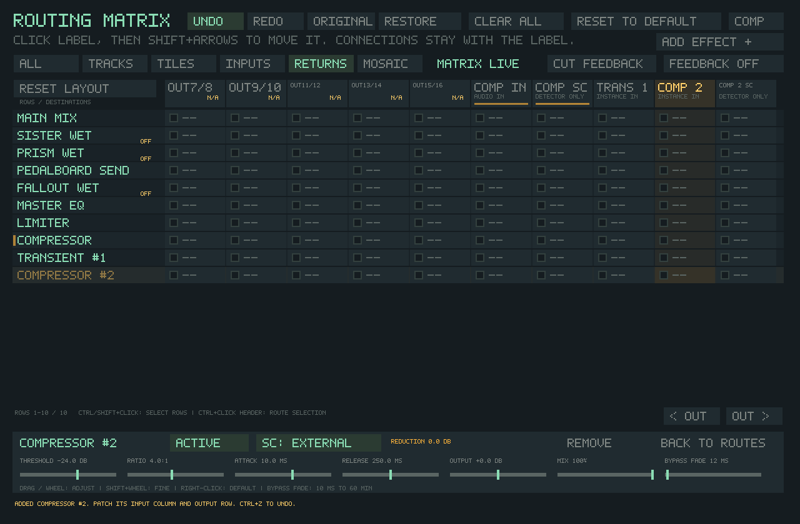
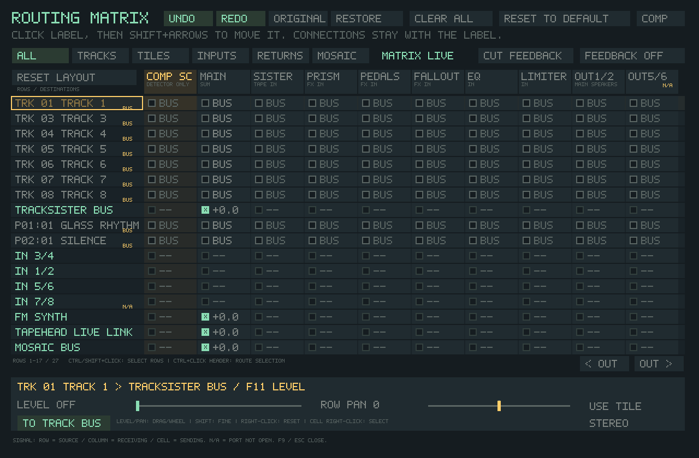
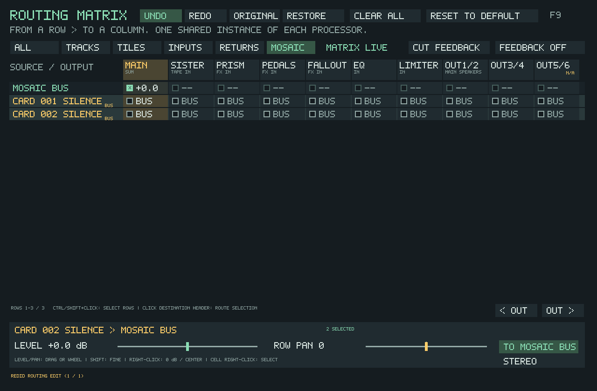
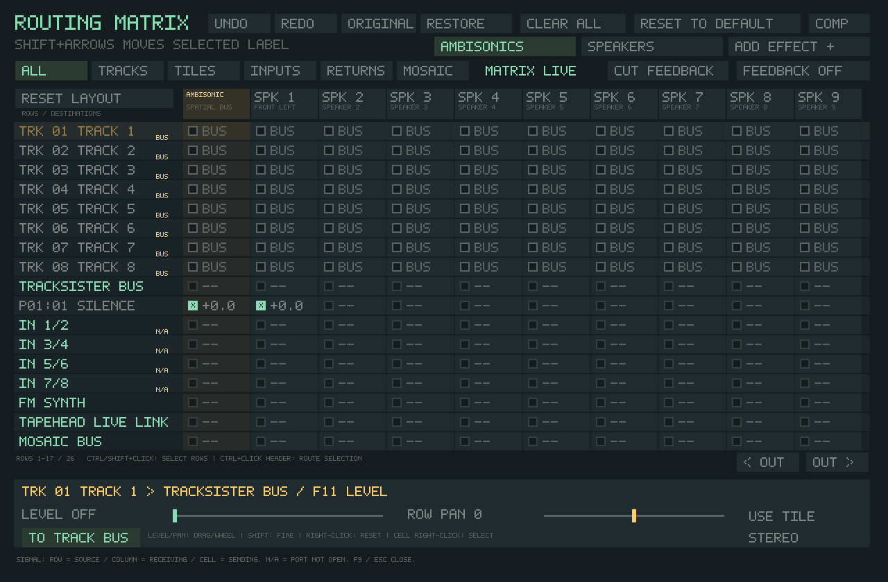

# F9 routing matrix

F9, tile right-click and TrackSister track-header right-click open the same
modeless window. Audio and keyboard playing continue while it is open.

**MATRIX LIVE** is a status indicator: this graph is controlling the audio.
It does not switch routing when clicked. Use **Original / Edited** for A/B listening.
It is not a sequencer. Storing/sequencing different matrix patches is
not implemented. The legacy Router Performance sequencer only affects the old
serial engine; Prism's Morph Matrix is a separate sound-morphing feature.

**Read across a row:** this sound goes to each checked destination column.
Multiple sources feeding one processor column are summed into that instance.
Added effects have independent columns and DSP histories.
Prism, Pedalboard and Fallout rows contain only the processed contribution.
Sister's row contains its tape/head mix. Dry audio needs its own connection;
checking a processor does not secretly add another dry copy.

## Independent effect instances

In Matrix mode, click **Add Effect +** and choose **Reverb, Delay, Distortion,
Grain, Transient, or Compressor**. Up to **16 added instances** can coexist with
the fixed processors and the five-slot pedalboard. You can use all 16 for one
type or mix types. Each has its own numbered row, input column, settings and DSP
history. Only occupied instance ports appear in the grid.

New effects start **unpatched**. Connect a source row to the instance's input
column, then connect its output row to another effect, Main, or a physical output.
For example: TrackSister Bus → Transient 1 → Reverb 2 → Transient 3 → Main.
Multiple sources can share an instance; multiple instances can run in parallel.
Added effects return their own dry/wet mix. Their default Mix is 100% processed;
use Mix to blend dry audio or make an explicit parallel dry connection.

Click an instance row label to edit it. **Back to Routes** exposes the ordinary
connection level and row pan controls. Selecting another source closes the added
instance panel. Escape closes the panel first, then the Matrix. Controls support
dragging, wheel, Shift+wheel for fine adjustment, and right-click for defaults.
Each instance has **Active / Bypass** and a **Bypass Fade** from 10 ms to 60 minutes.
Bypass fades to the dry signal; it does not mute the row. Parameter smoothing
remains independent of that enable/bypass fade.

Each added compressor also has its own **SC** destination. Patch the sound to
compress into its audio column, the trigger into its SC column, and select
**SC: External**. SC audio drives the detector only. You can use independent keys
for different compressors, or patch a processor output into another compressor's
key. Sidechain edges participate in the same cycle checks as audio edges.

**Remove** deletes the selected instance and all its incoming/outgoing routes,
including off-page tiles, hidden tracks and Mosaic cards. The change is undoable;
undo recreates the instance with its saved controls and connections, with a fresh
DSP history. A later new instance receives a new identity. Add/remove/control
edits participate in Matrix undo, A/B and project saving. Clear All and Reset to
Default retain instances/settings but disconnect their routes.

Row and column ordering works for added instances too. Their labels, controls,
meters and connections stay together through moves, filtering and undo. New ports
append at the end of a customized column layout.

The 16-instance limit bounds routing storage; it is **not** a promise that every
16-effect patch meets a device's audio deadline. Each node allocates only its
selected engine: at 48 kHz, 16 grain nodes use about 30 MiB of effect storage,
16 reverbs about 9 MiB, and 16 transient shapers about 20 KiB. Allocation and
retirement run on the control thread. Completely unpatched, silent nodes skip
DSP; connected reverb/delay histories keep processing their tails. Bypass retains
state and is not a CPU-unload switch. Remove releases the instance after a short
lifecycle fade. If an edit catches that fade, it is refused without changes and
can be retried; offline editing retires it immediately.

Build and run `tapesister_routing_matrix_instances_tests` for headless checks of
16-stage chains, parallel reverbs, mixed graphs, delayed feedback, independent
sidechains, extreme controls/signals, persistence and repeated removal/recreation.
It prints CPU time and allocated effect memory for each patch. CPU time is measured
on the host running the test, excludes much of the complete application, and is
not a real-time deadline guarantee. The native source-routing controller test also
checks the actual audio callback and linked physical-output guard with 16 boosted
transient shapers. Internal graph levels can be far above unity; FILE OUT remains
before the physical guard, so route through the Limiter when that is desired.

## Normal stereo

New configurations start with tile/track sound, the Mosaic bus and FM/Live Link feeding
**Main Mix → Master EQ → Limiter → OUT 1/2**. External inputs start disconnected.
Track routes take precedence over tile routes. **Use Tile** makes the entire
track inherit the route of each played tile; **Use Track** gives it its own route.
An inherited row says TILE rather than pretending that every note has one route.

**Clear All** disconnects every source, processor and physical output, including
tracks and tiles hidden by the current filter or on other pages. It also cuts
feedback. The matrix stays active and silent so you can patch a new path.

**Reset to Default** restores the normal stereo path above: all tiles/tracks,
FM, Live Link and the Mosaic bus feed Main; Main feeds EQ, then limiter, then OUT 1/2. Effect
returns feed Main, but no source is sent to an effect. External inputs are
disconnected. All tracks own their routes again rather than inheriting tiles.

Both buttons act immediately, center row pan, restore stereo, disable graph
feedback and keep your hardware names. They affect the whole project even when
the grid is filtered. Processor settings, samples and notes are unchanged.
Using either button on a legacy project enables the matrix with the chosen
blank/default routing. Save the project to retain the result.

Older configurations and project files retain the old engine and saved sound.
**Use Matrix** imports a supported ordinary serial chain with its processor order,
bypass choices, dry/wet settings, return trims and existing DSP histories intact.
The initial graph therefore sounds the same before you edit it. Imported effects
say **MIX**, because their output includes the saved dry/wet mix; newly patched
**WET** rows retain the wet-only behavior described above. For example, a Mosaic
project using Prism and delay/reverb imports as Mosaic → Main → Prism MIX →
Pedalboard MIX → EQ → limiter → OUT 1/2. It does not start a dry default patch.

The importer currently supports ordinary Main-source serial chains. Live Sister,
parallel/direct source or send-return arrangements, an active external Insert,
Ambisonics, monitor/reference paths, and running Router transitions/automation
are not yet safely translated. In these cases **Use Matrix leaves every route
unchanged** and displays the reason. Clear All and Reset to Default remain
explicit ways to build a different patch; neither is a preservation operation.

The original routing is captured before your first Matrix edit. Original/Edited
compares it during this session; Restore replaces the edited version with it.

## Main Mix early clipping and headroom

Select the **MAIN MIX** row in F9. Its footer shows **EARLY CLIP** with separate
**ON** and **OFF** buttons; the highlighted button is the current choice.

- **ON** retains the legacy program ceiling before downstream effects. It can
  flatten loud sums even when the OUT fader is low.
- **OFF** lets floating-point peaks pass through Main Mix to later effects,
  attenuation and limiting. Final output safety remains active.

Existing projects keep their saved sound. A normal Matrix graph starts with
early clipping OFF. **Use Matrix** imports an eligible legacy chain with early
clipping ON, preserving its original ceiling. The buttons require an active
Matrix; an unsupported legacy chain is not silently rewired to enable them.
The choice affects only paths through Main Mix. Routes directly to another
processor, a physical output or speakers do not pass through this control.
Sister's tape/head processing can still saturate independently.

For a direct A/B of one saved project, loop the same passage, select Main Mix,
and alternate ON/OFF without changing levels, effects or routes. The live
change fades over 12 ms; listen after that transition. Ctrl+Z/Redo also work.
If the project already shows OFF, its Main Mix is already preserving headroom;
this is not evidence that it previously clipped. Keep your normal listening
level conservative: removing distortion can raise peaks into later processors.

Save the project to retain the chosen mode. Older files infer their historical
mode automatically; older TapeSister builds ignore the optional new override
and use their historical mode again. F12's Active setup reports the effective
Main Mix headroom mode, not a measured clipping count. Internal legacy capture
taps are unchanged; this control does not promise unclipped audio at every tap.
See the [controlled callback investigation](validation/program-bus-headroom.md)
for measurements, routing details and limitations.

## Selection, undo and A/B

Ctrl-click row labels to select separate sources; Shift-click selects a range.
Ctrl-click a destination header (with multiple rows selected), or a selected row's
cell, to route the whole selection. Mixed selections connect all rows first;
click again to disconnect all. Other destinations stay connected. Level and Pan
apply to the selection; the footer identifies mixed values. A batch is refused
in full if it contains an inherited/legacy row or creates an unapproved loop.
Convert inherited/legacy rows individually before including them in a batch.

**Undo / Redo**, **Ctrl+Z / Ctrl+Y / Ctrl+Shift+Z** work while the Matrix owns
keyboard focus. The last 32 edits include connections, gains, pan, mono,
inheritance, names, feedback, activation, layout moves, effect instances and their controls, Clear All and Reset. A whole drag or
bulk edit is one step. A fresh edit after Undo replaces the redo branch.

**Original / Edited** auditions the state captured before the first routing edit
in this project session. The Matrix Live status never changes the audition.
A/B preserves the edited version and undo history; return to Edited to make
changes. **Restore** asks before replacing your edited routing, and that restore
can itself be undone. Closing/reopening the Matrix keeps the session history.
Loading another project clears it. Undo/A/B restore routes and related legacy
controls, not tape contents, FX tails or transport time. Deleted tiles/cards are not
recreated or confused with new sources. Removed effect instances are recreated
when undo/A/B restores them; their old audio histories are not restored. History and the alternate A/B state are
not saved; saving stores the routing currently being auditioned.

## Organizing the grid

Click a **row label**, then hold **Shift** and press **Up / Down** to move it
one visible row at a time. Click a **column header**, then use **Shift + Left /
Right** to move that destination. A yellow outline identifies the label that
will move. Hold an arrow to repeat; the view scrolls to keep the moved label
visible. Rows and columns have independent orders, so you can arrange checked
connections into a diagonal or staircase that follows your signal flow.

A plain header click now selects without changing any connections, including
when multiple rows are selected. Use **Ctrl-click on a header** to route a
multi-row selection, or click a cell as before. Ctrl-click and Shift-click on
row labels still select separate rows and ranges. Shift-arrows move only the
focused row, preserving the other selected sources.

Reordering changes presentation only: routes, gains, hardware channel numbers,
processor order, sidechain connections and audio histories stay attached to the
same source/destination. Meters follow their labels. This adds no per-sample DSP.
In a filtered view, moves swap adjacent visible rows; hidden rows retain their
relative order. Tile and Mosaic-card positions follow stable identities rather
than their current slot numbers. New sources append after a customized order;
deleted sources do not transfer their position to a replacement.

**Reset Layout**, above the source labels, restores both default orders without
changing routing. Layout moves and Reset Layout use the existing 32-step Matrix
Undo/Redo history. Clear All and Reset to Default still affect routing and leave
the layout alone. As with other Matrix edits, return to **Edited** before moving
labels while auditioning Original.

Save the project to keep its layout. Sister state **version 41** stores the two
orders independently of the audio graph. Older projects start in the default
layout; older application versions cannot read the new layout keys. Global INI
routing does not copy a project's arrangement into another project.

## Mosaic routing

**MOSAIC BUS** appears in All and Mosaic filters and defaults to Main. Patch it to shared
processors or hardware independently of keyboard tiles and tracker lanes.
The **Mosaic** filter exposes each card. A card marked **BUS** follows the bus.
Click a destination to make a custom route. Select one or more cards and click
**To Mosaic Bus** (bottom right) to remove their overrides. Custom routing replaces the bus
feed for that card, so it cannot add an unintended dry duplicate. Card routes
save with the arrangement and can be selected/edited/undone as a group.
Clear All also clears cards; Reset returns cards to the Mosaic bus.

## Live tile bus

**LIVE TILE BUS** appears in All and Tiles filters. Tiles without a custom route
feed it; it defaults to Main. A tile's first destination click replaces its bus
feed. **To Tile Bus** returns the selected tiles to it, with Matrix undo/redo.
TrackSister and ARP retain their own routing and levels.

Open **F11** and lower **Live Tiles** to trim QWERTY/MIDI playing and tile launchers
without lowering Mosaic, ARP or TrackSister. This shared trim also reaches custom
tile outputs and effects sends. It defaults to 0 dB, works in legacy and Matrix
modes, and saves with the project. The bus row controls routing of default tile
feeds; the Live Tiles fader controls all manually played voices, including FM
and Sister tile groups. Browser/transport preview has its existing level.

Mosaic cards reference audio sources copied into the arrangement. Cards sharing
a source can share edits through Update All, but live tile gain never edits that
audio or the card gains. Existing arrangements keep their sound at the default
0 dB setting.

## Connections and positioning

- Left-click a cell to connect/disconnect. A new connection starts at 0 dB.
- Right-click a cell to inspect it without toggling it.
- Drag or wheel over **Level** (its label or slider) to change the selected
  connection. Wheel steps are 1 dB; Shift+wheel gives 0.1 dB adjustments.
  Right-click Level to reset to **0 dB** (unity). As with dragging Level, this
  can connect a previously disconnected cell. Feedback connections keep their
  −6 dB ceiling. Ctrl+wheel over a connected grid cell also adjusts its level.
- **Row Pan** positions that source on all its outgoing connections. Track pan
  also updates the yellow scope indicator, including while stopped or muted.
  Drag or wheel over its label/slider; wheel steps are 5, or 1 with Shift.
  Right-click to center it at **0**. Inherited tracks remain read-only until
  **Use Track** is selected.
- **Stereo / Mono** preserves stereo or folds it to mono before pan. Mono plus
  full-left/right pan addresses a single speaker in an output pair.
- Wheel over the grid to scroll sources. The filters show tracks, tiles on all
  pages, external/live inputs, processor returns, or Mosaic cards. OUT arrows reveal more ports.
- Middle-click an input row or output column to rename it, or select it and use
  **Name I/O**. Enter saves; Escape cancels. IN/OUT numbers remain visible.

Amber/orange indicators follow actual signal activity with the same gentle fade:

- Beside a row: its source has audio, even if it is currently unpatched.
- Below a destination header: audio is arriving at that processor or output.
- Below a connected cell: that source is sending along the connection. Feedback
  indicators remain yellow. Disconnected and unavailable cells stay dark.

An OFF processor can show incoming activity while its output row stays silent.
Physical output indicators are measured after the OUT fader and final hardware
guard; unavailable outputs never light. Track and tile indications follow route
ownership: a track using its own route does not light the overridden tile's
connections. Track activity still appears when it inherits its tiles.
These are activity cues, not calibrated meters or clipping indicators. Sources
are measured individually, so two signals that cancel when summed can light
their individual routes while the destination stays dark. Updates are limited
to 20 Hz while the matrix is visible, and stale indications fade if callbacks stop.

Physical **OUT** destinations are pairs on the active output device, up to OUT 15/16;
input rows expose up to four pairs on the active input device. Output columns
appear only when at least one channel is available inside **CFG → OUTPUT RANGE**.
A partly enabled pair is labeled with its one active output. Hidden output routes
stay saved and produce silence; they are never redirected into the main speakers.
Input **N/A** means that port is not open on the current device. These physical matrix
outputs bypass the old spatial-array/Insert port reservation system.

The processors' own power/effect controls still apply. OFF labels distinguish
a connected processor from an enabled one. Pedalboard's row is its POST rack;
PRE/head placements remain local to Sister. Sister POWER, ROLL, HOLD and MONITOR
remain operational. Its old source trims are replaced by matrix connection
levels. Local head feedback remains inside Sister.

## Speakers and Ambisonics

**SPEAKERS** opens the same setup as **CFG → SPEAKER SETUP**. Set the active count
(1–16), name speakers, assign physical output channels and test them. SAVE CONFIG
keeps this hardware setup across projects. **SPK 1…16** destinations send a mono
average of each incoming stereo signal to those speakers. A speaker column appears
only if it is enabled in Speaker Setup and its mapped output is both open on the
device and inside the saved output range. Hidden speaker routes stay saved and
reappear when available again. OUT pairs follow the same output range.

**AMBISONICS** opens the separate Field / Speakers / Motion window (Ctrl+F9).
Connect any source or processor output to the **AMBISONICS** destination, choose
3–16 active speakers for its array, and enable it. **INPUT ROUTES** returns to the
Ambisonics column. Array members can simultaneously receive direct SPK routes:
the decoded field and direct sound add together. Muting Ambisonics affects only
that layer. Missing array members mute that layer without redirecting it to Main.
All bus inputs share the same field and motion controls. See the
[setup and four-speaker layering example](AMBISONICS.md).

## Terra to three destinations

Name IN 1/2 “Terra”. On that row check Sister, Prism and Main (or a physical
output pair for a direct path). Set each connection level independently.
Sister and Prism each process the sum of all sources sent to them once.
Route their output rows to Main or to different hardware pairs as desired.

## Vulture across the whole mix

1. Name OUT 3/4 “Vulture Send” and IN 5/6 “Vulture Return”.
2. On Main Mix, disconnect EQ and connect OUT 3/4.
3. Connect IN 5/6 to Master EQ.
4. Keep Master EQ → Limiter → OUT 1/2 connected.

Connect the physical OUT 3/4 cables to Vulture and its outputs to IN 5/6.
No legacy Insert assignment is needed. Keeping Main → EQ connected as well
would intentionally mix dry with the hardware return; leave it disconnected
for a full-series hardware path.

Matrix checkbox, gain, pan and naming changes are live. Adding an input route
requests the active capture device automatically. Changing the audio backend,
ASIO driver or driver buffer applies from CFG without closing the application;
see [ASIO audio setup](ASIO_AUDIO.md). The matrix does not aggregate multiple
independent output devices.

## Feedback

Ordinary connections must form an acyclic graph. Enable **Feedback** to make a
connection that closes a loop. That connection is amber and marked F. It reads
a bounded output delayed by 64 samples and is limited to −6 dB maximum gain.
**Cut Feedback** removes all explicitly delayed connections and clears their
stored samples. No extra processor instances are created. Physical cable loops
are outside the graph and cannot be inferred from port aliases.

## Saving, recording and compatibility

TSR41 tile files, SISTRK v10 tracker scores, Mosaic format 9 and Sister state v42
preserve the expanded source routes, effect instances and their settings, graph,
connection levels, row pan/mono, hardware aliases and Ambisonics array settings.
Speaker count, names and physical mappings remain global CFG preferences.
Old formats load; older application builds cannot read the new tile/score saves.
Opening a project replaces its matrix and aliases rather than retaining the
previous project's graph. The graph and aliases are also in saved configuration.
Saving a TSR project includes these settings in its accompanying project files.
Current saves use a named project folder containing the `.tsr`, `sister-state.ini`,
`project-data/` (including `sister-tracker.tst`) and `samples/`; move the complete
folder. Older layouts may use an adjacent `<name>.tsr.samples/` folder, which must
remain beside its TSR. See [project saving](USER_MANUAL.md#saving-moving-and-extracting-a-project).

FILE OUT records the main stereo program (OUT 1/2), before the added direct SPK
and decoded Ambisonics layers and the final linked hardware guard. It does not sum every separate speaker/send output. Sister's
H1/H2/H3 capture taps remain available. Matrix-routed input to Sister reaches
its tape directly; a second TRACK/EXT source switch is not required.

Internal route edits are compiled off the audio thread. The callback uses fixed
routing storage and one independent DSP history per active processor instance. ASIO inputs use the same
borrowed duplex block as playback; asynchronous input devices use bounded,
resampling input bridges. Physical M6/Vulture listening remains a hardware check.

A legacy direct stereo route using nonadjacent/reversed speaker-array channels
is marked OLD, rather than showing an incorrect matrix checkbox. It keeps
playing its saved map. The row's **Use Matrix** button explicitly replaces that
map with Main Mix so it can be repatched using the physical pair columns.

Hardware-name editing displays a blinking caret, which returns to visible after
typing or Backspace. The matrix currently uses fixed colors; its background,
text, selection, routing and activity roles are not individually editable in
CFG → PALETTE. An expanded palette editor is a separate proposed follow-up.

## Import regression checks

The core routing test compares running serial and imported graphs, including
reordered effects, Prism dry level/mix, delay tails, Fallout and the program
ceiling. Controller tests check guarded activation, status-only Matrix Live,
A/B and activation undo/redo. Sister state v32 persists the MIX processing mode;
older files default to wet-only graph nodes.

For an optional real Mosaic project comparison, set
`TAPESISTER_MATRIX_IMPORT_PROJECT` to a portable `.tsr` and run
`tapesister_source_route_controller_tests`. The test does not save the project.
It renders 768,000 frames from 5:30, enables Matrix during playback, and compares
Original/Edited against an uninterrupted legacy render. A Pale Weight measured
a maximum absolute difference of `2.98023224e-08` per sample (float rounding).

Mosaic OUTPUT uses the same stereo tap; it does not capture the added speaker layers.
