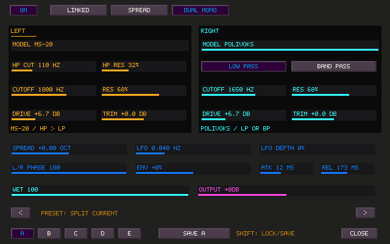
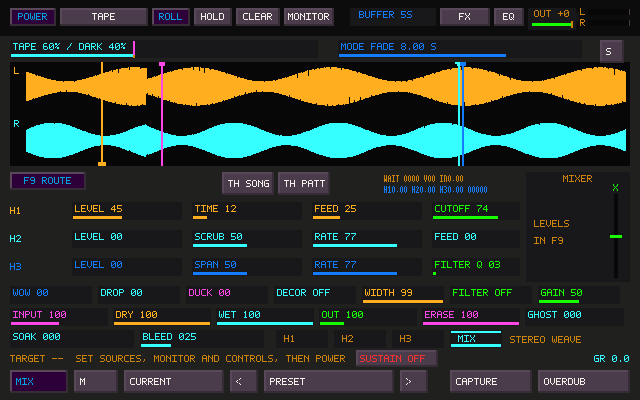

# Stereo character filters

Select **FILTER** in a pedalboard slot and click **EDIT FILTER**. F9 also has an
independent **FILTER** effect instance, with the same editor and DSP. Every slot,
placement and Matrix instance owns its own channel histories.

The compact row exposes output gain, cutoff, resonance, drive and mix. In dual
mono it edits the channel selected by clicking LEFT or RIGHT in the editor.
The expanded editor uses the same palette, drag/wheel gestures and resizable
native window mapping as Sister Machine.

| Routing | Behavior |
| --- | --- |
| Linked | Shared left-bank settings and modulation, independent L/R audio histories |
| Spread | Shared base settings, a signed stereo cutoff offset, adjustable LFO phase |
| Dual mono | Independent models, cutoffs, resonance, drive and trim; independent envelope detectors |

The **MS-20** model has high-pass and low-pass sections, with separate cutoffs
and resonance. **POLIVOKS** provides low-pass or band-pass operation. Drive
covers 0–24 dB; channel trim and shared output each cover −12 to +12 dB.
Cutoff is logarithmic from 20 Hz to 20 kHz, bounded internally below Nyquist.

LFO rate spans 0.005–20 Hz, with depth and 0–180 degree channel phase. Envelope
amount is bipolar; attack spans 1–500 ms and release 10–3000 ms. The effective
channel coefficients are smoothed even when changing between linked and dual
routing. Model and LP/BP changes blend their running returns.

## Presets and recall

The seven starting sounds are OPEN TAPE, MS-20 BITE, POLIVOKS SNARL, SPLIT
CURRENT, SLOW OPPOSITES, TOUCH FILTER and HOLLOW BAND. Arrows browse them.

A–E capture the filter settings, including routing and modulation. Click an
empty state to capture, click a stored state to recall, Shift-click to replace,
and middle-click to clear. SAVE writes the currently selected state (A initially).
Wet and shared output remain independent of the A–E sound captures, as with the
existing granular sound states. Projects and Sister presets preserve all of them.

Shift-click a parameter to lock it. Locked settings are retained by factory and
A–E recall. Ctrl+Shift+M enters MIDI learn; click an editor parameter and move a
controller. Pedal parameters use new IDs 4000–4639, separate from existing IDs.
Matrix mappings address stable effect IDs, so deleting/reusing a port cannot
redirect a mapping onto another instance.

Sister project state v48 and preset v25 add filter records and memory-blend
settings. Older files still load with the existing effect IDs, default filter
controls and the original 200 ms memory-mode transition. Matrix compressor ID 6
is unchanged; Matrix filters use new ID 7.

## DSP design and scope

These are original **circuit-inspired behavioral models**, not measured or
component-exact hardware emulations. The Korg35-inspired branch uses an
unequal-section damping law, signal-dependent resonance, asymmetric frequency
motion and a forward saturation path. The Polivoks-inspired branch uses a
separate nonlinear damping law and finite-slew integrator behavior. Both use
trapezoidal state updates and a fixed 2x nonlinear core, with bounded writes,
DC conditioning and denormal cleanup. Input interpolation and output averaging
provide modest antialiasing, not a claim of eliminating all aliasing.

There is no allocation, file I/O, UI-driven modulation or locking inside the
filter frame processor. Both model histories remain warm for smooth model
changes. MIDI, preset edits and saves are control-thread work.

References: [Tim Stinchcombe's MS-10/MS-20 circuit study](https://www.timstinchcombe.co.uk/synth/MS20_study.pdf),
[KORG's MS-20 description](https://www.korg.com/us/products/synthesizers/ms_20mini/page_1.php),
and [Erica Synths' Polivoks manual](https://www.ericasynths.lv/media/Black_Polivoks_VCF_v2_Manual_Preview.pdf).
Hardware listening/reference comparisons remain the way to assess tonal fidelity.

## Tape / Dark Matter crossfade

The strip above the memory display adds two controls:

- **TAPE / DARK:** a manual blend fader, 0–100%, smoothed over 50 ms. You can park
  it anywhere and hear both memories. It does not switch the control page.
- **MODE FADE:** sets the destination button's travel time, from 20 ms to 120 s.
  Clicking the Tape/Dark Matter header button selects an endpoint and uses that
  time. The live fader and percentages show the current blend; a small mark
  shows its destination. Changing time during a transition retimes the remaining
  move, and changing direction starts from the current blend without a jump.

Both memories keep running and retain their contents. The existing bounded
level match is latched only when leaving a settled endpoint, never continuously
chased during a long blend. Manual blend, fade time and endpoint choice save in
projects/presets and startup preferences; MIDI targets are 3010 and 3011.
