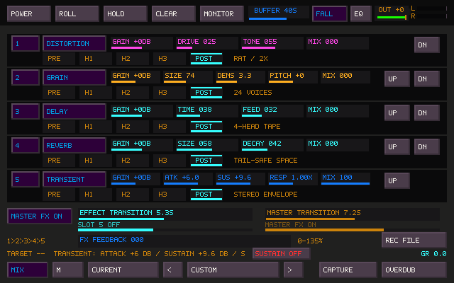
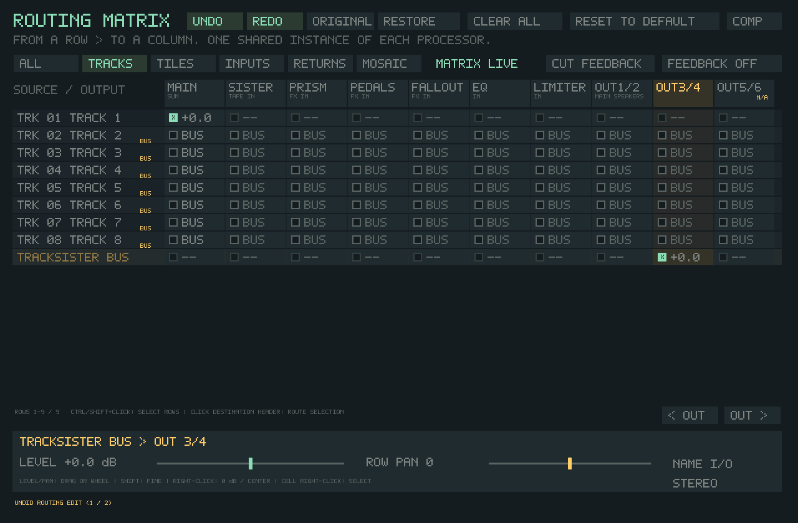

# Transient pedalboard

The pedalboard has five interchangeable slots. Click a slot's type button until
**TRANSIENT** appears. Slot 5 starts empty; loading an older project or preset
keeps its original four slots and sound.

| Control | Range | Use |
| --- | --- | --- |
| ATK | −15 to +15 dB | Soften or emphasize the start of a sound |
| SUS | −24 to +24 dB | Shorten or emphasize its decay |
| RESP | 0.25× to 4× | Scale detector timing; 1× is the starting point |
| MIX | 0–100% | Blend the shaped signal with its input |
| GAIN | −12 to +12 dB | Match the resulting level |

ATK/SUS at zero and GAIN at zero give exact unity at every MIX value. The
processor adds no audio delay. Both channels share one detector and gain, so
opposite-polarity stereo material still triggers correctly and keeps its balance.
Sustain increases existing decay; it does not generate a reverb tail from silence.
Higher RESP values follow longer events; lower values suit shorter ones.

A useful first experiment is a dry drum loop, MIX 100%, RESP 1× and GAIN 0 dB.
Try ATK +6 dB, then −6 dB. Return ATK to zero and try SUS −12 dB, then +6 dB.
Match loudness with GAIN before deciding which version you prefer. All five
slots support PRE, individual heads, POST, reorder, MIDI learn, parameter locks,
and the existing independent effect/master transition clocks.

## Routing

In the normal chain, the pedalboard already processes the full signal. In the
routing matrix, select the **PEDALS** row and choose **MODE: INSERT** to process
the full signal there. Route the source through PEDALS and remove that source's
parallel direct route when you want transient cuts to affect the whole sound.

**MODE: SEND** retains the existing wet-return behavior. A parallel dry path
continues to carry the original transient. Insert bypass restores its input;
Send bypass silences its return. The mode change slews over 12 ms and advances
the shared DSP only once per sample. Mode selection is saved in projects/config
and participates in matrix Undo/Redo and Original/Edited history. Existing
matrix projects retain their mode until explicitly changed.

### TrackSister group processing

Open **F9 → TRACKS** and select **TRACKSISTER BUS**, directly below the individual
track rows. It collects tracks using their normal output, after the F11 TrackSister
level. Its default route is Main, preserving the existing mix. To shape the group,
disconnect the bus from Main, connect it to PEDALS, and use **MODE: INSERT** on the
pedalboard row. The bus also has the usual level, pan, mono, hardware-output and
compressor/sidechain routing controls.

An explicit individual track route bypasses this bus. To put any selection of
tracks back into the group, select those track rows and click **TO TRACK BUS** at
the bottom left. Ctrl/Shift selection and Undo/Redo work for this action. **USE TILE**
still follows each playing tile's route; only tiles using their normal output
then reach the TrackSister bus. Live keyboard tiles, FM, Mosaic and preview audio
remain separate. F11 TrackSister level controls both grouped and direct tracks.

Reset to Default returns tracks to the bus; Clear All disconnects it along with
the other routes. Project-state version 38 saves the new source row, and older
projects receive a unity route to Main. Existing destination IDs are unchanged.
The duplicate F9 hint has been removed from the COMP button; it remains in the
window title and footer.

## Design and compatibility

This is an original digital interpretation of the differential-envelope idea
explained in SPL's [Transient Designer 4 Mk2 documentation](https://spl.audio/en/spl-produkt/transient-designer-4-mk2/)
and [Transient Designer 2 manual](https://spl.audio/wp-content/uploads/transient_designer_2_9946_manual.pdf).
The familiar attack/sustain ranges and threshold-free interaction are the
reference. The detector timing and adaptive release are our own design; no
hardware measurements or matched listening comparison establish circuit-level
or sonic equivalence. Response, parallel Mix and TapeSister's placement/transition
controls extend that starting point.

The detector compares normalized fast and slow envelopes, with separate onset
and decay paths. A relative ripple dead band rejects small carrier fluctuations.
A smooth near-silence guard protects floating-point residue; ordinary signals
above −140 dBFS use the normalized response. Control edits slew over 12 ms;
Mix and makeup gain slew over 20 ms. Coefficient exponentials are cached at
control changes. The sample path has bounded work and no allocation or locks.

Processor IDs and all existing MIDI/lock parameter IDs retain their values.
Slot 5's five parameters are appended after Prism instead of taking its IDs.
Project-state version 37 introduced the new slot, as did preset version 21; older versions
load it empty. Each slot/location owns independent history. Visual snapshots
include the new type without reassigning Prism's Mandala channel.

The fifth slot increases the board's preallocated reverb/delay/grain storage by
about 15.8 MiB at 48 kHz, even when empty. The transient processor itself uses
only small fixed state. This preserves the existing allocation-free live type
switching behavior. Physical-device CPU headroom and musical tuning still need
listening on the target machine.

## Verification

`tapesister_transient_tests` checks unity, onset/tail boost and cut, level scaling,
stereo linking, silence, nonfinite input, Response timing, steady carriers,
8/44.1/48/96/192 kHz processing, independent head history, fifth-slot project and
preset recall, legacy project/preset defaults, sample-rate reconfiguration, three-minute
slot and independent master fades, and matrix Insert/Send audio behavior.

`tapesister_transient_controller_tests` drives the native controller, checking
all fifth-row fields, MIDI targets, stable IDs, parameter locks, reorder, both
clock hitboxes, and matrix mode Undo/Redo. With any argument it also writes native
framebuffer screenshots. The legacy hit-test helper also guards its optional model pointer, allowing the
existing Sister UI fixtures to run. The Mandala controller fixture checks distinct Prism
and Transient channels. Both new fixtures are mandatory Linux/Windows release
gates.

The routing and source-route controller fixtures additionally check TrackSister
group audio, independent track overrides, live tile isolation, F11 trim, bus
meters, return-to-bus Undo/Redo, current/legacy project recall and reset behavior.

