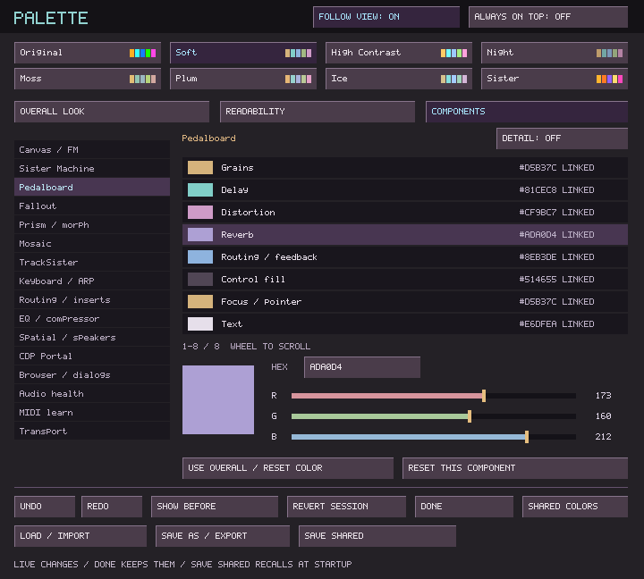
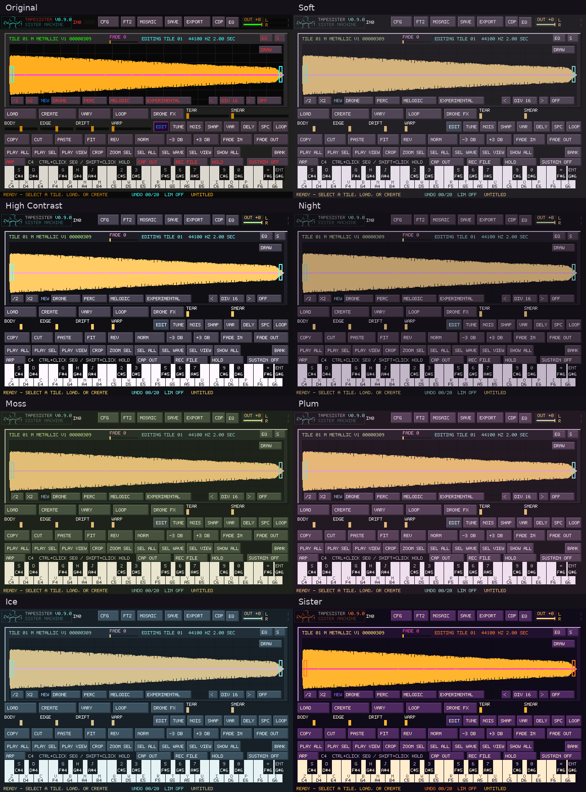

# TapeSister palette

**CFG → PALETTE**, the tracker configuration's **Palette** button, or
**Ctrl+Alt+P** opens a floating native window. It is modeless: leave it open,
move to another workspace, and watch edits on the real interface while playback
continues. Ctrl+Shift+P still opens CDP Portal.

## Start with a preset

Eight presets are built in: **Original**, **Soft**, **High Contrast**, **Night**,
**Moss**, **Plum**, **Ice**, and **Sister**. Original keeps the existing factory
appearance, including the distinct colors of the different workspaces.
Sister draws from the splash artwork: deep plum surfaces with saturated gold,
orange, violet and pink. It replaces the former Paper preset.
Selecting a preset replaces the current customizations; Undo restores them.

## A small set of controls, with detail available

- **Overall Look** changes shared backgrounds, panels, controls, text,
  selection, selected text, focus, and activity.
- **Readability** adjusts text clarity, grid visibility, selection strength,
  and the relief of desktop/control surfaces. 50 is neutral for the first
  three controls. These are visual adjustments, not a contrast guarantee for
  arbitrary custom colors.
- **Components** starts with eight relevant colors for the selected area.
  **Detail** exposes the complete set of semantic roles, including borders,
  secondary text, warnings, errors, muted states, solo, recording, and playheads.
  A role only affects elements that use it in that component.
- **Shared Colors** exposes all 32 legacy `.pal` values, including the seven
  individual tracker transport colors. Use this for compatibility or finer
  legacy edits; component overrides take precedence over shared values.

**Follow View** selects the component of the active workspace or auxiliary
window. Selecting a component in the sidebar pins it and opens or raises its
matching interface, keeping the palette editor in front. Repeated clicks leave
that view open. Browser / dialogs opens configuration (or raises an existing
browser); EQ / compressor raises an already-open compressor or opens EQ.
Unfinished edits and confirmations keep ownership: resolve them before changing
the main workspace. Playback continues during palette navigation.
Turn Follow View back on to resume following. **Always on Top** is optional. The window can be moved or
resized with normal operating-system controls.

Select a swatch, then drag its RGB sliders or edit its six-digit hex value.
Ctrl+A replaces the hex value; Enter applies it, Escape discards the typed value.
The mouse wheel changes a channel by one; Shift makes it eight. Arrow keys
select colors, and the wheel over the list scrolls Detail or Shared Colors.

A component inherits the corresponding Overall Look role until explicitly
edited. Its **CUSTOM** colors survive later overall changes. **Use Overall /
Reset Color** removes one override; **Reset This Component** removes all of
that component's overrides. Small sidebar marks identify customized components.
Original contains several original shades within some roles; a swatch represents
the primary color, and an override intentionally unifies that role.

## Coverage from the interface audit

| Area | Local colors and states |
| --- | --- |
| Canvas / FM | Mono and stereo waves, sum, loop/edge accents, playhead, selection, tile/source borders, controls and text |
| Sister Machine | Three head identities, source/mix/filter accents, tape display, controls and text |
| Pedalboard | Independent grains, delay, distortion and reverb accents; routing, controls and text |
| Fallout | Pitch, mix, bit/LFO, noise/pan and drop/skip accents; controls and text |
| Prism / morph | Rays, lens accents, grids, matrix states, decorative ink and text |
| Mosaic | Five source colors, selected borders/fills, playhead, muted/solo cards and recording |
| TrackSister | Native pattern fields, backgrounds, controls, cursor, selection and transport indicators |
| Keyboard / ARP | Sounding/stored notes, sequence progress, panel, selection and text |
| Routing / inserts | F9 matrix, source-route dialogs, connections, selection, feedback warnings and signal activity |
| EQ / compressor | Curve, spectrum/nodes, grid, solo/bypass, compressor controls and gain reduction |
| Spatial / speakers | Speaker display, grids, accents, panels, controls and text |
| CDP Portal | Source/result waves, parameter/loop accents, process/browser panels and text |
| Browser / dialogs | Files, directories, selections, configuration surfaces, borders and text |
| Audio health | Load/activity, warnings, errors, secondary text and panels |
| MIDI learn | Available, mapped and selected target overlays |
| Transport | Player mixer, controls, status and recording indicators |

Reverb has its own component color instead of sharing the right waveform
channel. Native TrackSister uses a display overlay: host theme edits neither
rewrite its saved native preferences nor change project/audio state. Returning
to Original restores the underlying native palette. A legacy shared color that
differs from the host default is also available to that overlay.

Mandala's Amber/Lunar/Ember artwork palettes remain independent. Palette-editor
chrome stays readable while experimenting; native OS title bars follow the OS.

## Undo, compare and save

**Undo/Redo** (Ctrl+Z / Ctrl+Y or Ctrl+Shift+Z) remembers up to 32 changes; a
slider drag is one change. **Show Before / Show Edited** compares against the
palette present when this editing session opened. **Revert Session** restores
that starting palette and is itself undoable. Editing while viewing Before
returns to the edited palette first.

**Done**, Escape, and closing the palette window keep live edits for this run.
They do not save a file. Closing while comparing Before keeps the edited version.

**Save As / Export** saves a named `.pal` anywhere in the built-in file browser;
**Load / Import** recalls one. Type a filename (Ctrl+A replaces it), navigate
folders, or create a folder. Replacing an existing file requires a second Save.
**Save Shared** writes the startup/shared palette; a second click confirms
replacement of an existing shared file. A failed write leaves the previous
palette file intact. Saving during Before saves the edited version.

## File compatibility

TapeSister and TapeHead share the legacy text file `palette.pal`. The canonical
section is `[Palette]`; readers also accept `[TapeheadPalette]`. The configured
exchange directory owns the shared file; otherwise it is beside TapeSister's
configuration. `TAPESISTER_PALETTE` overrides its full path.

All 32 color keys remain unchanged:

- `PatternText`, `BlockMark`, `TextOnBlock`, `Mouse`, `Desktop`, `Buttons`,
  `PatternNote`, `PatternInstrument`, `PatternVolume`, `PatternTuning`,
  `PatternEffect`, `PatternEmpty`.
- `WaveSelection`, `ActiveTile`, `StereoWaveLeft`, `StereoWaveRight`,
  `StereoWaveSum`, `SisterSourceHorizontal`, `SisterSourceVertical`.
- `TrackLengthPlayhead`, `FastTracksPlayhead`, `ControlPlayhead`,
  `FastTracksSync`, `FastTracksPhase`, `FastTracksSong`,
  `FastTracksLengthPlayhead`.
- `MosaicHighlight`, `MosaicTile1`, `MosaicTile2`, `MosaicTile3`,
  `MosaicTile4`, `MosaicTile5`.

Colors are `#RRGGBB`. `DesktopContrast` and `ButtonsContrast` remain 1–100.
Old local `tapesister.pal` and `tapehead.pal` files still load. Missing optional
legacy keys receive the existing fallbacks; loading never rewrites a file.

New saves append `ThemeVersion=1`, `ThemePreset=0..7`, `ThemeText`, `ThemeGrid`,
`ThemeSelection` (0–100), and explicit `Theme.<Group>.<Role>=#RRGGBB` overrides.
An absent override means inheritance, while `#000000` is explicit black.
Known malformed values fail without changing the live palette; unknown keys
are ignored. Theme data lives in the palette file, not the musical project.

Older standalone TapeHead versions can read the legacy colors but do not apply
component overrides. They may omit extension keys when re-saving; keep a named
TapeSister export when moving a customized theme through an older reader.

## Validation

See [palette validation](PALETTE_VALIDATION.md) for regression coverage and the
remaining native-desktop checks.
