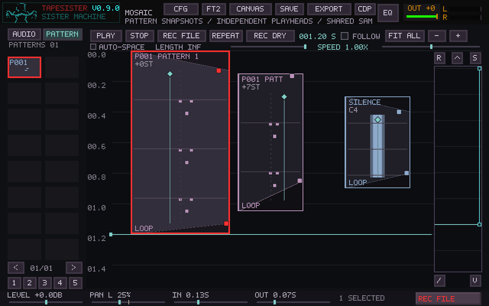

# TrackSister patterns in Mosaic

Choose **PATTERN** in Mosaic's source browser. Its pages contain the current
TrackSister patterns, including patterns from the existing XM import workflow.
Use the existing source audition control before dragging a pattern into the
arrangement. Pattern cards show their note content and instance transposition;
`+0ST` plays the authored pitches.

## Ownership and editing

A placed card references an immutable snapshot of the pattern, its instrument
maps/envelopes, track settings, tempo, speed, and samples. Copies of the same
snapshot share the definition and PCM buffers. Each sounding instance has its
own tracker channels, effect memory, envelopes, sample voices, and row clocks.
There is no deck assignment or fixed deck concurrency limit. Playback storage
is reserved as cards are added, including room for each card's Scatter chord.
No allocation happens in the sample callback.

Editing the TrackSister source affects subsequent drags. Existing cards, copies,
and arrangement undo states retain their captured sound. Deleting a pattern,
replacing an XM module, editing a sample, or changing a sample bank cannot
invalidate the captured audio. Deleting a card does not delete its source
pattern. Unreferenced snapshots are reclaimed with ordinary Mosaic sources;
undo and clipboard pins keep their dependencies alive.

Double-click a card to reach its original TrackSister pattern editor. Existing
cards remain snapshots when editing there; drag the edited pattern to place a
new version. If the original pattern no longer exists, the card continues to
play and reports that its source editor is unavailable.

## Timing, repeats, and tails

A card starts at row zero with fresh effect memory and no inherited notes.
Its captured BPM and ticks per line determine its clock. The captured CONTROL
length, or the longest explicit track length (falling back to physical rows), determines one
cycle in master time. Track lengths, ratios and directions operate inside that
cycle. Pattern/Song private-track modes are bounded to this single pattern.

* Extending a **LOOP** card repeats complete source cycles, then plays the
  partial final cycle up to the card edge. Each repeat resets clocks, voices,
  and effect memory. A short boundary ramp prevents abrupt discontinuities.
* Extending an **ONCE** card does not trigger additional rows after the first
  source cycle. It issues note releases and allows sample/envelope tails within
  the remaining card duration.
* Shortening either kind gates the output at the new card edge with Mosaic's
  short release ramp. Tails never escape the card boundary. Width is visual and
  does not affect duration or sound.
* Seeking reconstructs the instance from its start, advancing effects at tracker
  ticks and sample positions in bulk. Restarting/repeating resets it. Pausing,
  stopping, and auditioning use the ordinary Mosaic transport behavior.
* Mosaic speed controls the virtual playback time. Instance transposition
  changes sample pitch while preserving row timing and musical intervals.

The captured tempo/speed are authoritative: `Fxx`, `Bxx`, `Dxx`, `E6x`, and
`EEx` do not change a card's timeline or navigate the foreground song. Volume,
pan, pitch, instrument envelopes, volume-column effects, and tuning commands
use the existing FT2 replayer. `Z` clock commands operate on instance-local
state; selected-track commands use the captured selection, and private Song
mode stays in this pattern. Global tracker transport, MIDI output, Deck Matrix,
and sample-morph performance state are not driven by a card.

## Mixing and arranging

The pattern's tracks first mix to one stereo output. Mosaic then applies the
same gain, fades, stereo balance, mute/solo, and output route as an audio card.
Internal track panning remains part of that stereo mix; card PAN is the existing
stereo balance control. Tracker track/tile output routing does not bypass the
card's route.

The PR #154 fade handles, shaded gain boundaries, pan centerline/diamond,
hover feedback, reset gestures, cancellation, and undo are shared unchanged.
Direct handles affect the grabbed card; footer controls retain group editing.
Live fade, pan, gain, and routing edits preserve the instance's playback phase.

Selection, group movement, Shift-copy, clipboard, delete, edge resizing,
overlap selection, Auto-Space, alignment, Scatter, and arrangement undo use the
same event model as audio cards. Scatter **Keep Notes** retains authored pitches
and any existing instance transposition. Other pitch modes use C4 as zero
transposition: C5 moves every authored note up 12 semitones. Chord mode layers
transposed performances with the same normalization as audio-card chords.
Source pattern cells are never rewritten by Scatter. Its **Fades / Pan** page can
assign fixed or randomized fades and stereo balance to the combined output of
each instance, alongside audio cards. Mix-only Apply preserves the running
instance phase; bulk pattern copies reserve playback capacity before publication.
See [Scatter fades and pan](MOSAIC.md#scatter-fades-and-pan).

The shared PR #154 navigation/save paths still handle Fit All, edge scrolling,
Follow suspension, gesture cleanup, Ctrl+S, and preserving view/selection across
save, cancel, and errors. Both logical and native renderers draw pattern notes
through the ordinary card compositor, alongside the existing fade/pan controls.

## Project format and validation

Mosaic format 13 adds a source-kind record and lossless pattern sidecars: native
score, exact tracker cells (including XM volume-column commands), instrument
sample bindings, and float WAV assets. Multiple cards save their shared snapshot
once. Identity, timing, transposition, routing, fades, pan, and loop state remain
ordinary Mosaic event fields. Versions 1–12 remain readable. Loading validates
source cells and assets before publishing the new arrangement.

The `tapesister_mosaic_pattern_tests` CTest fixture drives the actual embedded
replayer, project codec, source browser, and SDL compositor. It covers overlapping
copies, offset starts, seeking/restarts, live mix changes, snapshot edits and
undo/redo, ordinary audio coexistence, foreground transport isolation, source
and XM round trips, and CPU workloads with multiple eight-track patterns.
The ordinary Mosaic controller suite retains PR #154's interaction and native
scroll/scale regression checks.

## Rendered examples

These are captures of the actual SDL compositor from the integration fixture,
with two overlapping pattern cards and one ordinary audio card. They are not
mockups. The first pattern has a fade-in and left balance; its copy is transposed
seven semitones, balanced right, and faded out.

[Logical framebuffer](images/mosaic-pattern-cards.png) ·
[Fractional scaling and scrolling at 1729 × 973](images/mosaic-pattern-cards-fractional.png)

## Validation results (2026-10-23)

The full Release build completed with the optional CDP8 bundle disabled. All 12
targeted CTest suites passed, including Mosaic core/controller, embedded tracker
and realtime integration, tracker playback/edit/controller/model, audio
reconfiguration, native waveform rendering, offline rendering, and the new
pattern integration suite. A stale, unmarked local staging directory initially
blocked an existing project-save fixture; that test passed both in a fresh
directory and after removing the stale test output.

AddressSanitizer passed the new integration suite with the changed playback,
source codec, embedded mixer/replayer, and test objects instrumented. Leak
detection was disabled because the application fixture intentionally retains
its initialized global UI/engine allocations at exit.

The tests also cover 17-pattern browser pagination, original-editor navigation,
full TSR project saves/loads, linear and Amiga-period XM imports with 32 channels,
keymaps and envelopes, fractional transport speed, transposition, per-card
routing, and stop/release behavior. The primary seek comparison's peak sample
error was `1.86264515e-09` after the standard seek attack. Native card pixels
translate identically during scroll at integer and fractional scale. The
embedded patch was reapplied to SHA256-verified pinned upstream originals and
compared with the vendored files.

### CPU and memory

Reference measurement: Linux x86-64, Intel Xeon Platinum 8370C at 2.80 GHz,
Release build, 48 kHz, 256-frame blocks, eight sounding/modulated tracks per
pattern, independent copies, 1.2 seconds rendered. The block pass includes a seek
to 0.197 seconds. This measures the real embedded PCM mixer and Mosaic path;
it excludes a physical audio device, effects graphs, and concurrent foreground
performance. Shared-host scheduling makes wall-time peaks variable.

| Overlapping cards | CPU time / audio time | Mean block wall time | Maximum block CPU time |
| --- | ---: | ---: | ---: |
| 1 | 2.93% of one core | 0.181 ms | 2.523 ms |
| 2 | 6.31% | 0.284 ms | 1.583 ms |
| 4 | 10.48% | 0.615 ms | 3.783 ms |
| 8 | 22.48% | 1.084 ms | 3.004 ms |
| 16 | 45.08% | 2.462 ms | 6.299 ms |

The 256-frame deadline is 5.333 ms: the 16-card run exceeded it at its worst
block. These results do **not** certify X220/X230 realtime performance. Those
machines still need physical testing with the intended audio buffer, realistic
samples/effects, seeks, and simultaneous TrackSister transport. Larger buffers
and fewer concurrent performances leave more headroom.

Playback state is reserved on the control thread, never in the render callback.
The current reservation is approximately 1.2 MiB per placed pattern card (five
possible Scatter voices), plus one audition reservation, on this build. It
tracks placed cards rather than maximum overlap and retains its high-water mark
for undo. Definitions and PCM are shared; very large arrangements should account
for this instance-state cost as well as samples and history. Seek work scales
with tracker ticks rather than skipped PCM frames, but very long one-shot-tail
seeks can still be expensive.

### Source-tab click regression

The initial PR #155 build's transport hit area consumed clicks in most of the
AUDIO/PATTERN tabs. The transport handler now checks its horizontal bounds.
The regression fixture first failed on the original handler, then passed with
the correction. It clicks both tabs at their upper edge, center, and lower edge
at 640 × 400, 1280 × 800, and 1729 × 973; selects and auditions a source with A;
drags/releases it into the canvas; and verifies that the placed card renders
audio. It also clicks PATTERN after loading a TSR with 17 saved patterns before
opening the TrackSister editor. This load case uses a generated project fixture.

### Scatter mix validation

The controller fixture clicks the Arrange / Pitch and Fades / Pan tabs at
1×, 1.5× and 2× scale, enters fixed and random values, exercises fractional
wheel input, and checks preview stability, independent rolls, validation,
cancellation, Undo/Redo, save/load and untouched unselected cards. Applying
mix-only edits preserves audio and pattern voice generations. The embedded
fixture also creates and renders 24 overlapping pattern copies through Scatter;
capacity is reserved before the batch is published, with no engine overflow.

The Release build's 1,015-card randomized mix preview averaged **0.032 ms** over
100 previews on the available Xeon host. Mix planning stays on the UI thread;
playback uses the existing per-card fades and balance. This measurement does not
replace the physical X220/X230 playback checks described above.

Rendered dialog and resulting cards are in the
[Scatter fade/pan guide](MOSAIC.md#scatter-fades-and-pan).
