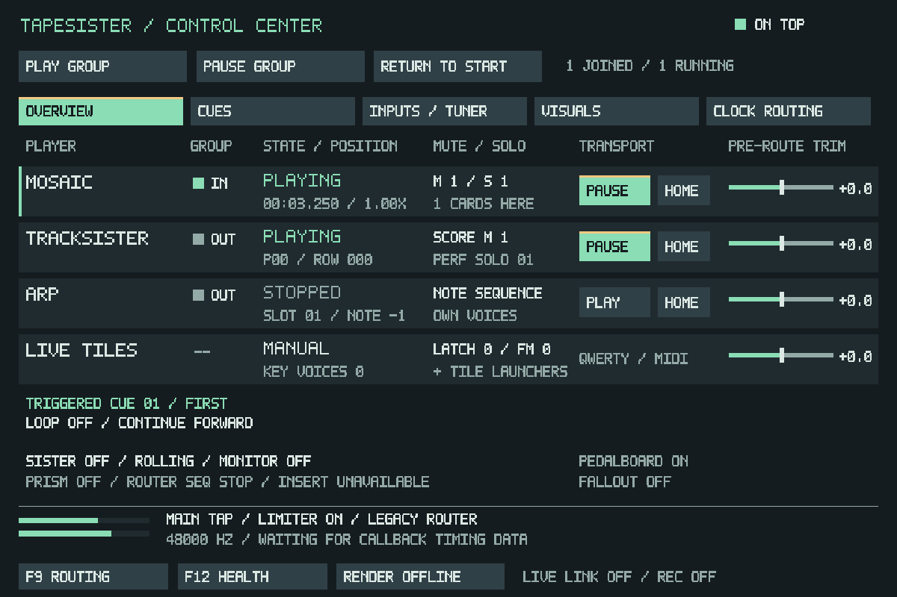

# F11 font legibility

The previous renderer painted every lit glyph cell as a separate SDL rectangle
through the window's logical scale. At fractional scales, cells could acquire
uneven widths/heights or lose thin strokes. Native 960x640 fixtures did not expose
that difference. A controlled text swatch at 125% differed from a single scaling
of its native image at 7,276 pixels; the regression test fails on the old path.
This reproduces a rendering problem, not a measurement of the user's Windows
DPI setting or a claim that every visible difference in their screenshot has
the same cause.

F11 now paints an opaque 960x640 CPU bitmap and uploads/scales the complete image
once, explicitly with nearest sampling. Small labels use hinted 8x12 glyphs with
uniform two-pixel strokes, preserving their existing nine-pixel character spacing.
Primary text keeps its existing size. No font library or external font asset is
needed, and theme colors, control hit targets and the window dimensions remain
unchanged.

The backing pixels and streaming texture use about 4.7 MiB of payload after F11's
first open. They are reused while its window is hidden, and released when the
window is destroyed (including session reset/exit). Painting stays UI-only,
capped at twenty Hz and suspended when hidden/minimized. Audio DSP, routing,
clock behavior, project format and callback work are unchanged by this follow-up.

The F11 integration check compares actual renderer output against a single
nearest scaling of a native reference at 75%, 125% and 150%. It also checks a
solid two-pixel small-letter stem/bar, clipped edge text and existing pointer
conversion at 125%. Existing routing/controller, clock, input/tuner, visualizer
and offline-render checks cover the actual pages and window lifecycle. Screenshots
read the physical renderer dimensions, including the 1200x800 capture below.

On the shared Linux AMD EPYC 9V74 development host, Release software rendering,
one 100-paint run per case of the existing explicit F11 benchmark measured:

| Sample cards | Metadata | Before, ms/paint | After, ms/paint |
| ---: | --- | ---: | ---: |
| 1 | Cached | 0.863 | 0.566 |
| 1 | Forced refresh | 0.873 | 0.587 |
| 1024 | Cached | 0.834 | 0.613 |
| 1024 | Forced refresh | 0.868 | 0.583 |

These are short UI measurements, not audio throughput or timings on the
X220/X230/HP A8. They include upload/presentation. Reproduce with
`TS_COCKPIT_BENCHMARK=1 tapesister_source_route_controller_tests --cockpit <directory>`.
The scale cases use SDL software windows; physical Windows DPI virtualization,
monitor changes and perceived readability still need a check on the real display.

On Windows, reopen F11 at the current display scale, then try the usual desktop
scaling/fullscreen choices. Check every page, small status text, selected buttons,
the tuner, and mouse targets. Play the same project with F11 closed/open and use
F12 RESET/COPY REPORT for a controlled load comparison. Keep the buffer and
routing fixed; this font change introduces no audio-thread work.
