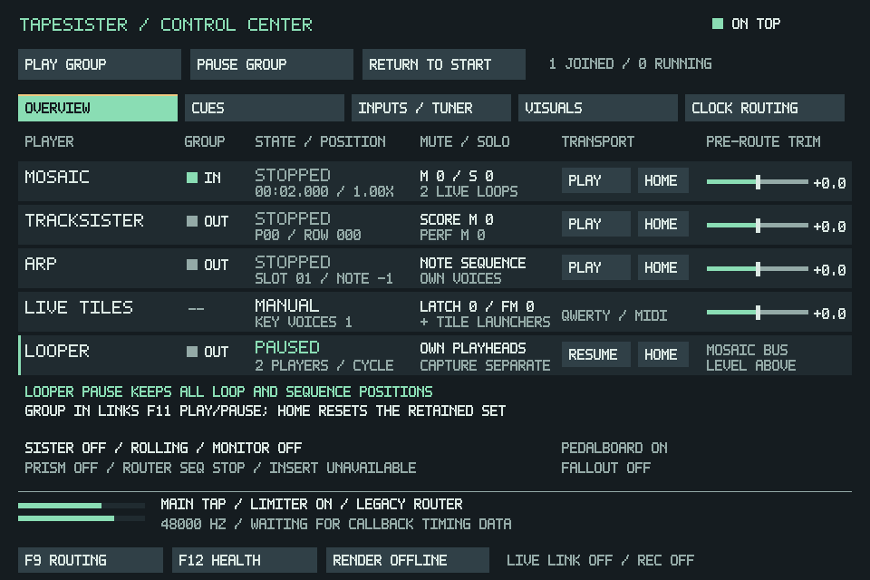
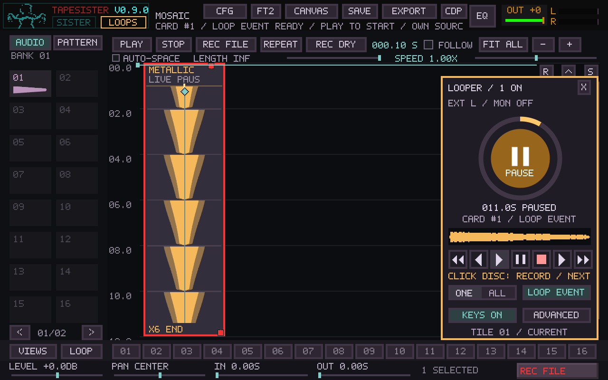

# F11 Looper transport validation

The F11 Overview now has five rows inside the existing 960×640 window. Looper
has its own Pause/Resume and Home controls, optional session-only group checkbox,
and no extra gain stage. Its audio retains the Mosaic bus trim and card routes.

## Behavior checked

- Individual F11 Pause freezes live elapsed time, source position, release
  progress, waiting launches and the handover sequencer. Resume keeps the same
  active set and positions. Idle cards stay idle.
- Looper starts outside the group. Group Pause can stop the main Mosaic playhead
  while loops keep advancing. Checking IN lets group Play/Pause hold and resume
  both at the same callback boundary, without changing saved per-card links.
- Local Home resets only the retained loops and sequence; group Home can also
  return the selected main playhead. Neither action launches idle loop cards.
- The temporary group checkbox does not affect project dirty hashes and resets
  when a different project is published into the same Mosaic instance.
- A held manual keyboard voice survives F11 Looper Pause. A real dry capture
  continues while loop elapsed time is frozen, and its published take contains
  the played keyboard audio. Recording still has priority over amber pause status.
- The real loop route path fades Matrix output and the recording reference tap
  to silence while ordinary timeline audio and its route continue. Resume restores
  loop output. Explicit Stop while paused clears retained players instead of
  leaving frozen release states. Save/load reopens stopped and unpaused.
- The paused disc holds its progress, draws pause bars in both render paths, and
  reuses the native raster on unchanged snapshots. Mosaic's Looper Play/Cycle can
  release the hold; the main timeline transport remains independent.

## Local validation

Linux Release application/core build with the existing extracted SDL2/FFmpeg
libraries; CDP8/video bundling and MIDI backend disabled for the local build.
The two large controller translation units use `-O0` locally; production
application and core retain Release optimization.

Updated against main `a3bdeed`, including merged PR #167. Eight relevant CTests
pass: performance, Mosaic core, Mosaic controller, live-loop controller, quick
capture, source-route controller, F11 cockpit, and clock routing. The new
pause tests run inside these existing targets. This covers synthetic buffers and
real SDL dispatch under dummy audio/video, not physical MIDI/audio hardware.

The selected-source integration fixture also runs with F11 Looper paused:
page-2 sources 17, 22, 25 and 30 remain playable as four layers, F11 reports their
voices, and REC SRC captures/publishes the expected stereo signal while the
loop position stays frozen and the main playhead advances. F11 Resume then
continues the retained loop. The dedicated `--source-keys` case passes too.

## Screenshots

Captured from the real native SDL controller fixtures, then converted losslessly
to PNG. No UI elements were composited.

Shared F11 transport is not continuous playhead phase alignment. Different loop
lengths retain their local positions; existing clock/tempo controls continue to
apply. Closing F11 retains the session checkbox; New/load resets it. Shared DSP
returns can finish their tails after the loop source is paused.
