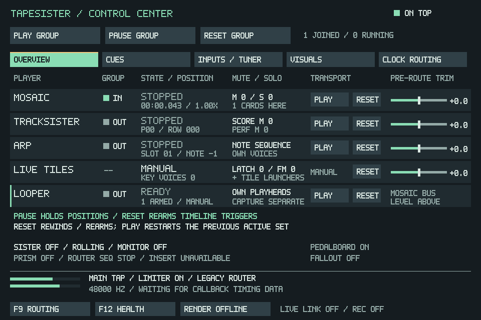

# F11 Reset validation

Based on main `d26d727`, after PR #169. F11's Home buttons are labelled Reset,
and Return to Start is labelled Reset Group.

| Control | Result |
| --- | --- |
| Looper Pause/Resume | Holds and continues the same source, release and sequence positions. |
| Looper Reset | Stops/rearms players and releases sequence ownership and the pause. Play restarts the previous active set from zero; timeline crossings can also trigger normally. Idle cards are not added. |
| Mosaic Reset | Stops the timeline at zero. |
| TrackSister Reset | Stops at song order zero, row zero; the first order may reference a pattern other than 00. |
| ARP Reset | Stops, resets note/slot-chain/LFO cursors and returns to the last manually selected slot. |
| Live Tiles Reset | Rewinds active note, source-layer and tile-launcher voices, preserving held keys, latches, sample ownership and routes. Idle/ended voices stay idle. |
| Reset Group | Retains existing group and independent Clock Routing Reset-follower choices. Manual Live Tiles has its own Reset button. |

The looper previously reused its pause flag for Home. A later seek/encounter could
leave a loop sounding logically active but frozen. The synthetic 1 kHz reproducer
launches, calls Home, seeks Mosaic to zero, then renders 250 timeline frames: the
old implementation reports **0.000000** loop elapsed; the fix reports
**0.250000**. Reset now has a separate bounded restart plan identified by event
IDs, without sequence ownership while armed. Fresh timeline launches consume the
relevant armed entries. Explicit Stop cancels the plan, and New/load clears it.

Reset uses a five-millisecond loop-source residual fade on ordinary output and
existing card routes. Reset after a silent pause must not replay a stale cached
frame. Manual voice rewinds use the existing bank/route handoffs. No file access,
source hashing or sample allocation is added to callback rendering or Reset.
The #169 envelope policy and smoothing remain intact.

## Checks

Linux Release application/core build. Local SDL controller translation units use
`-O0` with assertions; CDP8/video bundling and physical MIDI backend disabled,
using the existing extracted SDL2/FFmpeg dependencies and dummy audio/video.
Ten relevant CTests cover performance, keyboard sequence/hold, source routing,
F11 cockpit, clock routing, Mosaic core/controller/live controller and quick
capture. The F11 fixture uses real pointer dispatch, not direct calls alone.

Regression coverage includes:

- Pause/Resume hold, Reset-to-Play rewind, idle Reset, and later timeline crossings.
- Sequence Reset releasing ownership, manual restart from its first step, and
  timeline takeover without the old pause or stale sequence ownership.
- Repeated Reset, silent-pause Reset, deleted/reused event IDs and load defaults.
- Live Tiles rewind across all manual banks without losing latch/group/generation
  ownership, plus normal release semantics.
- ARP note, slot-chain and LFO rewind, song-start reset with a nonzero first
  pattern, and independent clock-position followers preserving running state.
- Existing layered source playing/REC SRC while loops are paused, capture and
  #169 volume-lane/envelope regressions through the Mosaic controller suites.

The screenshot comes from the real SDL fixture, converted losslessly to PNG.
No physical interface, MIDI controller or older laptop capacity is claimed.
