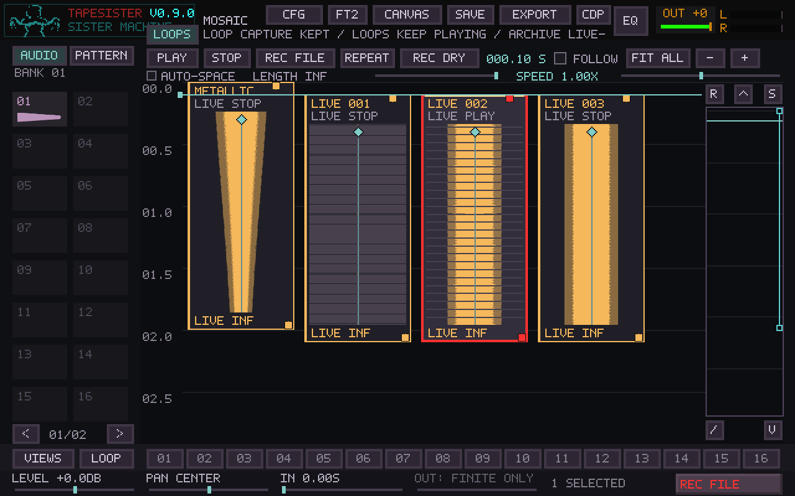
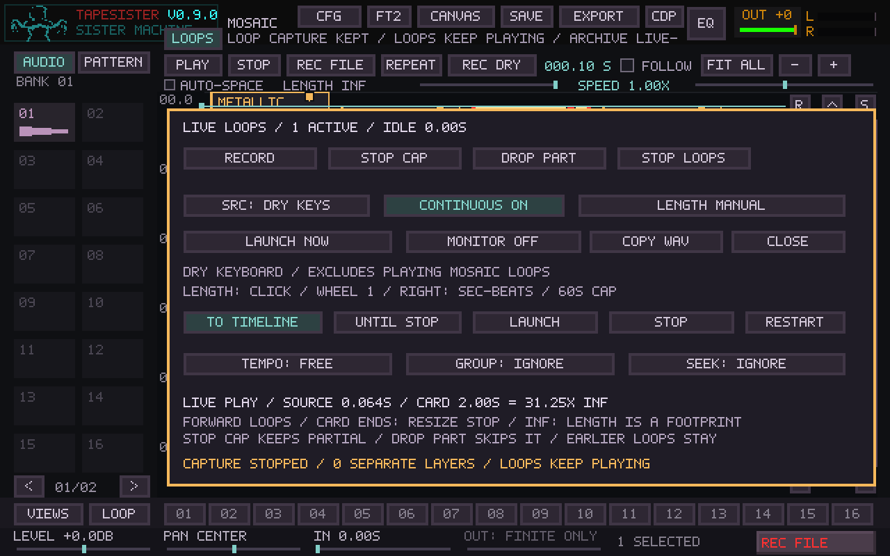

# Mosaic live-loop validation

Base: main `d11b052285b93f5dcf63c732bb39e8345d53eb00`, the merged #163.
The before build is #163's identical source tree (`d9751a7`). No merge of #163
was performed by this work. Behavior is described in
[MOSAIC_LIVE_LOOPS.md](../MOSAIC_LIVE_LOOPS.md).

## Automated coverage

Final local Release pass: **14/14 relevant CTests passed**, including both the
full Mosaic controller run and its focused live-loop alias.

- Core Mosaic tests cover manual and timeline launch, one player per card,
  main pause/end/speed, seeking over or exactly onto a start, cue jumps, cue
  repeat, whole-timeline repeat, finite/ongoing playback, smooth stop, mute/solo,
  rate changes with main paused, independent master tempo/launch/group/seek
  controls, live/ordinary summation, and custom Matrix routes while paused.
- Native FT2 integration verifies overlapping pattern cards plus an independent
  audio loop by PCM superposition, and format-15 save/load of that mixed scene.
  Pattern cards continue to use their private clocks.
- Capture tests compare every sample across successive automatic/manual frame
  ranges, including a split inside an input buffer and a range read while the
  next layer is recording. Single mode, stop/keep, stop/discard, 60-second cap,
  pending-layer exhaustion, writer-queue exhaustion and retained prefixes are
  exercised. Normal performance-file recorder tests remain in the checks.
- SDL controller tests exercise production callbacks, controller MIDI dispatch,
  note-on versus release, dry-source isolation from playing loops, live QWERTY
  input during successive layers, capture stop without stopping notes/loops,
  per-card MIDI toggle, source switching with a disabled producer between sessions,
  exact OUTPUT capture, master tempo changes without player restart, and raw
  44.1 kHz stereo external input with two complete layers and a discarded partial.
  They also check deferred publication during gestures and actual UI captures.
- Project tests round-trip full bundles with live roles/settings as well as
  ordinary scenes, Windows CRLF files, malformed data rejection, and the
  existing staging/cancellation/load protections. Players reopen stopped.
- Existing F11, clock, routing, save, state, external recording, keyboard sequence
  and offline-render regressions are included in the Linux validation.

The unfiltered PR baseline builds the app and runs Mosaic core/controller,
native pattern, project and new capture tests on Linux and Windows. Release
bundling includes the same tests; looper source/header/test paths explicitly
trigger downloadable bundles. Windows file sharing and `_fseeki64` continue to
use the existing WAV writer/reader implementation, including the concurrent
immutable-prefix range-read test.

## Development-host measurements

Shared Linux AMD EPYC 9V74 host, 9 visible CPUs, 8-CPU quota, 8 GiB memory limit;
Release GCC 13.3. These are **not X220/X230 or HP A8 measurements**.

The existing deterministic routed Mosaic benchmark produced **190,709,760
identical bytes** of stereo PCM and routing frames before/after:
SHA-256 `9373671ba0633443be6933cd4a3801919b59a4491a53841c66bbd519f550b33e`.
This covers ordinary cards, chords, loop directions, fades, live edits,
staggered starts, and custom routes. It does not prove every project sounds
identical, and the benchmark's variable shared-host timings do not establish
a throughput improvement. Raw timing/checksum output is retained in
[live-loop-normal-before.txt](live-loop-normal-before.txt) and
[live-loop-normal-after.txt](live-loop-normal-after.txt).

The new explicit CPU benchmark uses 1024 placed cards with 0/1/8/32 independent
loops active, main timeline paused, mono sample sources, 48 kHz/256 frames,
master tape rate, live mute/pan edits, and optional custom Matrix routes.
Median of three trials, each 512 blocks; process CPU time, no disk capture,
effects, native pattern players or UI workload:

| Active loops | Main bus ms/block | Routed ms/block |
| ---: | ---: | ---: |
| 0 | 0.011246 | 0.009951 |
| 1 | 0.031658 | 0.052160 |
| 8 | 0.162475 | 0.192668 |
| 32 | 0.634713 | 0.720217 |

The block budget is 5.333 ms on this host. The routed 8-loop result is about
3.6% of that budget; 32 loops about 13.5%. These are engine-only CPU costs,
not end-to-end callback deadline or supported-polyphony guarantees. Older
CPUs, effects, dense patterns, control locks and drivers can change the result.
Raw measurements: [live-loop-cpu.csv](live-loop-cpu.csv).

The Mosaic model grows from 21,365,400 to 22,213,360 bytes (about 0.81 MiB,
mostly additional per-event undo fields and fixed runtime state). One 48 kHz
stereo capture queue adds 1,536,000 bytes (about 1.46 MiB). Source audio consumes
additional memory; see the documented import/take limits. No new loop sample
allocation, waveform generation, file I/O or source traversal is added to the
sample callback. The existing buffer schedule classifies cards once per buffer;
its independent render list contains active/waiting loops only.

Reproduce explicitly, outside CI timing gates:

```sh
cmake --build build --target tapesister_mosaic_benchmark tapesister_mosaic_live_benchmark
build/tapesister_mosaic_benchmark --routed normal-after.bin
build/tapesister_mosaic_live_benchmark
```

## Actual-hardware F12 and listening exercise

Use a copy of a valued project and keep the same device, sample rate, buffer,
routing and effects between comparisons. Test the intended interface/driver
separately on each X220/X230 and HP A8; none has been remotely measured here.

1. Open F12, PROFILE off, RESET. Note buffer/rate, driver, routing, master source
   and loop settings. Record 30 seconds of the ordinary project as a baseline.
2. In Mosaic LOOPS choose EXT INPUT, the intended mono/stereo channel in the
   existing input config, and a monitoring setting you understand. Use headphones
   or the performance monitoring arrangement. Record a short spoken count/tap,
   finish with the foot controller, and listen to several wraps. Check seam
   clicks, transient softening, first-return delay, and whether capture alignment
   is acceptable for that interface/buffer.
3. Select CONTINUOUS, 4 seconds, and create 8 separate layers without touching the
   mouse. Repeat with different manual lengths. Verify old loops remain audible,
   NEXT affects only the current take, STOP CAP keeps the partial, and DROP PART
   skips only the partial. COPY WAV should locate the complete session archive.
4. Play ordinary and overlapping pattern cards through that scene. Hold QWERTY
   notes, edit/move/pan/mute/solo a loop while recording another, and release a
   drag across a recording boundary. New card publication can wait for the drag;
   the recording must continue. Pause the timeline: independent loops continue.
5. Seek forward/back, trigger cues, enable/disable cue repeat, cross a playing
   loop again, and stop/relaunch an individual loop. Check there is no doubled
   voice. STOP LOOPS leaves notes/capture alone; future timeline launches remain
   possible.
6. With F11 master on, try beat-length capture and NEXT BEAT launch. Change tempo,
   disable/re-enable tempo following, then try GROUP FOLLOW and SEEK RESTART
   separately. Master tape following changes pitch. Capture boundaries retain
   their session-start frame length across tempo edits.
7. Save/reopen. Verify source audio, roles, finite lengths, routes, mutes/solos,
   view and controls; live players should open stopped. Test the ordinary project
   copy in the prior build separately, since format 15 needs the new build.
8. In F12 COPY/SAVE after each 30-second workload. Compare callback overruns,
   native control skips and actual driver reports separately; listen and note
   exact actions where a click occurs. PROFILE on can help identify a cost but
   changes the workload, so do it in a separate pass. Add layers gradually.

Physical latency, capture-device drift, microphone/monitor routing, real MIDI
pedals, older CPU limits, Windows ASIO/other drivers and actual audible results
still require these hardware checks. Continuous capture continuity in tests
does not establish immediate or calibrated playback return on a real interface.




