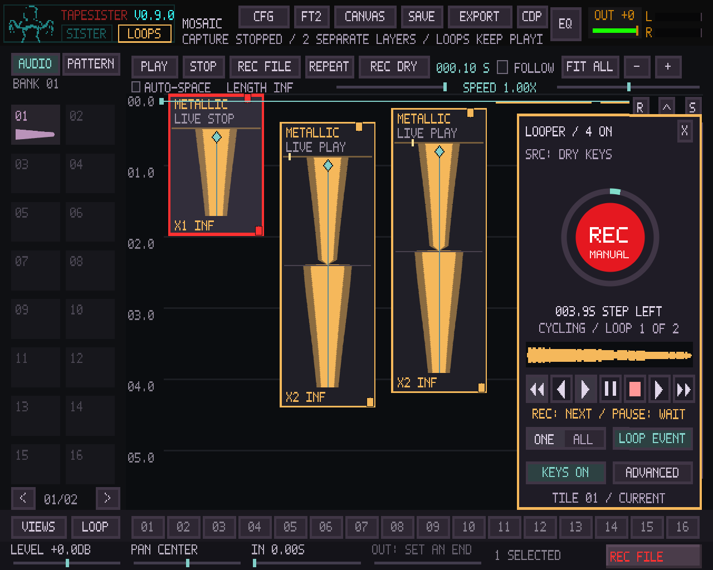
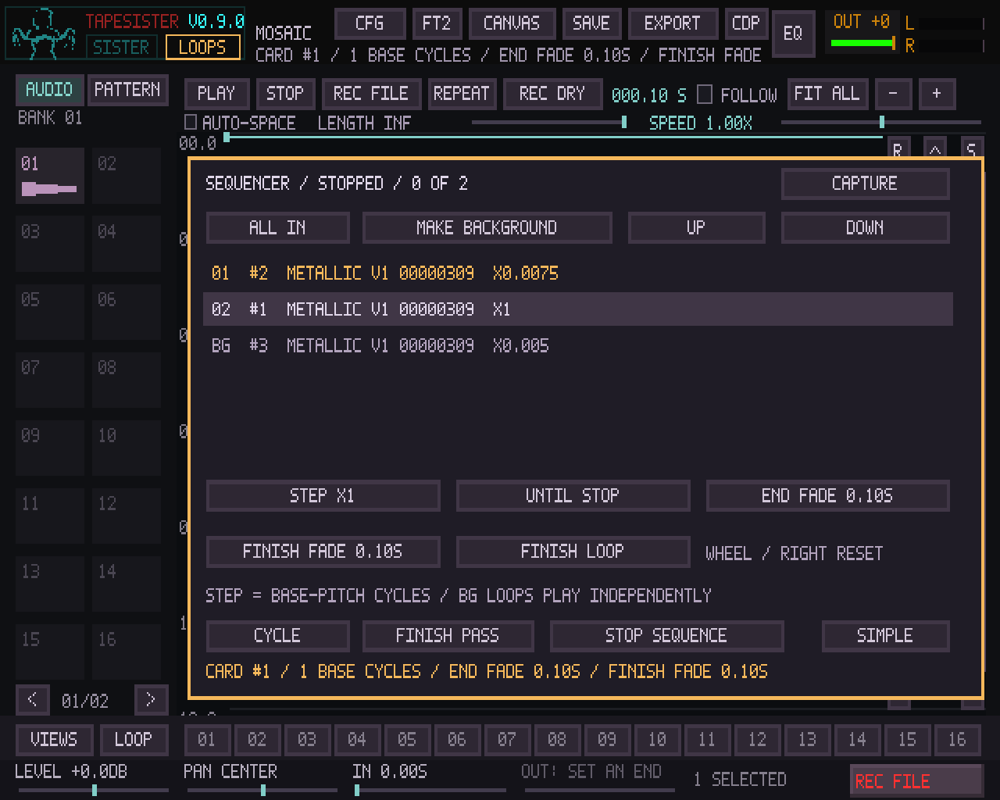
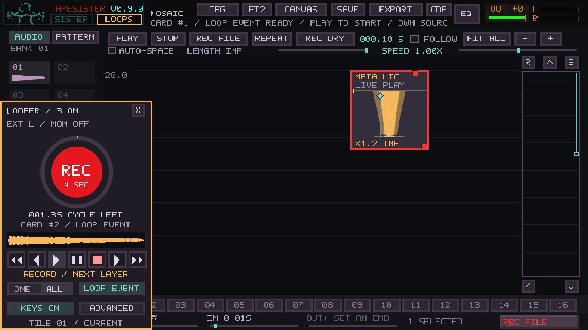

# Mosaic loop-sequencer validation

Base: main `50e0444f5046522caf042acaa62d3fb7fdf1ea99`, after #165 merged.
Its source tree is identical to #165's tested head `e444be2`. This PR targets
main directly; neither #165 nor another PR was merged by this work.

[Behavior and controls](../MOSAIC_LOOP_SEQUENCER.md).

## Coverage

Release app and regression targets built successfully. **20/20 relevant CTests
passed in 68.72 s**. After aligning the final native card labels with the new
cycle readout, **2/2 focused controller/native checks passed in 8.21 s**.
[Full run](mosaic-loop-sequencer-tests.txt) ·
[final native checks](mosaic-loop-sequencer-native-tests.txt).

An initial reused native-pattern fixture contained an unowned `01_SILENCE.wav`
from a prior test run. Saving refused the conflicting generated path. The file
was retained outside the fixture and the clean rerun passed; the project-save
protection was not changed. An empty local generated executable was also
relinked before the clean run. CI uses fresh build/test directories.

Core tests exercise ordered handovers, one player per step, repeat passes,
Finish idle/idempotence, Continue cancelling Finish without moving phase,
background lifetime, explicit ordering, timeline launch exclusion, pause/seek,
per-card tempo, first-launch-only beat quantization, output-rate changes,
deleted steps and all-members-deleted recovery. A 2,000-pass test checks
fractional step boundaries within one output sample without cumulative drift;
subsample steps are bounded to at least one output frame.

Finish Loop tests release from the current level during an unfinished fade-in,
and interrupt a long finish with quick Stop. Format-16 tests round-trip order,
background membership and Finish Fade, including Windows CRLF data. Invalid
metadata is rejected transactionally, and a failed save leaves the prior file
readable. Full project-bundle tests retain staging, preparation/cancellation,
publication, source retirement and reopening stopped, for ordinary format 14,
existing live format 15 and the new metadata in format 16.

The production SDL/controller fixture exercises the actual two outer buttons,
MIDI Learn targets and note press/release mapping, advanced membership/order,
cycle length, end/finish fades, and successive Dry Keys takes while the
sequence and background loop continue. New take publication does not mutate the
frozen running order. Existing live tests still cover QWERTY source switching,
held releases, SisterMachine off/on, raw external capture, failure/recovery,
cue/clock behavior and custom routes.

Native screenshots measure actual disc width/height and antialiased coverage
at 1280×800, 1366×768 and 1280×1024. Source/card native layers remain masked
behind the panel. Unchanged geometry and moved-panel calls reuse the same
buffers and raster; MIDI Learn retains its visible logical overlay. Native
draw/allocation/texture failure retains the logical UI fallback.

The unfiltered Linux/Windows baseline includes Mosaic core/controller,
clock/F11, project and capture/recorder checks. Native bundles include the
broader regression suite and archive download/extraction checks. The new
`test_mosaic_sequence*.inc` path also explicitly triggers native bundles.
Benchmarks remain optional targets with no CI timing threshold.

## Development-host measurements

Shared Linux Intel Xeon Platinum 8573C host, nine visible CPUs, Release GCC.
These are **not X220/X230 or HP A8 results**. CPU timings exclude real device
drivers, physical latency, foot pedals and audio-interface behavior.

The core benchmark places 1,024 cards, queues eight loop steps and leaves four
independent background players running. It measures 48 kHz/256-frame blocks,
main timeline stopped, ordinary sample sources, and main/custom Matrix routes.
Three trials of 512 blocks report median process CPU time. Steps of 5 ms stress
handover frequency; 100 ms and four seconds cover longer creative use. Effects,
pattern instruments, capture and UI are excluded from this engine measurement.

The native-circle benchmark uses the production six-card controller fixture at
1280×1024, 600 varying-phase frames per trial, three interleaved trials per
workload. It compares the logical UI with and without the native circle and
separately measures cached circle updates. SDL upload/presentation and native
waveform composition are excluded. Shared-host timing differences do not
establish a speedup or real-time deadline guarantee.

Measured engine CPU time (5.333 ms audio-block budget on this host):

| Step length | Main bus ms/block | Matrix ms/block |
| ---: | ---: | ---: |
| 0.005 s | 0.165254 | 0.204998 |
| 0.100 s | 0.141807 | 0.182873 |
| 4.000 s | 0.167150 | 0.216227 |

[Raw engine measurements](loop-sequencer-audio-cpu.csv).

| UI workload at 1280×1024 | Median CPU ms/frame |
| --- | ---: |
| logical ui | 0.473483 |
| logical ui plus native circle | 0.585583 |
| native circle only | 0.048653 |

[Raw UI measurements](loop-sequencer-ui-cpu.csv). These are component timings,
with the stated exclusions, not end-to-end frame-rate or old-laptop guarantees.

The unchanged ordinary-card benchmark generated **190,709,760 identical
bytes** of PCM/routing data matching the stored pre-loop reference render:
SHA-256 `9373671ba0633443be6933cd4a3801919b59a4491a53841c66bbd519f550b33e`.
[Current render log](loop-sequencer-normal-after.txt);
[reference and workload](mosaic-live-loops.md#development-host-measurements).
This verifies that deterministic workload, not every possible project.

The circle's CPU buffers occupy 595,984 bytes at 1280×1024 (about 0.57 MiB).
Coverage/angles are computed on resize; moving the panel changes destination
coordinates. Progress reuses the cached base and ring coverage. Sequencer
runtime uses fixed arrays of Card IDs/slots; control-thread preflight sorts
once. The callback directly visits the current step and existing live-player
schedule, rebuilding the latter on a handover. No new callback allocation,
file I/O, source scan, waveform build or sort is introduced.

## Practical hardware and F12 exercise

Use a copy of a project. Keep the same interface, driver, sample rate, buffer,
routing and effects for comparisons, and test the ThinkPads and HP separately.

1. F12: PROFILE off, RESET, note rate/buffer/driver. Play the ordinary project
   for 30 seconds and COPY/SAVE the report as the baseline.
2. Make three loop cards with different source/step lengths. In Advanced >
   Sequence, set their order; mark a fourth card Background and launch it.
   Cycle should hand over through the three while the background keeps phase.
3. Press Finish during the second step: hear the rest of that pass and a stop.
   Repeat, then press Cycle before the pass ends: it must continue at its
   current position. Finish while stopped must stay stopped. Try real learned
   pedals, checking that releases do not retrigger actions.
4. Extend a card's trailing edge: check whole-cycle lengths and Shift for free
   lengths. Change length during a running step: that entry keeps its duration;
   the next entry uses the edit. Move cards around: the visible sequence order
   remains deliberate. Try mute/solo, pan, fades and custom Matrix routes.
5. Enable master tape tempo for one step and keep another free. Change tempo,
   pause/seek Mosaic and trigger cue repeats. The sequence keeps its own
   position; per-card tempo choices still affect its speed. Next Beat should
   wait only for the initial launch. Tape following also changes pitch.
6. Record successive layers from Dry Keys and then the intended external input
   while the sequence runs. Check source-tile/QWERTY changes and held releases.
   The new takes play independently and enter the sequence on its next start.
   Stop Recording leaves the sequence running. Stop Sequence leaves capture
   running. Simple Stop keeps the partial take and stops capture/all loops.
7. Set Finish Fade to two seconds on an ongoing background loop and use Finish
   Loop. Check the fade by listening; quick Stop should still end it promptly.
   At your monitor/laptop resolutions, drag the panel and check the smooth
   circle, labels, ring movement, Learn feedback and matching click regions.
8. Save a second F12 report after a 30-second sequence/record/edit workload.
   Compare overruns, control skips and driver reports separately. Note the exact
   action if a click occurs. PROFILE can help in a separate pass but adds work.
   Save/reopen after capture finishes; check all takes, order, background flags,
   fades, routes, mute/solo and view. Players and the sequence reopen stopped.

Real interface latency/drift, microphone monitoring, ASIO behavior, physical
pedals and older-computer limits remain hardware checks. Source import and
waveform building can still briefly occupy the UI for a long take; this change
does not remove the existing 60-second take and bounded-queue/source limits.

## Native-rendered fixtures

Synthetic test audio using production rendering, rather than a user project.

