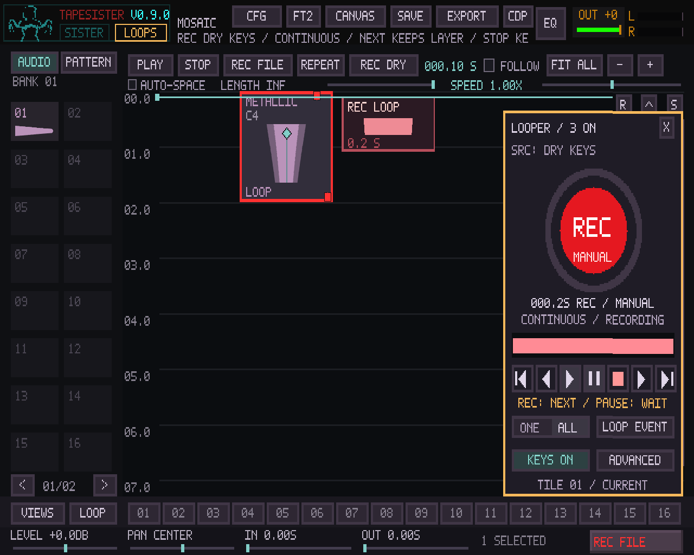
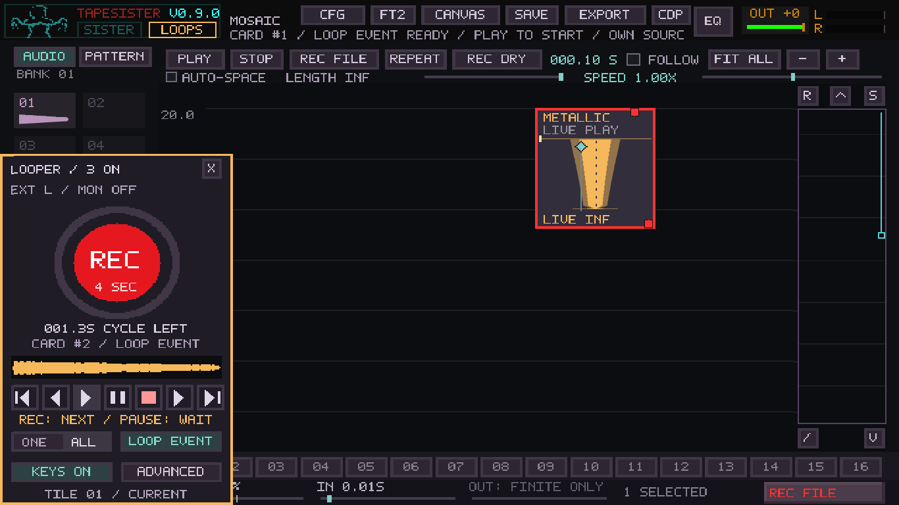

# Mosaic looper cockpit follow-up

Base: main `6500e7cedc5e79f8352b5c4224884afa89bea923`, the merged #164.
Master-clock #163 and the first live-loop implementation are already on main;
this is a separate PR. The controls and exact behavior are documented in
[MOSAIC_LIVE_LOOPS.md](../MOSAIC_LIVE_LOOPS.md).

## Scope

This stage adds the draggable red REC panel, seven transport icons, ONE/ALL
play scope, a clear Loop Event role switch for existing forward audio cards,
and a growing recording waveform. It preserves existing Card IDs and MIDI
targets. Assignable/shared Loop IDs, linked launchers/splits and native pattern
loop players are a separate stage: [requirements and conflicts](../MOSAIC_LOOP_ID_PLAN.md).

Pause means **Stop Recording**: keep the partial take, let existing loops play,
and wait indefinitely before punching in again. Stop keeps the take and stops
all loop players, including suppressing automatic playback of queued cards
that have not been published yet. It does not stop Mosaic's main timeline or
other instruments. The old MIDI `mosaic.live.stop_all` remains loops-only.

First/Previous/Next/Last select, reveal and launch in existing Card-ID creation
order. They are additive, bounded at the ends, and leave a running player's
phase alone. They do not seek the main timeline. Advanced retains explicit
selected-card Stop and Restart. These rules avoid silently renumbering existing
MIDI-addressed cards while the identity model is developed.

## Automated coverage

Release application and 16 regression executables built successfully on the
development host. **20/20 relevant CTests passed in 63.53 seconds**, including
the full controller and focused live-loop alias, common performance recorder,
Mosaic core/native patterns, project save/state, external input, keyboard,
MIDI, audio config, F11/clock routing, native waveforms, new-project and offline
render checks. [Full CTest output](mosaic-looper-cockpit-tests.txt).

The new cockpit fixture is part of the full Mosaic controller regression as
well as its focused `--live-loops` alias. It uses the production SDL event,
MIDI mapping, audio callback, disk writer, renderer and project save/load paths.

- Actual drag/mouse-up, Escape cancellation, double-click reset, clamping and
  focus-loss release; selection and sounding players remain intact.
- MIDI hit regions follow the panel, including every transport icon. A learned
  Next action advances on press without advancing again on release.
- Native opacity over both source and card surfaces at 1280×800, 1366×768 and
  1280×1024. The 1280×800 fixture also checks every panel pixel against the
  logical renderer. Configuration save/load retains the moved position.
- Existing audio-card conversion preserves its ID, source range, source-repeat
  choice, notes, gain/pan, fades and Matrix route; no implicit launch. Save/load
  and conversion undo/redo retain the role. Reopening leaves players stopped.
  Unsupported reverse conversion leaves both the card and undo history intact.
- ONE/ALL play and bounded creation-order navigation preserve phase and main
  timeline position. Capture Pause keeps the partial and earlier players,
  permits a long wait without creating new cards, and can punch in later.
  Stop preserves queued complete and partial takes but publishes them stopped.
- Actual capture snapshots contain nonzero growing peaks without creating a
  playable event prematurely. Earlier source-selection tests still exercise
  QWERTY source changes, held-note release, dry isolation and routes with
  SisterMachine off and on.
- Capture overview checks cover empty writer polls, 90 seconds across the
  bounded preview's wrap, partial writer batches, stale-bin rejection and
  mono cancellation matching recorded PCM. Existing capture tests retain exact
  range/PCM checks, concurrent reads, fractional periods, capacity/failure
  behavior and partial keep/drop. Common performance-recorder regressions
  exercise the shared writer with its observer disabled.

The unfiltered Linux/Windows PR baseline includes the full Mosaic controller
and loop-capture tests, and now adds the common performance-recorder regression
because the writer gains the optional observer. The native packaging path filter also
includes the new `test_mosaic_looper*.inc` fixture. No extra packaging matrix
or timing-sensitive CI gate was introduced.

## Performance and portability

The waveform adds a fixed 32 KiB of time-tagged atomic peak bins to the capture
controller. The disk writer analyzes successfully written ring frames before
releasing their slots; the UI reads an approximately 20 ms overview. Writer
backlog can delay the visual preview. It is not an exact sample editor or an
additional recovery copy. Frame pushing in the audio callback is unchanged:
no new audio-thread peak scan, allocation, disk access or waveform generation.
The compact waveform redraw is bounded to 148 columns.

Local validation uses a shared Linux development host with SDL dummy devices;
the native renderer produces screenshots at the listed dimensions. It does
not measure physical audio latency, real MIDI footswitch behavior, Windows
ASIO, old-computer CPU headroom or an actual display. The existing engine CPU
measurements in [the first-stage validation](mosaic-live-loops.md) belong to
that earlier implementation, not a new benchmark of this panel.

The generic float WAV writer/reader remains the file path on both platforms,
including immutable-prefix range reads and Windows file sharing. Native UI
and baseline Windows builds must pass for the PR; neither substitutes for
testing the user's interface and driver.

## Practical hardware exercise

Use a project copy and the same audio device, rate, buffer, routing and effects
for comparisons. Test the X220/X230 and HP A8 separately; none was measured here.

1. Open F12, turn PROFILE off, RESET, and note the device/rate/buffer. Play the
   usual project for 30 seconds, then COPY/SAVE the Audio Health report.
2. Open Mosaic LOOPS. In Advanced choose DRY KEYS, MANUAL, then Simple. Click a
   source tile, play QWERTY, and hit REC. Verify the waveform grows both on the
   canvas and in the panel. Hit REC to start a separate next layer; choose a
   different tile and verify earlier loops retain their own sound. Repeat with
   SisterMachine enabled using the same project/routing.
3. Hit Pause. The partial take becomes a loop, earlier loops continue, and
   recording stops. Wait a minute, then hit REC to punch in again. Try fixed
   four-second continuous layers too. Hit Stop with a partial take in progress:
   all takes must remain available and the newly published ones stay stopped.
4. Drag the header to the left, middle and right while holding/releasing notes
   and recording. Check mouse/MIDI targets, waveform masking, Escape cancellation
   and double-click docking. At 1280×1024 and the laptop's resolution, confirm
   source labels, transport icons and hover explanations remain readable.
5. Select an existing forward audio card, enable Loop Event, and Play. Try
   ONE/ALL, First/Previous/Next/Last, mute/solo, routing and Advanced Restart/Stop.
   Move cards around: navigation still follows creation IDs. Try timeline
   pause, cues and repeat with several loops running; they must not double.
6. Choose EXT INPUT with the intended channel and monitoring. Record a count
   or tapped rhythm. Check wrap clicks and the first-return delay by listening.
   OUTPUT intentionally captures earlier loops; EXT and DRY KEYS should not.
   Try a real learned pedal for REC, Pause, Stop and Next.
7. During a 30-second recording/dragging workload with 4–8 layers, save a second
   F12 report. Compare overruns, control skips and driver reports separately;
   note the exact action if a click occurs. PROFILE can help in a separate pass
   but changes the workload. Add layers gradually on the older computers.
8. Stop recording, wait for FINISHING to clear, save/reopen, and confirm all
   takes, roles, Card IDs, routes and original repeat choices. Players reopen
   stopped. Panel position is a normal config preference, not project content.

## Remaining limitations

The 60-second take guard, four-second writer ring, 32 pending layers, 128 MiB
retained-source import budget, 1024-card limit, writer/UI playback-return delay
and uncalibrated hardware latency/drift are unchanged. A growing preview does
not mean every sample is durable; the session WAV remains the recovery archive.
Long take loading can still briefly delay UI work.

Independent playback is forward, using exact source periods and short edge
fades. Converting reverse/ping-pong or sample-intro cards is rejected clearly;
their timeline sound remains unchanged. Source overlap-crossfade metadata is
retained for returning to timeline mode. Pattern-card independent players and
shared/assignable identities require the separate design stage above.

## Native-rendered fixtures

These use production rendering and synthetic test audio, not a user's project
or physical screen capture.

