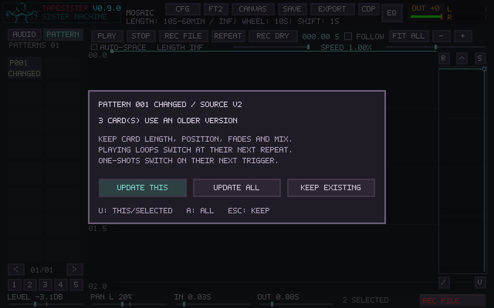
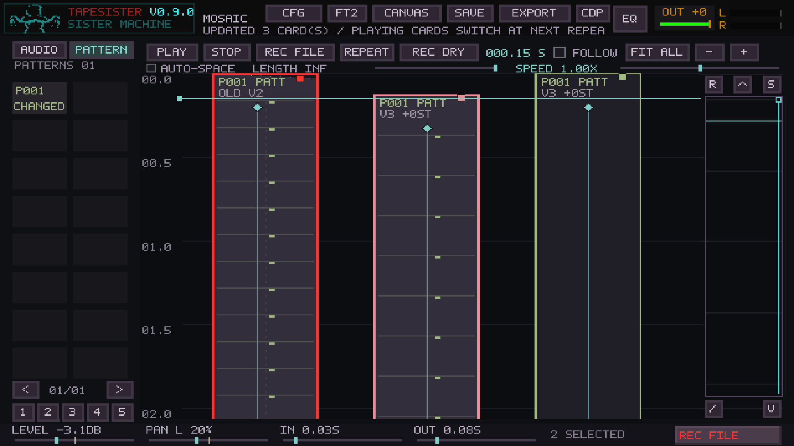

# Mosaic pattern source updates

Validated with the Release build on an Intel Xeon Platinum 8573C Linux host,
SDL dummy audio/video, and the real embedded FT2 replayer. This does not certify
X220/X230 hardware or a physical sound device.

## Checks

- Core Mosaic tests and tracker persistence/migration tests pass, including
  tracker formats 1–10 and the new format 11 lineage field.
- Full Mosaic controller suite passes, including fades, pan, Scatter, group
  resizing, source actions, save-view preservation and native scrolling tests.
- Real pattern integration passes: overlapping copies, offset starts, loop and
  one-shot releases, seeks, mixed audio/pattern cards, live mix edits, XM imports,
  source replacement rejection, project round-trips and independent transport.
- The new source-update test enters the real editor through a card, edits the
  source, returns through the controller, and clicks the actual update dialog.
  It covers this-card/selected/all scopes, Escape/Keep, manual badge review,
  suppression after reopen, unused instrument/cursor changes, hidden-row sample
  aliases, stable instance controls, Undo/Redo, repeated pending updates,
  independent repeat boundaries, changed source length, one-shot deferral,
  save while pending, seek/restart and retired-source collection.
- Before the next repeat, updated cards produce the same samples as a saved
  reference arrangement within 1e-6, and keep the same voice generation.
- Native screenshots are captured at 1280×800 and 1729×973. Existing integer and
  fractional-scale translation assertions pass without changed card pixels.

## Cost and limits

The source-review test measures 20 unchanged workspace returns with one source,
three cards and retained older revisions: **7.689 ms CPU per return**. Ten thousand
cached idle polls average **0.0127 ms CPU per poll**. Preparation is on the UI
thread, outside audio exclusion; all accepting cards share the prepared version.
The callback only checks the pending boundary and switches an existing pointer.
It performs no source hashing, copying, preparation or allocation.

The existing eight-track stress fixture measured 4.89%, 9.29%, 29.96%, 30.76%,
and 78.50% of one CPU core for 1, 2, 4, 8, and 16 cards respectively in this run
(48 kHz, 1.2 seconds rendered). Timings on this shared host are noisy: 256-frame
block runs exceeded the 5.333 ms deadline at higher overlap counts, with very
large outliers in the 4/16-card runs. These numbers are diagnostic, not a claim
of bounded real-time performance. Seek/reconstruction and dense overlap still
need profiling on X220/X230; the source-update feature does not remove those
existing limits.

## Screenshots

