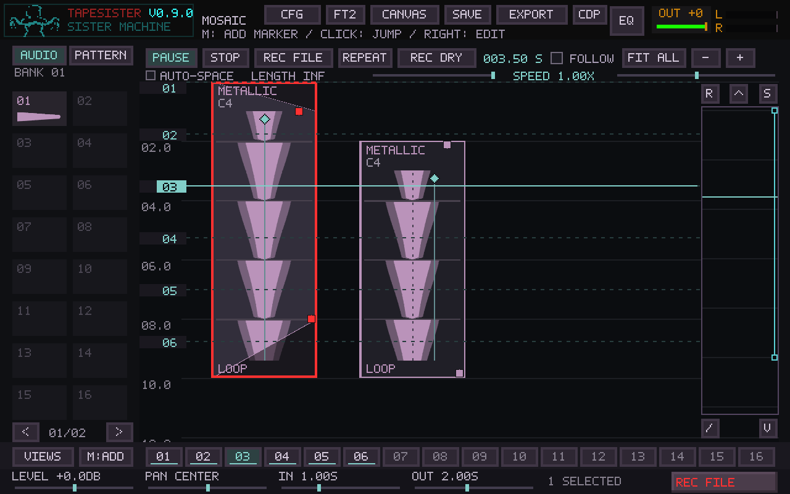
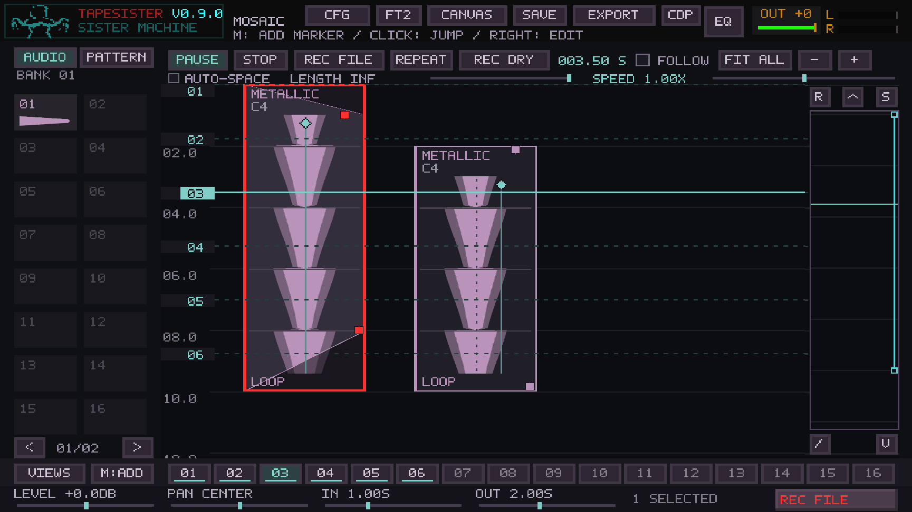
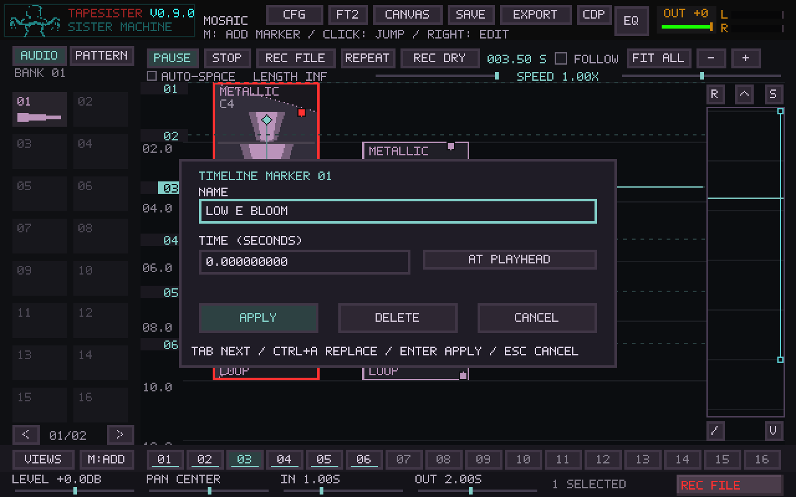

# Mosaic timeline markers

The bottom strip now holds sixteen numbered transport cues. M adds the playhead
to the next empty slot; clicking a filled slot seeks through Mosaic's existing
seek path without changing its playing/paused state. Shift-click captures a
particular slot. Ruler flags can be dragged, and right-click opens name, exact
time, and delete controls. The original five canvas views remain under VIEWS.

Marker metadata is part of arrangement Undo/Redo, the project hash, and Mosaic
format 14. Earlier projects retain their saved views and start with empty marker
slots. Absolute seconds are independent of card edits and global speed. MIDI
bindings and solo-state recall are deferred. Mute moves to Alt+M; source-wide mute
moves to Alt+Shift+M. Solo shortcuts are unchanged.

## Verification

- Core persistence checks cover fractional seconds, names, LF/CRLF files,
  legacy formats, no-op edits, Undo/Redo, and rejection of invalid metadata
  without replacing the current arrangement.
- Controller checks exercise M and key repeat, empty/full slots, Shift capture,
  paused/playing jumps, drag commit/cancel/focus loss, editor ownership,
  validation, rename/delete, epoch replacement, and the revised mute shortcuts.
- Twelve alternating playback jumps match direct `ts_mosaic_seek` reference
  output within 1e-6 over 256 stereo samples per jump.
- Native SDL compositor captures cover 1280×800 and 1729×973 windows. At 2×,
  the entire marker/mix strip is checked against the logical framebuffer.
- Tests use generated audio and SDL dummy audio/video on Linux. These checks do
  not certify live controller latency or X220/X230 hardware performance.

## Native captures

These are application framebuffer/compositor captures, not design mockups.

## Try it

1. Play a Mosaic arrangement and press M at several useful moments.
2. Click the numbered slots repeatedly; pause, then recall a slot again.
3. Shift-click an empty number, drag its ruler flag, and undo/redo the move.
4. Right-click a slot to rename it or enter an exact time; save and reopen.
5. Open VIEWS and recall a previously saved canvas view.
