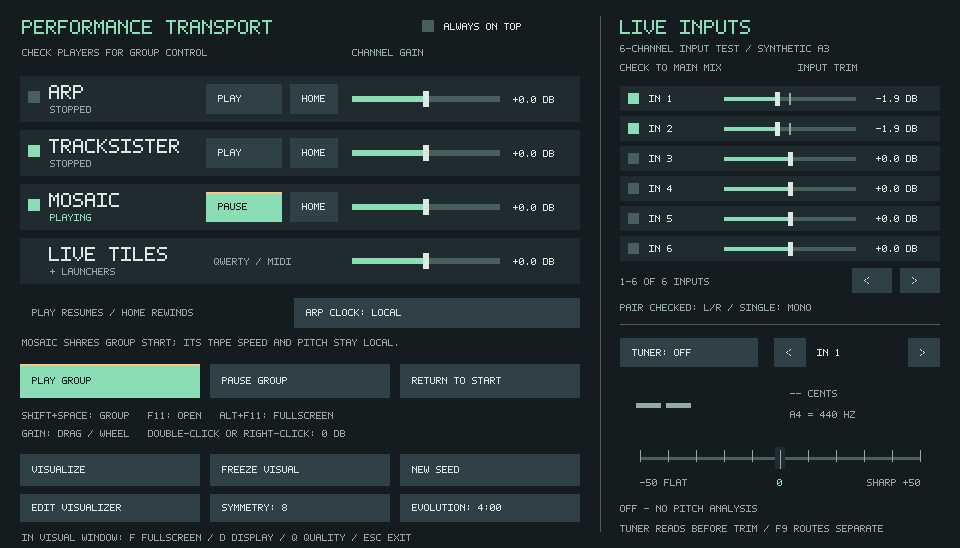
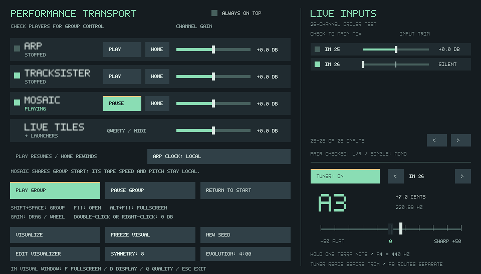

# F11 live inputs and tuner validation

Validated locally on Linux on 2026-10-17, with the SDL software renderer and
synthetic input. Actual Terra, Focusrite and MOTU hardware was not available.

## Behavior checked

- Input selection, 0–2 linear trim, double/right-click reset, six-row paging,
  physical input 26, unavailable input ranges, and project dirty tracking.
- Native audio callback: selected live input reaches Main Mix with transports
  stopped; zero trim silences that feed; existing F9 physical-input routes
  remain audible independently of F11 trim.
- Mono centering, paired stereo, bounded gain slew, independent-clock FIFO,
  duplex input, and device disconnect/reset.
- Project round trip retains selection and trim, including physical input 255.
  Old projects default to unchecked inputs at unity gain.
- Tuner detects 27.5–1760 Hz, including +17-cent detuning, at 44.1, 48 and
  96 kHz. Pure and harmonic-rich tones have less than two cents error in the
  regression fixtures. A separate input-255 fixture checks negative detuning.
- Silence, DC, noise, source changes, queue overflow and tuner-off state clear
  or suppress readings. The tuner reads before the F11 trim, including at zero
  trim. Closing F11 disables analysis without muting selected live inputs.
- Existing F11 transport, Matrix routing and source-routing controller checks
  still pass. The real application starts, renders and shuts down with an
  8 MiB stack limit. Mock-ASIO audio reconfiguration passes.

## Tests

Built a Release configuration with SDL2, CDP8 bundling and MIDI disabled for
the local headless environment. Passed these tests:

```text
tapesister_linux_startup
test_external_input_channels
test_input_ownership
test_sister_project_state
tapesister_input_monitor_tests
tapesister_performance_input_tests
tapesister_audio_reconfigure_tests
tapesister_source_route_controller_tests
```

The core input/tuner regression also passed AddressSanitizer and
UndefinedBehaviorSanitizer. Native Linux and Windows CI includes the new
`performance_input` and existing `input_ownership` regression tests.

## Tuner cost

A local Release microbenchmark used 48 kHz, 26 interleaved physical inputs,
input 26 selected, 512-frame callback chunks, and 1,000 analysis updates at
ten updates per second. The 440 Hz input was generated before measurement.
Only the tuner path was enabled; this does not measure the full application.

| Operation | Mean CPU time |
| --- | ---: |
| Capture-side decimation/copy, per 100 ms of audio | 0.0077 ms |
| UI-thread pitch analysis, per update | 0.5455 ms |
| Combined cost at ten updates per second | 0.55% of one core |

With the tuner off, capture performs no tuner sample copying and the UI does
not call pitch analysis. The enabled result is specific to this test host;
it is not a Windows, Terra or audio-interface latency measurement.

Pitch work runs on the UI thread, never the audio callback. The audio side
uses fixed-size buffers and bounded decimation/copying. Analysis pauses when
F11 is minimized and disables when it closes. Tuning is not restored from
project files.

## Actual renderer captures

The six-channel screenshot uses a synthetic A3 at +7 cents, not a connected
Terra. The second fixture demonstrates paging through a 26-channel device.





