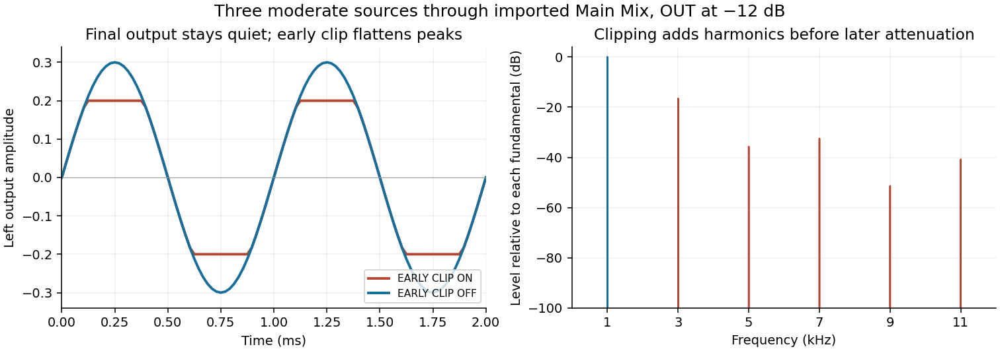
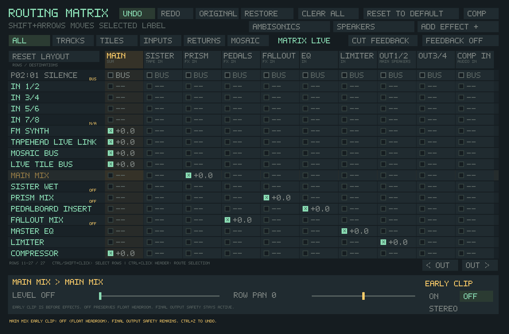

# Program-bus headroom investigation

Baseline: `main` at `59d26a5d5ec7d107383c6e1518004421104af7c6`, after PRs
#156–158 merged. Main and open PRs were inspected again before publishing;
there were no competing open PRs. The audit was a lead, not the evidence.

## What the current code does

The ordinary callback in `src/main_sdl.c` sums the legacy musical buses, sanitizes
nonfinite values, and clamps each channel to ±1 **before** the ordinary shared
Router/FX chain. It then applies `mixer.program_gain` (normally 0.8). A quiet OUT
fader or attenuation in a later effect cannot undo that waveform flattening.
`ts_audio_mixer_render_unclamped()` also retains an internal legacy program
clamp: “unclamped” refers to its output sum, not all internal stages.

| Configuration or source | Relationship to the early ceiling |
| --- | --- |
| Ordinary Main-routed preview, QWERTY/MIDI sample notes, performances/ARP/launchers, live tiles, Mosaic, FM, embedded TrackSister/legacy tracker and TapeHead Live Link | Contributions to the legacy musical sum encounter the ±1 ceiling before ordinary effects. Source/track routes can remove a contribution from that sum. |
| Monitored external input | Joins the ordinary eligible signal after the musical ceiling, before shared effects. It does not itself pass through that ceiling. |
| Reference tone, completed Sister/FX returns, explicit direct/speaker/parallel routes, performance-input contribution | Can join later or take a separate route. The musical ceiling is not a universal final-output boundary. Their downstream processing depends on the route. |
| Normal Matrix graph | Main Mix passes float peaks. Graph connections determine which effects and limiter a signal reaches. |
| Imported legacy Matrix graph | Main Mix reproduces the legacy ceiling at ±program gain, since musical gain is already applied upstream. Existing import-parity tests deliberately require this even for overloaded input. |
| A Matrix route bypassing Main Mix | Does not encounter Main Mix's ceiling, even in an imported graph. |
| Powered legacy SisterMachine | Selected inputs, trims and route-count normalization feed the Router before the callback's legacy sum. Closed-insert ownership suppresses the direct musical legacy buses; selected audio returns through Sister. Tape/head saturation and Sister's linked finish safety are separate mechanisms. |

Matrix's Sister node follows the graph; the old source-selection switches do
not choose its inputs. Sister can receive a clipped Main signal, floating-point
Main signal, or sources patched directly to it. Actual tape/head processing is
intentionally nonlinear; this investigation does not remove that behavior.

The callback still computes its legacy capture tap even when Matrix/Sister owns
playback. Grouped performance capture can instead take the raw group mix. These
internal taps are unchanged. FILE OUT and Mosaic OUTPUT take the later stereo
program after EQ/limiter/OUT, before added speaker/spatial layers and Matrix's
final hardware guard. An unclipped physical output does not establish that every
recording tap or intermediate processor has headroom.

## Controlled callback test

`tests/benchmark_program_headroom.c` drives the real `audio_callback`, including
source routing, shared processors and physical-output safety. It uses a looped
preview, a held QWERTY sample note and an overlapping looped Mosaic card. Each
source has left peak 0.5 (−6.02 dBFS), right peak 0.25 (−12.04 dBFS). The sources
are individually moderate; their coherent left sum is 1.5, or 1.2 after the
normal musical gain. A second case uses independent 1,000/1,300/1,700 Hz tones
to avoid relying exclusively on identical, phase-aligned material.

There are 16 configurations: quieter sources, ordinary/normal/imported Matrix,
the opt-out, later attenuation, powered Sister with its tape stage bypassed,
an imported route bypassing Main, and final limiter/guard boundaries. Output is
48 kHz stereo float in 256-frame blocks, with one second of warm-up and one
second measured. OUT starts settled at 0.25 (−12.04 dB), except the final-safety
cases. The attenuation case uses a POST delay slot at MIX 0 with −12 dB gain,
making that stage a controlled linear trim rather than adding delay coloration.
The test asserts that preview, held note and Mosaic remain active.

The residual is RMS energy outside the known input tones divided by total RMS
energy, expressed in dB. It detects nonlinear products, not CPU overruns. Very
low residuals are floating-point/numerical limits, not analog noise measurements.
The CSV's runtime meters decay and are phase-dependent snapshots; they are not
exact interval peak measurements. `output_peak_*` is measured from every sample.

All waveform measurements were repeated on a **Linux development container,
AMD EPYC 9V74**, with generic x86-64 GCC Release DSP and harness builds. No
physical audio device or listening test was involved. These are signal tests,
not CPU benchmarks or measurements on an X220, X230 or HP A8. They do not identify
the cause of any previously heard clicks/dropouts or prove that a saved project
actually exceeds this ceiling.

## Results

| Three-source case | Left output peak | Left residual | Interpretation |
| --- | ---: | ---: | --- |
| Quiet sources, ordinary or normal Matrix | 0.1200 | below −120 dB | No overdrive of the early ceiling |
| Coherent sources, legacy or imported Main with EARLY CLIP ON | 0.2000 | −16.43 dB | About 15.1% RMS residual; 54.17% of samples at the flat peak |
| Same sources, normal Matrix or imported Main with EARLY CLIP OFF | 0.3000 | below −120 dB | Floating-point Main preserves the waveform |
| Later −12 dB trim, legacy/imported ON | 0.05024 | −16.43 dB | Attenuation leaves the clipping distortion intact |
| Later −12 dB trim, Matrix OFF | 0.07536 | below −120 dB | Headroom reaches the later trim |
| Independent tones, legacy ON | 0.2000 | −18.99 dB | About 11.2% RMS residual; not confined to coherent sources |
| Independent tones, normal Matrix OFF | 0.2831 | below −120 dB | No early clipping products |
| Imported sources patched directly to EQ, bypassing Main | 0.3000 | below −120 dB | Confirms the ceiling is local to Main |

The right channel stays below the early threshold and retains its waveform.
This is independent per-channel early clipping, not linked stereo limiting.
The measured distortion supports offering an opt-out. Its audibility and
usefulness for a particular musical project remain an A/B listening check.



The powered Sister case selects PREVIEW and TILES (note plus Mosaic), bypasses
only the Sister tape stage in the Router, and applies the later −12 dB trim.
Its normalized Router input exceeds unity (theoretical peak 1.5/√2), while its
output peak is 0.06661, residual below −120 dB, and Sister overload count zero.
This isolates the source-selection/normalization path from tape coloration and
shows that the ordinary clamp is not its feeder. Its gain law differs from the
ordinary bus, so absolute levels are not a direct sonic comparison with tape on.

With OUT at unity, the normal Matrix's final limiter at −1 dB holds the physical
peak to **0.891251**. With that limiter disabled, the existing linked hardware
guard holds it to **0.980000**. The guard can apply its own gain modulation;
removing the early ceiling does not remove final safety or guarantee transparent
sound under final overload. These are sample-peak boundaries, not true-peak or
analog intersample guarantees.

[Before CSV](program-headroom/before.csv) and [after CSV](program-headroom/after.csv)
contain the full results. All 14 configurations using unchanged laws produce
byte-identical before/after WAVs. The other two float comparisons also match byte
for byte: the baseline harness experimentally clears the old Main serial bit;
the new harness uses the independent headroom override. Clearing that bit is
**not** the implementation: `serial_mask` also controls legacy effect/send
plumbing, especially when Main is its sole bit. The new setting preserves every
serial flag and connection. The baseline archives were checked up to date against
the exact main tree; the benchmark retains assertions even in Release builds.

## Focused change and compatibility

F9 Main Mix now exposes **EARLY CLIP ON/OFF** with the current button highlighted.
Normal graphs still default to float; legacy projects and imported graphs retain
their original ceiling until explicitly changed. No existing project is migrated
to a different sound automatically. Routes, effect histories, source-send laws,
limiter settings, output guard and the legacy mixer remain unchanged.

The optional `Matrix.MainHeadroom` value is AUTO (0, omitted), FLOAT (1) or CLIP
(2). AUTO derives the historical law from the Main serial bit. A separate field
is necessary to avoid changing other imported processing. Live edits and
Undo/Redo use a finite 12 ms crossfade between the original and clipped frames;
subthreshold samples are identical throughout. Initial activation/project recall
restores the saved law immediately, including a recall during an unfinished A/B
fade. Unrelated edits preserve an active fade. No allocation, new lock, CPU-specific
instruction requirement or new DSP history is added to the callback.

The explicit choice round-trips with project/config state. Older builds ignore
the new optional field and return to their historical law. The control requires
Matrix to be active. Unsupported legacy imports remain refused; this PR does not
silently change Sister/direct/external routing to expose an opt-out.



## Verification and reproduction

Local regression checks cover the real 16-case callback fixture, ordinary mixer,
shared effects/limiter, source routes, spatial routes, Mosaic patterns, project
save, routing graph/instances and Audio Health. Native controller tests exercise
the actual buttons, status, unchanged connection/serial flags, Undo/Redo,
Original/Edited protection and screenshots. Core tests exercise float/clip
restoration, text and project round-trips, invalid-value/graph rejection,
subthreshold stereo parity, fades in both directions, unrelated edits during a
fade, immediate project recall during a fade, and completion at 192 kHz.

AddressSanitizer and UndefinedBehaviorSanitizer cover the routing test with the
changed routing/runtime/project-state objects instrumented; other linked
libraries are Release builds and leak checking is disabled. Native Linux and
Windows Release builds run this fixture and the selected regression suite in
the PR workflow; consult its checks for the final status. Windows also gives
the callback fixture the same 16 MiB stack allowance as other full-app tests.

In an SDL/FFmpeg development environment (Bash/MSYS2; use `.exe` on Windows):

```sh
cmake -S . -B build-headroom -G Ninja -DCMAKE_BUILD_TYPE=Release -DTAPESISTER_BUNDLE_CDP8=OFF
cmake --build build-headroom --target tapesister_program_headroom_tests tapesister_routing_matrix_tests tapesister_source_route_controller_tests tapesister_audio_health_tests
ctest --test-dir build-headroom --output-on-failure -R 'routing_matrix|source_route_controller|audio_health'
mkdir -p headroom-wavs
build-headroom/tapesister_program_headroom_tests headroom-wavs > headroom.csv
```

The optional directory receives synthetic float WAVs for waveform/spectrum
inspection. The before run uses the same harness on the baseline tree, replacing
only its unavailable `graph.main_headroom=TS_MATRIX_HEADROOM_FLOAT` assignment
with `graph.serial_mask &= ~(1u<<TS_MATRIX_MAIN)` for the two experimental float
cases. That substitution is solely a controlled reference, not a project edit.

## One-project A/B on the user's hardware

1. Open the saved project and loop a busy passage at a comfortable level. Keep
   device, buffer, OUT, source levels, routes and effects fixed for the comparison.
2. Press F9 and select MAIN MIX. If Matrix is inactive, use **Use Matrix** only
   if its importer accepts the project; it preserves the initial serial sound.
   If it refuses, retain that routing and report the reason.
3. Alternate **EARLY CLIP ON/OFF**, allowing more than 12 ms to settle. Listen
   for harshness on coincident notes/transients, plus changes to later effects
   or limiting. A project below the ceiling can sound identical. A normal Matrix
   project already showing OFF did not use this early Main ceiling.
4. Press F12 and copy the report with each choice. Active setup should show
   LEGACY CLIP versus FLOAT; compare the existing overload/limiter and callback/
   ASIO counters separately. The new mode line is not a clipping meter. A change
   in distortion alone does not establish a scheduling/dropout fix.
5. Try held QWERTY notes and the same overlapping passage. Choose the preferred
   mode, then save only if you want to retain that choice. There is no need to
   maintain two project versions for the listening comparison.

No listening result, driver behavior or CPU cost on the user's older PCs has
been measured here. Actual tape/effect saturation, other recording taps, unusual
graphs and older-version reopening remain separate limits described above.
